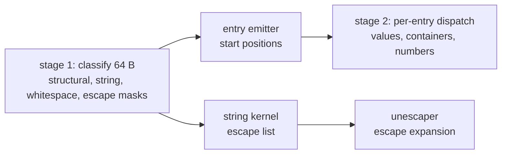

# Native SIMD JSON pipeline: measured performance record

Status: **measurement record, with stage 1 now in the tree**. The pipeline was
built and measured in a scratch tree outside the checkout, and the numbers below
are a record of observed runs, not an artefact reproducible from this tree —
re-measuring requires rebuilding the harness, whose structure, arms and controls
are described in §7 so that a rebuild can repeat the same comparisons. The
exception is the stage-1 classification-mask unit: its kernel is extracted as
`kernel/json/s1_block.c`, its emitted IR is committed as
`probes/install/ir/json-s1-masks.candidate.ll`, and `s1_masks_refines`
(`LeanLLVM/Vellum/JsonS1MasksSteps.lean`) proves that pinned body stores the six
masks and the carry `LeanLLVM/Vellum/JsonScanSpec.lean` specifies. Nothing past
stage 1 — the entry emitters, the exit/escape stage, the parser's own refinement
— is in the tree.

The note answers one question: **can a byte-mask JSON parser, in the shape the
Lean development would lower to, be competitive with a mature native parser on
the same documents?** It records what was measured, which shapes were refuted
and at what cost, the decision table the measurements support, and what this
does not establish.

## 1. Contracts compared

Every ratio is this pipeline over simdjson On-Demand over the same file in the
same run, medians of 11–15 rounds, pinned to one core with `taskset`, compiler
`-falign-loops=64 -falign-functions=64` for both.

|Contract|What it requires|
|---|---|
|`OFF`|document validity only; no value extraction, no error position|
|`P0`|full value extraction, no error position, no validation of escaped content|
|`P2`|`P0` plus exact byte offset of the first error, and validation of every string|
|`SCHEMA`|`P2` plus extraction of named fields from a known schema|

`P2` is the strictest of the four and is the one quoted for "faster", because it
includes the work a caller most often wants and is where simdjson is hardest to
beat. `OFF` was below 1.0 on all seven documents (0.68–0.98) and is not
tabulated further.

## 2. Corpus

The seven standard documents: `canonical` (French text, UTF-8, 1.05 escapes
per block), `citm`, `twitter`, `canada`, `dense` (26.4 structural entries per
block), `longstr` (string-heavy) and `escdense` (escape-dense). The structural
and string densities of these documents drive every decision in §5, which is
why the thresholds are expressed in those units and not in document names.

## 3. Result

Ratio to On-Demand; below 1.0 means this pipeline is faster. `E` and `P` are
the two core classes of the measurement host (§7.3).

|File|entries/blk|P2 E|**P2 P**|P0 E|**P0 P**|
|---|---:|---:|---:|---:|---:|
|canonical|6.8|1.044|**0.922**|0.945|**0.814**|
|citm|7.9|0.843|**0.555**|0.746|**0.452**|
|twitter|7.9|0.847|**0.611**|0.704|**0.528**|
|canada|9.9|1.023|**0.946**|0.910|**0.849**|
|dense|26.4|1.027|1.037|0.829|**0.873**|
|longstr|1.3|0.721|**0.586**|0.296|**0.236**|
|escdense|7.4|0.816|**0.759**|0.648|**0.719**|

On the P-core class the pipeline is faster under `P2` on six of seven
documents (4–45%), with `dense` the single loss at 3.7%. On the E-core class
four are clearly faster, `canada` and `dense` within 2.3–2.7%, and `canonical`
4.4% behind. `P0` is faster on all seven on both classes.

The margin is core-specific and the *decisions* are not (§5, §7.3): on the
E-core the stage-1 advantage is 1.7–3.9 ns/block over an alternative arm, on
the P-core 0.2–0.9.

## 4. Pipeline shape

Properties the measurements depend on, each of which was checked rather than
assumed:

- **Masks are computed once per block** and every later stage reads them; the
  per-block record is one word plus, where a stage needs it, the escape mask.
- **Entry emission is two-phase** — mask, then expand — and beats emitting
  entries inside the classify loop by 7–8 ns/block on `canonical`.
- **The string kernel is escape-list driven** where escapes exist; the list is
  built only for blocks that have one, and only for documents whose class is
  not `PLAIN` (see §5).
- **UTF-8 validation is a `pshufb` table DFA** accumulated per 32-byte vector:
  46 instructions per block against 89 for a mask-derived kernel, and it costs
  −0.5 ns/block inside stage 1 against a no-check arm on `canonical` (the
  separate mask-derived kernel cost +8.0).

## 5. Decision table

Both builds print their decisions for a document (`<binary> <file> dens`), so
a measurement can be traced to the branch that produced it.

|File|class|entries/blk|skip q8|kernel E|kernel P|UTF-8|list, `P2`|list, `P0`|
|---|---|---:|---:|---|---|---|---|---|
|canonical|SPARSE|6.84|3|POS8|POS8|ungated|on|none|
|citm|PLAIN|7.88|248|B8|B8|gated|off|none|
|dense|PLAIN|26.38|256|POS8|POS8|gated|off|none|
|twitter|SPARSE|7.92|196|POS8|POS8|gated|on|none|
|canada|PLAIN|9.88|256|**POS8**|**B8**|gated|off|none|
|longstr|HEAVY|1.31|256|B8|B8|gated|on|none|
|escdense|HEAVY|7.36|256|POS8|POS8|gated|on|none|

Thresholds, all sampled from the first 64 block pairs of the document by the
same masks the timed pass uses (a window that starts inside a long string reads
a string-heavy document as entry-dense and is not used):

|Name|Value|Governs|
|---|---|---|
|class cut, PLAIN|escape hits per sample `< 1/64`|escape list, string kernel|
|class cut, HEAVY|escape hits per sample `≥ 2`|string kernel choice|
|`DENS_B_POS8_Q8`|5120 (20 entries/blk)|POS8 emitter|
|`DENS_B8_Q8`|512 (2 entries/blk)|B8 emitter|
|`DENS_PLAIN_B8_Q8` (E / unknown)|2176 (8.5)|inline B8 emitter for `PLAIN`|
|`DENS_PLAIN_B8_Q8_P`|3072 (12)|the same, P-core class|
|`DENS_U8_SKIP_Q8`|154 (60%)|ungated UTF-8|
|list gate|`class != PLAIN`|escape list construction|
|core class|`CPUID.1Ah.EAX[31:24]`: `0x40` = P, `0x20` = E|the two kernel entries marked above|

The probe costs ≈0.01 ns/block, and reads `citm` 31% high against an exact
census; the 8.5/12 boundary is an interpolation between two documents (7.9 and
9.9 entries/blk) and is the weakest entry in the table.

## 6. Shapes measured and refuted

Each of these was implemented and priced; the cost is what it adds over the
shape it would have replaced. They are recorded so a later attempt does not
repeat them.

|Shape|Measured outcome|
|---|---|
|per-block escape mask instead of the compacted escape list|consumer 16.7 vs 6.9 ns/block, both cores|
|batching the processing of one-escape windows|pure addition; escapes are 1 in 10 windows|
|`POS8` expansion inside the consumer|slower than a scalar batch per lane|
|splitting run copy from escape expansion|21.3 vs 16.4 ns/block fused|
|branch-free escape expansion|+25 ns/block on `longstr`/`escdense`|
|carrying the escape kind out of stage 1|27.875 vs 27.871 ns/body — the branch moves, not disappears|
|mask-derived UTF-8 (`pshufb` classes over the classifier's masks)|117 instructions vs 89; +8.1 vs +7.3 ns/block|
|mask-derived UTF-8, vectorised range check|15.5–20.0 ns/block; the gated form mispredicts 33% of the time|
|4-entry emitter batch for `dense`|did not reproduce under the corrected route; POS8 wins|
|removing the escape-list class gate|saves 2.3–2.8 ns/block on `dense`/`canada` — the gate is the win, not the cost|

Two refutations are specifically about **where** a decision is taken rather
than what it computes: the escape kind and the UTF-8 class both looked
attractive as stage-1 outputs and both cost more than the branch they removed,
because the branch is predictable per body and the record is a dependent load.

## 7. Measurement discipline

Three failures shaped how these numbers were taken; they are the most reusable
part of this record.

### 7.1 The timed path must be shown to reach the new code

A dispatch defect left the `P2` driver calling the inline builder while the
two-phase builder it was supposed to time was never invoked. Three rounds of
`P2` ratios described the wrong binary, including one that concluded the
two-phase emitter was the win and one that concluded a batch was better for a
dense document. Both reversed once the route was fixed. A change to a staged
pipeline is not measured until the preprocessed source of the timed entry point
names the new code.

### 7.2 Cross-binary comparisons are not comparisons

Identical hot code, six builds, spanned 99.2–105.1 ns/block on `canonical`
(≈6%), and one cross-binary table carried a 15 ns/block artefact that reversed
a 2 ns/block conclusion. Consequence: an arm is compiled into one binary and
selected per process; a decision of 1–3% needs either same-binary arms or
several independent binaries per arm, and the report states which.

### 7.3 The core class changes the answer

The host has two core classes: `CPUID.1Ah.EAX[31:24]` reads `0x40` on cpus 0–3
(kernel `cpu_core` PMU, 4.9 GHz) and `0x20` on cpus 4–7 (`cpu_atom`, 3.67 GHz,
128-bit datapath, so every 256-bit operation is two uops). Standalone kernel
throughput differed by ~2.3× between classes, `llvm-mca` predicted 9.0 cycles
per block where the E-core measured 21, and one kernel selection flips between
classes (`canada`: POS8 on E, B8 on P, wrong-choice cost 1.21/0.82 ns/block on
`P2`). Ratios are therefore reported per class; a table entry that is
core-specific is marked as such.

### 7.4 Correctness gates are held fixed across every arm

Every arm measured above passes the same gates: 1,361,282 string bodies with
zero position mismatches against a scalar reference; 58,367 documents with
23,842 reject offsets equal; entry streams byte-identical across kernels, arms
and core classes; and for UTF-8 an exhaustive 10,172,525-string × 64-offset
placement set (651M placements) with zero disagreements against the scalar
reference, including documents that start mid-sequence and a lone lead byte at
the end of a document.

## 8. Open items

Bounded but unresolved, and all inside or near the placement floor:

- the P-core window between 12 and 26 entries/blk is unmeasured; the 12
  threshold is `canada` plus 2.1 and is an extrapolation;
- `escdense`'s emitter on the E-core at `P2` disagrees in sign between two
  runs (~1 ns/block);
- `canonical`'s UTF-8 arm on the E-core disagrees between two runs (+1.9/−2.1
  ns/block); the rule keeps the ungated arm because it wins on the P-core;
- the `CPUID.1Ah` encoding direction is established empirically on this part;
  an inverted part would cost at most the 1.2 ns/block bounded above, with
  POS8 as the unknown-class fallback.

## 9. What this does not establish

- **Mostly nothing about refinement, and stage 1 is the exception.** The measured
  pipeline is a native implementation. Stage 1's mask unit is now related: its
  kernel is extracted as `kernel/json/s1_block.c`, and `s1_masks_refines`
  (`LeanLLVM/Vellum/JsonS1MasksSteps.lean`) proves the emitted body pinned from
  that source stores exactly the masks and carry `JsonScanSpec` defines — which
  `JsonScanSpec` in turn relates to `ScanBlock`'s `maskOf` fold and to
  `ScanWindow`'s `windowOf`. Everything else here is still unrelated to the Lean
  development by any proof: the entry emitter, the escape and exit stages, the
  assembled pipeline, and `LeanLLVM/JSON/`'s parser. Connecting those is the open
  obligation, not a corollary of these numbers.
- **Nothing about this machine's generality.** One host, two core classes, one
  governor setting (`powersave`), one compiler toolchain, `AVX2` code paths.
  Absolute levels drift 5–10% between processes; only within-run paired deltas
  are claimed.
- **Nothing about other parsers.** The comparison is simdjson On-Demand on
  these seven documents; a different reference parser or a different corpus can
  change both the ranking and the thresholds in §5.
- **Nothing about documents outside the seven.** The decision table is tuned on
  them; the class boundaries in §5 are meaningful for documents with similar
  structural and escape densities, and the probe's 31% overread on `citm` is a
  known inaccuracy in the instrument, not in the pipeline.
