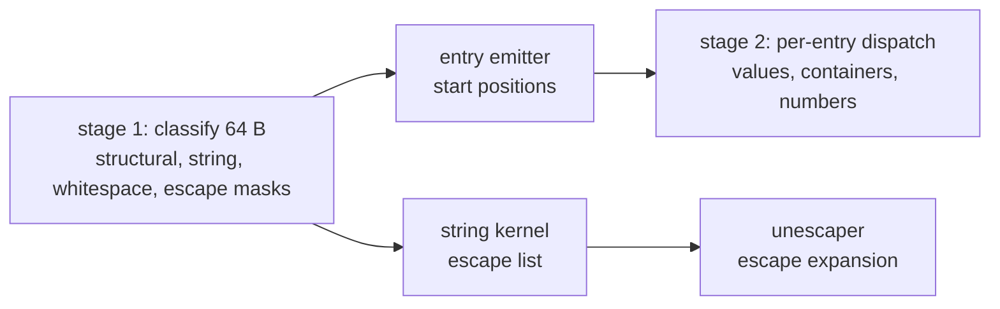

# Native SIMD JSON pipeline: measured performance record

Status: **measurement record, with stage 1's three units in the tree**. The
pipeline was built and measured in a scratch tree outside the checkout, and the
numbers below are a record of observed runs, not an artefact reproducible from
this tree — re-measuring requires rebuilding the harness, whose structure, arms
and controls are described in §7 so that a rebuild can repeat the same
comparisons. Stage 1's units are the exception. The classification-mask
kernel is extracted as `kernel/json/s1_block.c`, its emitted IR is committed as
`probes/install/ir/json-s1-masks.candidate.ll`, and `s1_masks_refines`
(`LeanLLVM/Refinement/JsonS1MasksSteps.lean`) proves that pinned body stores the six
masks and the carry `LeanLLVM/Refinement/JsonScanSpec.lean` specifies. The entry
positions unit is extracted as `kernel/json/entry.c`, its emitted IR is committed
as `probes/install/ir/json-entry.candidate.ll`, and the two bodies
`LeanLLVM/Refinement/JsonEntryIR.lean` pins are proved by `entry_pos8_refines`
(`LeanLLVM/Refinement/JsonEntrySteps.lean`) and `entry_b8_refines`
(`LeanLLVM/Refinement/JsonB8Steps.lean`) against the entry word
`LeanLLVM/Refinement/JsonEntSpec.lean` specifies. The UTF-8 validity stage is the
third, and it is in the tree: its unit is `kernel/json/utf8.c`, its emitted IR is
committed as `probes/install/ir/json-utf8.candidate.ll`,
`LeanLLVM/Refinement/JsonUtf8IR.lean` gives its three calls their reading
(`utf8Calls`, with `utf8Calls_pshufb`/`utf8Calls_usubSat`/`utf8Calls_ptestz`),
`LeanLLVM/Refinement/JsonUtf8Spec.lean` states the specification the verdict is
judged against, and `utf8_stage_refines` (`LeanLLVM/Refinement/JsonUtf8Steps.lean`)
proves the pinned body returns zero exactly when the staged window is a valid
prefix. Everything else — the selection that fills the entry stream, the exit
and escape stages, the assembled pipeline, and the parser's own refinement —
remains outside the tree. The three units have a measurement of their own,
separate from every ratio in this note: §"Stage 1's three units, measured in this
tree" records the instrument, corpus, flags, host and the numbers with their
variance.

The note answers one question: **can a byte-mask JSON parser, in the shape the
Lean development would lower to, be competitive with a mature native parser on
the same documents?** It records what was measured, which shapes were refuted
and at what cost, the decision table the measurements support, and what this
does not establish.

## 1. Contracts compared

Every ratio is this pipeline over simdjson On-Demand over the same file in the
same run, medians of 11–15 rounds, pinned to one core with `taskset`, compiler
`-falign-loops=64 -falign-functions=64` for both.

|Contract|What it requires|
|---|---|
|`OFF`|document validity only; no value extraction, no error position|
|`P0`|full value extraction, no error position, no validation of escaped content|
|`P2`|`P0` plus exact byte offset of the first error, and validation of every string|
|`SCHEMA`|`P2` plus extraction of named fields from a known schema|

`P2` is the strictest of the four and is the one quoted for "faster", because it
includes the work a caller most often wants and is where simdjson is hardest to
beat. `OFF` was below 1.0 on all seven documents (0.68–0.98) and is not
tabulated further.

## 2. Corpus

The seven standard documents: `canonical` (French text, UTF-8, 1.05 escapes
per block), `citm`, `twitter`, `canada`, `dense` (26.4 structural entries per
block), `longstr` (string-heavy) and `escdense` (escape-dense). The structural
and string densities of these documents drive every decision in §5, which is
why the thresholds are expressed in those units and not in document names.

## 3. Result

Ratio to On-Demand; below 1.0 means this pipeline is faster. `E` and `P` are
the two core classes of the measurement host (§7.3).

|File|entries/blk|P2 E|**P2 P**|P0 E|**P0 P**|
|---|---:|---:|---:|---:|---:|
|canonical|6.8|1.044|**0.922**|0.945|**0.814**|
|citm|7.9|0.843|**0.555**|0.746|**0.452**|
|twitter|7.9|0.847|**0.611**|0.704|**0.528**|
|canada|9.9|1.023|**0.946**|0.910|**0.849**|
|dense|26.4|1.027|1.037|0.829|**0.873**|
|longstr|1.3|0.721|**0.586**|0.296|**0.236**|
|escdense|7.4|0.816|**0.759**|0.648|**0.719**|

On the P-core class the pipeline is faster under `P2` on six of seven
documents (4–45%), with `dense` the single loss at 3.7%. On the E-core class
four are clearly faster, `canada` and `dense` within 2.3–2.7%, and `canonical`
4.4% behind. `P0` is faster on all seven on both classes.

The margin is core-specific and the *decisions* are not (§5, §7.3): on the
E-core the stage-1 advantage is 1.7–3.9 ns/block over an alternative arm, on
the P-core 0.2–0.9.

## 4. Pipeline shape



Properties the measurements depend on, each of which was checked rather than
assumed:

- **Masks are computed once per block** and every later stage reads them; the
  per-block record is one word plus, where a stage needs it, the escape mask.
- **Entry emission is two-phase** — mask, then expand — and beats emitting
  entries inside the classify loop by 7–8 ns/block on `canonical`.
- **The string kernel is escape-list driven** where escapes exist; the list is
  built only for blocks that have one, and only for documents whose class is
  not `PLAIN` (see §5).
- **UTF-8 validation is a `pshufb` table DFA** accumulated per 32-byte vector:
  46 instructions per block against 89 for a mask-derived kernel, and it costs
  −0.5 ns/block inside stage 1 against a no-check arm on `canonical` (the
  separate mask-derived kernel cost +8.0).

## 5. Decision table

Both builds print their decisions for a document (`<binary> <file> dens`), so
a measurement can be traced to the branch that produced it.

|File|class|entries/blk|skip q8|kernel E|kernel P|UTF-8|list, `P2`|list, `P0`|
|---|---|---:|---:|---|---|---|---|---|
|canonical|SPARSE|6.84|3|POS8|POS8|ungated|on|none|
|citm|PLAIN|7.88|248|B8|B8|gated|off|none|
|dense|PLAIN|26.38|256|POS8|POS8|gated|off|none|
|twitter|SPARSE|7.92|196|POS8|POS8|gated|on|none|
|canada|PLAIN|9.88|256|**POS8**|**B8**|gated|off|none|
|longstr|HEAVY|1.31|256|B8|B8|gated|on|none|
|escdense|HEAVY|7.36|256|POS8|POS8|gated|on|none|

Thresholds, all sampled from the first 64 block pairs of the document by the
same masks the timed pass uses (a window that starts inside a long string reads
a string-heavy document as entry-dense and is not used):

|Name|Value|Governs|
|---|---|---|
|class cut, PLAIN|escape hits per sample `< 1/64`|escape list, string kernel|
|class cut, HEAVY|escape hits per sample `≥ 2`|string kernel choice|
|`DENS_B_POS8_Q8`|5120 (20 entries/blk)|POS8 emitter|
|`DENS_B8_Q8`|512 (2 entries/blk)|B8 emitter|
|`DENS_PLAIN_B8_Q8` (E / unknown)|2176 (8.5)|inline B8 emitter for `PLAIN`|
|`DENS_PLAIN_B8_Q8_P`|3072 (12)|the same, P-core class|
|`DENS_U8_SKIP_Q8`|154 (60%)|ungated UTF-8|
|list gate|`class != PLAIN`|escape list construction|
|core class|`CPUID.1Ah.EAX[31:24]`: `0x40` = P, `0x20` = E|the two kernel entries marked above|

The probe costs ≈0.01 ns/block, and reads `citm` 31% high against an exact
census; the 8.5/12 boundary is an interpolation between two documents (7.9 and
9.9 entries/blk) and is the weakest entry in the table.

## 6. Shapes measured and refuted

Each of these was implemented and priced; the cost is what it adds over the
shape it would have replaced. They are recorded so a later attempt does not
repeat them.

|Shape|Measured outcome|
|---|---|
|per-block escape mask instead of the compacted escape list|consumer 16.7 vs 6.9 ns/block, both cores|
|batching the processing of one-escape windows|pure addition; escapes are 1 in 10 windows|
|`POS8` expansion inside the consumer|slower than a scalar batch per lane|
|splitting run copy from escape expansion|21.3 vs 16.4 ns/block fused|
|branch-free escape expansion|+25 ns/block on `longstr`/`escdense`|
|carrying the escape kind out of stage 1|27.875 vs 27.871 ns/body — the branch moves, not disappears|
|mask-derived UTF-8 (`pshufb` classes over the classifier's masks)|117 instructions vs 89; +8.1 vs +7.3 ns/block|
|mask-derived UTF-8, vectorised range check|15.5–20.0 ns/block; the gated form mispredicts 33% of the time|
|4-entry emitter batch for `dense`|did not reproduce under the corrected route; POS8 wins. The extraction in `kernel/json/entry.c` carries the POS8 and B8 kernels and no batch, so no cost is claimed for the batch there|
|removing the escape-list class gate|saves 2.3–2.8 ns/block on `dense`/`canada` — the gate is the win, not the cost|

Two refutations are specifically about **where** a decision is taken rather
than what it computes: the escape kind and the UTF-8 class both looked
attractive as stage-1 outputs and both cost more than the branch they removed,
because the branch is predictable per body and the record is a dependent load.

## 7. Measurement discipline

Three failures shaped how these numbers were taken; they are the most reusable
part of this record.

### 7.1 The timed path must be shown to reach the new code

A dispatch defect left the `P2` driver calling the inline builder while the
two-phase builder it was supposed to time was never invoked. Three rounds of
`P2` ratios described the wrong binary, including one that concluded the
two-phase emitter was the win and one that concluded a batch was better for a
dense document. Both reversed once the route was fixed. A change to a staged
pipeline is not measured until the preprocessed source of the timed entry point
names the new code.

### 7.2 Cross-binary comparisons are not comparisons

Identical hot code, six builds, spanned 99.2–105.1 ns/block on `canonical`
(≈6%), and one cross-binary table carried a 15 ns/block artefact that reversed
a 2 ns/block conclusion. Consequence: an arm is compiled into one binary and
selected per process; a decision of 1–3% needs either same-binary arms or
several independent binaries per arm, and the report states which.

### 7.3 The core class changes the answer

The host has two core classes: `CPUID.1Ah.EAX[31:24]` reads `0x40` on cpus 0–3
(kernel `cpu_core` PMU, 4.9 GHz) and `0x20` on cpus 4–7 (`cpu_atom`, 3.67 GHz,
128-bit datapath, so every 256-bit operation is two uops). Standalone kernel
throughput differed by ~2.3× between classes, `llvm-mca` predicted 9.0 cycles
per block where the E-core measured 21, and one kernel selection flips between
classes (`canada`: POS8 on E, B8 on P, wrong-choice cost 1.21/0.82 ns/block on
`P2`). Ratios are therefore reported per class; a table entry that is
core-specific is marked as such.

### 7.4 Correctness gates are held fixed across every arm

Every arm measured above passes the same gates: 1,361,282 string bodies with
zero position mismatches against a scalar reference; 58,367 documents with
23,842 reject offsets equal; entry streams byte-identical across kernels, arms
and core classes; and for UTF-8 an exhaustive 10,172,525-string × 64-offset
placement set (651M placements) with zero disagreements against the scalar
reference, including documents that start mid-sequence and a lone lead byte at
the end of a document. That differential is a scratch-build measurement and is
not the UTF-8 unit's route: the route compares the extracted object, the Lean
body and the measured function on the counted matrix of its curated rows in
`tests/json-utf8/corpus.tsv` and the driver's generated arms — 73,071 generated
documents plus a 512-row placement arm — and the two must not be read as one
measurement.

## 8. Open items

Bounded but unresolved, and all inside or near the placement floor:

- the P-core window between 12 and 26 entries/blk is unmeasured; the 12
  threshold is `canada` plus 2.1 and is an extrapolation;
- `escdense`'s emitter on the E-core at `P2` disagrees in sign between two
  runs (~1 ns/block);
- `canonical`'s UTF-8 arm on the E-core disagrees between two runs (+1.9/−2.1
  ns/block); the rule keeps the ungated arm because it wins on the P-core;
- the `CPUID.1Ah` encoding direction is established empirically on this part;
  an inverted part would cost at most the 1.2 ns/block bounded above, with
  POS8 as the unknown-class fallback.

## 9. What this does not establish

- **Mostly nothing about refinement, and stage 1 is the exception.** The measured
  pipeline is a native implementation. Stage 1's units are the exception.
  The classification-mask unit's kernel is extracted as `kernel/json/s1_block.c`,
  and `s1_masks_refines` (`LeanLLVM/Refinement/JsonS1MasksSteps.lean`) proves the
  emitted body pinned from that source stores exactly the masks and carry
  `JsonScanSpec` defines — which `JsonScanSpec` in turn relates to `ScanBlock`'s
  `maskOf` fold and to `ScanWindow`'s `windowOf`. The entry positions unit's two
  kernels are extracted as `kernel/json/entry.c`, and `entry_pos8_refines`
  (`LeanLLVM/Refinement/JsonEntrySteps.lean`) and `entry_b8_refines`
  (`LeanLLVM/Refinement/JsonB8Steps.lean`) prove the bodies pinned from
  `probes/install/ir/json-entry.candidate.ll` against the entry word
  `LeanLLVM/Refinement/JsonEntSpec.lean` specifies: the positions each body writes and
  the cursor it returns. The UTF-8 validity stage is the third, and it too is
  refined: its unit is `kernel/json/utf8.c`, its emitted IR is
  `probes/install/ir/json-utf8.candidate.ll`, `LeanLLVM/Refinement/JsonUtf8IR.lean`
  gives its three calls their reading, `LeanLLVM/Refinement/JsonUtf8Spec.lean` states
  the specification, and `utf8_stage_refines`
  (`LeanLLVM/Refinement/JsonUtf8Steps.lean`) proves the pinned body returns zero
  exactly when the staged window is a valid prefix. Everything else here is
  still unrelated to the Lean development by any proof: the selection that fills
  the entry stream, the escape and exit stages, the assembled pipeline, and
  `LeanLLVM/JSON/`'s parser. Connecting those is the open obligation, not a
  corollary of these numbers.
- **Nothing about this machine's generality.** One host, two core classes, one
  governor setting (`powersave`), one compiler toolchain, `AVX2` code paths.
  Absolute levels drift 5–10% between processes; only within-run paired deltas
  are claimed.
- **Nothing about other parsers.** The comparison is simdjson On-Demand on
  these seven documents; a different reference parser or a different corpus can
  change both the ranking and the thresholds in §5.
- **Nothing about documents outside the seven.** The decision table is tuned on
  them; the class boundaries in §5 are meaningful for documents with similar
  structural and escape densities, and the probe's 31% overread on `citm` is a
  known inaccuracy in the instrument, not in the pipeline.

## The number conversion's cost, after it stopped calling the library

The fallback branch of `num_fast` used to copy the lexeme into a heap buffer
and call the C library's conversion. It no longer does: it reads a bounded
window of significant digits, records whether any digit past the window is
nonzero, and rounds once. That removed three things — an allocation sized by
whoever sent the document, a process exit when the allocation failed, and the
platform's conversion as a premise — and it costs throughput.

Measured on this host, both revisions built with the same compiler and flags
from `kernel/json/stage2.c` at `7d5623b~1` (before) and at `7d5623b` (after),
calls interleaved so host drift cannot be attributed to either, three runs
each, median of the three:

| input | before | after | ratio |
|---|---|---|---|
| `tests/json-strtod/corpus.txt`, 71 lexemes (24 first class, 11 middle, 36 fallback) | 116 ns/call | 137 ns/call | **1.18×** |
| 102-digit number | 225 ns | 318 ns | 1.41× |
| 1 002-digit number | 1 035 ns | 2 917 ns | **2.82×** |
| 100 002-digit number | 82 565 ns | 182 245 ns | 2.21× |

The cost is largest exactly where the old code allocated, and it is not a
mystery: the C library's conversion is a decades-tuned implementation with its
own fast paths, while this one does its own wide-integer arithmetic in a fixed
96-limb frame. The window is 768 significant digits because a rounding
decision's boundary can be that long; a lexeme shorter than that pays for a
frame larger than it needs.

What the numbers do not say: that the old path was acceptable. It ended the
process when an allocation failed, and the allocation's size was the sender's
choice, so a document could terminate the parser. The comparison above prices
correctness against throughput on a host with memory to spare; it is not an
argument for reverting.

Not measured: whether a smaller frame for short lexemes, or a fast path for
the common case, recovers the ratio. Both are available and neither is done.

## Stage 1's three units, measured in this tree

Everything above this heading is the scratch pipeline's record. This section is
the three extracted stage-1 units of that pipeline, measured on their own, in
this tree, with the instrument in this tree. It is not a re-measurement of any
row above, and no number below is compared with a parser or with those rows.

The units are `kernel/json/s1_block.c` (classification masks),
`kernel/json/entry.c` (entry positions) and `kernel/json/utf8.c` (UTF-8
validity), each called at the ABI its header states and each proved against its
specification (`s1_masks_refines`, `entry_pos8_refines`, `entry_b8_refines`,
`utf8_stage_refines`). What they are not is a parser: the selection that fills
the entry stream, the escape and exit stages, stage 2, and the assembled
pipeline are not in this tree, so no figure here is an end-to-end one.

### The instrument

`tests/json-units-bench/bench.sh` compiles the three kernel sources at the
measured compiler line (`-O3 -march=x86-64-v3 -mpclmul -std=gnu11
-falign-loops=64 -falign-functions=64`), links them against
`tests/json-units-bench/bench.c`, and runs one process per CPU and trial. The
harness declares the ABIs rather than including the headers, as the route
drivers do, and does not edit a kernel source. Five rows:

|row|entry point|one pass|
|---|---|---|
|`s1_masks`|`leanllvm_json_s1_masks`|once per complete 64-byte block, with the carry threaded; the timed loop reads one mask word per block back into its accumulator|
|`entry_pos8`|`leanllvm_json_entry_pos8`|once over the document's whole mask stream, cursor 0, output buffer pre-sized|
|`entry_b8`|`leanllvm_json_entry_b8`|the same stream and buffer, the other emitter|
|`utf8_gated`|`leanllvm_json_utf8` with `ungated = 0`|once over the document|
|`utf8_ungated`|`leanllvm_json_utf8` with `ungated = 1`|once over the document|

The mask stream is derived the way the entry route derives its corpus: lane `t`
of block `i` is set exactly when byte `64*i + t` is one of the eight structural
bytes, so the entry rows read a stream of the form the entry route's corpus has,
not arbitrary data. The UTF-8 staging is the ABI's: three zero bytes before the
document and zero padding to the block boundary; the document's first byte, and
every document and derived array, is 64-byte aligned (the units' loads are
unaligned and take any address, so alignment is the caller's choice; one choice
is made and recorded rather than leaving it to `malloc` placement).

Every pass sweeps a buffer that the preceding passes already read: the corpus is
loaded once, each row is warmed once, and each repetition re-runs the unit
over the same bytes, so no repetition pays a first-touch page fault or a
cold-cache fill of its own. One repetition processes the whole document. Each
row is 51 repetitions; the whole binary is run three times per CPU, so
process-to-process variance is visible beside the within-row spread. The
reported quantity is `CLOCK_MONOTONIC_RAW` around one repetition: GB/s is
document bytes per nanosecond (one byte per ns is one GB/s), and cycles per byte
is ns per byte times the core clock measured immediately before the row.

That clock is calibrated, not observed: this host has no perf events for an
unprivileged process (`perf_event_paranoid` is 4), so the harness times a serial
dependent-add chain (`add; dec; jne`, one iteration per cycle on this part) with
the same clock, twice, and uses the mean. On cpu4 the chain reads 3.65-3.67
GHz, which is the clock the E cores are recorded at above and is what the
one-cycle premise predicts. The chain measures the core's clock at
the moment of the row, not during it; if the core runs at a lower clock under
the row's 256-bit code, the cycles/byte column is high by that ratio while the
GB/s column is unaffected. The invariant TSC frequency is measured and printed
too (3.302 GHz on this host), so a wall time converts to reference cycles
independently of the calibration.

Gates held fixed across every row, because a row that did not reach the code is
not a measurement: `entry_pos8`'s and `entry_b8`'s cursors must both equal the
stream's total set lanes; the gated and ungated UTF-8 words must be equal; every
timed pass's checksum must equal its warm-up pass's; and the checksum of a
(document, unit) pair must be identical across all trials and both CPU classes. The
harness exits 3 rather than print a number when one of those fails, and the
script also asserts that every row ran on the CPU `taskset` pinned it to.

Reproduce, from the repository root:

```bash
nix develop -c bash tests/json-units-bench/bench.sh
```

`BENCH_CPUS` (default `0 4`), `BENCH_TRIALS` (3), `BENCH_REPS` (51),
`BENCH_DIR`, `BENCH_CC` and `BENCH_SEED` change the run; the corpus and the
objects are written under `tests/json-units-bench/build/`. The transcript of the
recorded run is `tests/json-units-bench/transcript.txt`, 240 rows over two CPUs
and three trials.

### Corpus

Two classes, both produced by the script under the build directory. The route
documents are the checked-in documents the unit routes already use: the six
`tests/json-s1-masks/corpus/*.json` files (63 to 98 bytes) and the fifteen
`tests/json/corpus/utf8-*.json` files (3 to 7 bytes). Each class is
concatenated in byte order and tiled to exactly 65,536 bytes, so a class whose
files total a few dozen bytes still has a document long enough to time. Tiling
changes where block boundaries and the escape/in-string carry fall, which is
irrelevant to what these units compute per block, and it is recorded rather than
assumed; the tiled bytes are not valid JSON at the seams, and `route-u8-64k` is
a rejecting UTF-8 byte string (it contains the corpus's invalid sequences), so
its UTF-8 rows measure the rejecting path.

The synthetic documents come from `tests/json-units-bench/gen.c` at seed
`0x243F6A8885A308D3` -- the seed the unit drivers' random arms use -- and are
written at 65,536 and 4,194,304 bytes in three shapes: `dense` (small objects,
many structural bytes), `strings` (long ASCII strings with occasional escapes)
and `utf8` (raw multi-byte UTF-8 sequences). The generator closes the array
inside the budget and pads with newlines to the exact size, and refuses to write
a file whose byte count is not the requested one.

|file|bytes|sha256 (first 16)|structurals/block|all-ASCII vectors|UTF-8 word|
|---|---:|---|---:|---:|---:|
|`route-s1-64k.json`|65,536|`41f918853d55dad0`|37.24|2048 / 2048|0|
|`route-u8-64k.json`|65,536|`d14a6a6842610aaa`|26.67|0 / 2048|1|
|`syn-dense-64k.json`|65,536|`3d9e0237ec66adb2`|31.60|2048 / 2048|0|
|`syn-dense-4m.json`|4,194,304|`243e8f36f14e1acb`|31.73|131072 / 131072|0|
|`syn-strings-64k.json`|65,536|`bd007090d7a5ab09`|4.61|2048 / 2048|0|
|`syn-strings-4m.json`|4,194,304|`3ce71d559eef1d11`|4.61|131072 / 131072|0|
|`syn-utf8-64k.json`|65,536|`f95f4aeaac083d5d`|5.44|25 / 2048|0|
|`syn-utf8-4m.json`|4,194,304|`2091fc28bf071e8a`|5.44|1132 / 131072|0|

"Structurals/block" is the mean set lanes of the entry mask stream; "all-ASCII
vectors" counts the 32-byte vectors the UTF-8 gate can skip; "UTF-8 word" is the
verdict. Every document's length is a multiple of 64, so the UTF-8 rows' bytes
charged equal the padded window they scan.

### Host and build

|what|value|
|---|---|
|CPU|Intel Core Ultra 7 268V, 8 CPUs online|
|core classes|`CPUID.1Ah.EAX[31:24]` reads `0x40` on cpu0 (P) and `0x20` on cpu4 (E)|
|cache|cpu0: L1d 48 KiB, L2 2560 KiB; cpu4: L1d 32 KiB, L2 4096 KiB; L3 12288 KiB|
|host kernel|Linux 6.17.0-1033-oem x86_64|
|governor|`powersave` on all CPUs; no CPU isolation, no frequency pinning|
|PMU|`perf_event_paranoid = 4`, no events for an unprivileged process; cycles are calibrated|
|compiler|clang 21.1.8|
|kernel objects|`s1_block.o=80d29a5b5aed7902`, `entry.o=384f710b27a7829b`, `utf8.o=78cd3df8fe422e9f` (sha256, first 16)|
|harness|`-O2 -std=gnu11`|

The 65,536-byte documents are L2-resident on both classes; the 4,194,304-byte
documents exceed the P-core's 2560 KiB L2 and match the E cluster's 4096 KiB L2,
so their sweeps do not fit a private L2 and are served from L3. No DRAM-resident
row was measured.

### Numbers

Both cores are reported, because the classes differ and the difference is not a
constant ratio. Each cell is GB/s at the median of the three trial medians, with
the minimum and maximum of those three medians in parentheses. The row
calibrations spanned 4.1-4.8 GHz on cpu0 and 3.6-3.7 GHz on cpu4.

**P core (cpu0), GB/s:**

|document|`s1_masks`|`entry_pos8`|`entry_b8`|`utf8_gated`|`utf8_ungated`|
|---|---:|---:|---:|---:|---:|
|`route-s1-64k`|13.6 (11.1-13.7)|13.8 (13.6-13.8)|6.0 (5.2-6.0)|83.2 (83.0-96.9)|28.7 (23.9-28.8)|
|`route-u8-64k`|13.6 (11.2-13.7)|14.1 (14.0-14.1)|8.6 (8.6-8.6)|25.6 (23.4-25.7)|28.7 (28.7-28.8)|
|`syn-dense-4m`|13.9 (12.6-13.9)|11.4 (11.4-11.8)|5.4 (5.4-5.5)|54.9 (51.1-57.1)|34.7 (31.4-34.8)|
|`syn-dense-64k`|13.7 (12.5-13.8)|13.7 (13.6-14.1)|6.6 (6.3-6.6)|88.9 (83.0-89.2)|28.7 (26.1-28.7)|
|`syn-strings-4m`|13.8 (12.8-14.2)|14.8 (14.2-14.9)|23.7 (22.5-24.6)|54.6 (54.3-55.1)|35.7 (32.5-37.2)|
|`syn-strings-64k`|13.8 (13.7-13.8)|15.1 (13.1-15.1)|30.0 (28.0-32.5)|96.7 (89.2-96.8)|28.7 (23.8-28.7)|
|`syn-utf8-4m`|13.4 (12.4-13.7)|12.9 (12.4-13.2)|26.1 (23.4-26.6)|29.4 (29.3-30.8)|34.2 (31.8-34.9)|
|`syn-utf8-64k`|11.3 (11.3-13.9)|14.3 (13.5-14.8)|28.5 (26.8-31.0)|25.7 (23.3-25.7)|26.2 (26.2-28.8)|

**P core (cpu0), cycles per byte at the calibrated core clock:**

|document|`s1_masks`|`entry_pos8`|`entry_b8`|`utf8_gated`|`utf8_ungated`|
|---|---:|---:|---:|---:|---:|
|`route-s1-64k`|0.342|0.345|0.795|0.055|0.167|
|`route-u8-64k`|0.347|0.329|0.558|0.185|0.163|
|`syn-dense-4m`|0.336|0.399|0.828|0.084|0.134|
|`syn-dense-64k`|0.332|0.330|0.718|0.052|0.165|
|`syn-strings-4m`|0.340|0.317|0.198|0.084|0.130|
|`syn-strings-64k`|0.342|0.311|0.148|0.049|0.160|
|`syn-utf8-4m`|0.341|0.347|0.177|0.145|0.130|
|`syn-utf8-64k`|0.392|0.321|0.162|0.186|0.172|

**E core (cpu4), GB/s:**

|document|`s1_masks`|`entry_pos8`|`entry_b8`|`utf8_gated`|`utf8_ungated`|
|---|---:|---:|---:|---:|---:|
|`route-s1-64k`|8.2 (8.2-8.2)|14.0 (14.0-14.0)|2.2 (2.1-2.2)|63.6 (62.7-63.7)|14.0 (14.0-14.0)|
|`route-u8-64k`|8.2 (8.2-8.2)|13.9 (13.9-14.0)|3.5 (3.5-3.5)|12.5 (12.5-12.5)|14.0 (14.0-14.0)|
|`syn-dense-4m`|7.3 (7.2-7.4)|7.1 (6.9-7.1)|2.4 (2.4-2.4)|26.3 (23.8-30.2)|11.6 (11.3-11.9)|
|`syn-dense-64k`|8.2 (8.1-8.2)|13.7 (13.7-13.7)|2.7 (2.7-2.7)|63.8 (63.6-63.8)|14.0 (14.0-14.0)|
|`syn-strings-4m`|7.6 (7.4-7.7)|13.2 (13.2-13.3)|14.6 (14.5-14.7)|24.3 (22.1-26.4)|11.4 (11.3-11.5)|
|`syn-strings-64k`|8.2 (8.1-8.2)|14.4 (14.3-14.4)|17.0 (17.0-17.0)|63.7 (63.4-63.7)|14.0 (14.0-14.1)|
|`syn-utf8-4m`|7.5 (7.3-7.7)|13.6 (13.5-13.6)|15.0 (14.9-15.1)|10.9 (10.4-11.2)|11.7 (11.6-12.1)|
|`syn-utf8-64k`|8.2 (8.1-8.2)|14.1 (14.1-14.1)|16.1 (16.1-16.1)|12.5 (12.5-12.5)|14.0 (14.0-14.0)|

**E core (cpu4), cycles per byte at the calibrated core clock:**

|document|`s1_masks`|`entry_pos8`|`entry_b8`|`utf8_gated`|`utf8_ungated`|
|---|---:|---:|---:|---:|---:|
|`route-s1-64k`|0.448|0.261|1.691|0.058|0.262|
|`route-u8-64k`|0.448|0.262|1.047|0.293|0.262|
|`syn-dense-4m`|0.501|0.516|1.546|0.140|0.316|
|`syn-dense-64k`|0.449|0.268|1.378|0.057|0.262|
|`syn-strings-4m`|0.476|0.277|0.252|0.151|0.322|
|`syn-strings-64k`|0.450|0.254|0.216|0.058|0.262|
|`syn-utf8-4m`|0.488|0.269|0.243|0.337|0.313|
|`syn-utf8-64k`|0.448|0.260|0.228|0.293|0.262|

### What the spread shows

The rows are medians, and the spread around them is not uniform. Within a row,
the median relative span between the 10th and 90th percentile of the 51
repetitions, taken over the eight documents and the three trials:

|core|`s1_masks`|`entry_pos8`|`entry_b8`|`utf8_gated`|`utf8_ungated`|
|---|---:|---:|---:|---:|---:|
|P (cpu0)|13.7% (2.5-22.0)|1.3% (0.7-17.9)|5.6% (0.7-15.9)|15.5% (9.5-30.3)|23.1% (15.5-29.1)|
|E (cpu4)|0.6% (0.5-13.2)|0.7% (0.5-35.2)|0.8% (0.4-8.8)|1.5% (0.5-83.1)|0.8% (0.5-14.5)|

The parenthesised range is over the documents, and the largest single row is the
E core's `utf8_gated` on `syn-dense-4m` at 83.1%, whose three trial medians
already span 23.8 to 30.2 GB/s. Two things are recorded rather than resolved:
the host is a `powersave`-governed laptop SoC with no CPU isolation, so the
spread includes whatever else the machine was doing; and the instrument does not
observe the core clock during a row, so a clock change under sustained 256-bit
code would appear as exactly this kind of within-row drift without being
identified as one. The P-core rows' larger spread is consistent with such a
change, but it is not established; the GB/s figures are wall-clock and stand
whatever the clock did.

Read as a whole, the rows say three things. The classification unit is close to
content-independent: 11.3-13.9 GB/s on the P core and 7.3-8.2 on the E core
across structural densities from 4.6 to 37.2 per block, at 0.33-0.39 and
0.45-0.50 cycles per byte. The P core's low end is `syn-utf8-64k`, whose three
trial medians are 11.3, 11.3 and 13.9 GB/s: two trials cluster low and one
high, so that row is recorded as a spread and not explained by its content. The
two entry emitters trade places with density as the measured pipeline's decision
table predicts: at 31.7 positions per block POS8 is the faster (11.4 against 5.4
GB/s on `syn-dense-4m`, 7.1 against 2.4 on the same document's E-core row, and
13.7 against 2.7 on the E core's `syn-dense-64k`), at 4.6 B8 is (23.7 against
14.8, 14.6 against 13.2), the two rows being the same process, the same stream
and the same output buffer. The UTF-8 gate is worth what it costs where it can
skip: on the all-ASCII documents the gated arm is 83-97 GB/s on the P core and
63-64 on the E core against 29 and 14 ungated, and on the UTF-8 document the two
converge (29.4 against 34.2, 10.9 against 11.7).

### Why there is no simdjson row

No simdjson comparison was measured, and none is implied. The obstacle is that
no simdjson development output or source is obtainable on this host without
network access or a new flake input, and neither was used.

- A shared library from an earlier realisation exists at
  `/nix/store/i3gz6v86drjzzf5q9887q5zcll0ybygv-simdjson-4.6.11/lib/libsimdjson.so.33.0.0`,
  but its output holds `lib/` only; there are no headers anywhere in the store.
- The `dev` output the simdjson 4.6.11 derivation declares,
  `/nix/store/y0hqbi9vc9khdw90i1hwdar0ja664kv8-simdjson-4.6.11-dev`, is absent.
  An offline realisation of it was still building bootstrap derivations (bash,
  binutils tarball derivations) when it was stopped after three minutes, so it
  was not obtainable for this measurement.
- The nixpkgs registry's simdjson 5.0.5 has neither its `dev` output
  (`/nix/store/m2i8165bayxxgzj3fbvdg6gihz6na93d-simdjson-5.0.5-dev`) nor its
  source (`/nix/store/206chydsvdm9vxfbarpaa1r6vnm7acjb-source`) in the store, so
  realising it needs a fetch.
- `probes/json/route/bench/simdjson-baseline.cc` needs `simdjson.h` from a
  `SIMDJSON_SRC` tree, for the same reason the route's stage-timings page
  records its reference arm as unmeasured.

That is the whole reason: the numbers above stand alone rather than being set
against a parser. It is also worth stating what the comparison would have to be
if it is added later: the corresponding stage is simdjson's stage 1 -- its
structural-character indexing, and its UTF-8 validation -- not the full parse.
A ratio against a full parse would be a parser against three units, which is not
a like-for-like claim and is the reason this section is separated from the
ratios above.

### What this does not establish

- **Not a parser.** These are three stage-1 units at their own ABIs. The entry
  stream's selection, the escape and exit stages, stage 2 and the assembled
  pipeline are absent, so the GB/s rows are not end-to-end JSON throughput and
  no row above is re-derived or confirmed.
- **Nothing about another host.** One machine, two core classes, one compiler,
  one `powersave` setting, one staging alignment (64 bytes), one corpus seed.
  The same row can differ by a factor from 0.95 to 3.1 between the classes -- the
  E core is faster on `entry_pos8` over `syn-utf8-4m`, and about three times
  slower on `utf8_ungated` over `syn-strings-4m` -- so a single figure without
  its class would be misleading; the tables report both.
- **Cycles per byte is derived, not observed.** It is wall time times a clock
  calibrated just before the row. Under sustained 256-bit code the core may run
  below that calibration, which makes the figure an upper bound on true core
  cycles per byte; GB/s is measured directly. The invariant TSC (3.302 GHz)
  gives the reader a clock-free conversion of any wall time.
- **Nothing about documents outside this corpus.** The synthetic documents are
  three shapes from one seed, and the route corpora are the checked-in documents
  tiled to 65,536 bytes. Results are for these bytes and these sizes: the
  65,536-byte rows are L2-resident and the 4,194,304-byte rows are L3-resident,
  and no DRAM-resident row was measured.
- **Nothing about the unmeasured arms.** The UTF-8 stage's document-end rule is
  measured only through the unit's verdict (the corpus's rejecting document
  returns 1 under both gate values); no separate row measures the tail term, and
  the units' correctness rests on their routes, not on these timings.
