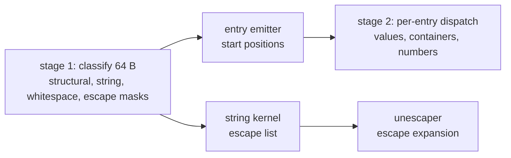

# Native SIMD JSON pipeline: measured performance record

Status: **measurement record, with stage 1's three units and the assembled
pipeline in the tree**. The pipeline was built and measured in a scratch tree
outside the checkout, and the numbers below are a record of observed runs, not
an artefact reproducible from this tree — re-measuring requires rebuilding the
harness, whose structure, arms and controls are described in §7 so that a
rebuild can repeat the same comparisons. Stage 1's units, and the assembled
pipeline after them, are the exceptions: each has its own measured section
below, reproducible from this tree. The classification-mask kernel is extracted
as `kernel/json/s1_block.c` with its escape derivation in the adopted arithmetic
form (no `pext`/`pdep`/`lzcnt`), its regenerated IR is committed as
`probes/install/ir/json-s1-masks.candidate.ll`, and `s1_masks_refines`
(`LeanLLVM/Refinement/JsonS1MasksSteps.lean`) proves that pinned body stores the six
masks and the carry `LeanLLVM/Refinement/JsonScanSpec.lean` specifies. The entry
positions unit is extracted as `kernel/json/entry.c`, its emitted IR is committed
as `probes/install/ir/json-entry.candidate.ll`, and the two bodies
`LeanLLVM/Refinement/JsonEntryIR.lean` pins are proved by `entry_pos8_refines`
(`LeanLLVM/Refinement/JsonEntrySteps.lean`) and `entry_b8_refines`
(`LeanLLVM/Refinement/JsonB8Steps.lean`) against the entry word
`LeanLLVM/Refinement/JsonEntSpec.lean` specifies. The UTF-8 validity stage is the
third, and it is in the tree: its unit is `kernel/json/utf8.c`, its emitted IR is
committed as `probes/install/ir/json-utf8.candidate.ll`,
`LeanLLVM/Refinement/JsonUtf8IR.lean` gives its three calls their reading
(`utf8Calls`, with `utf8Calls_pshufb`/`utf8Calls_usubSat`/`utf8Calls_ptestz`),
`LeanLLVM/Refinement/JsonUtf8Spec.lean` states the specification the verdict is
judged against, and `utf8_stage_refines` (`LeanLLVM/Refinement/JsonUtf8Steps.lean`)
proves the pinned body returns zero exactly when the staged window is a valid
prefix. The assembled pipeline is in the tree too: `kernel/json/pipeline.c`
runs the mask unit, the entry emitter, the escape list, the UTF-8 stage and
stage 2 (`kernel/json/stage2.c`) in one call, with its refinement development
under `LeanLLVM/Refinement/JsonPipeline*.lean`; §"The composed route, against
simdjson 5.0.5" measures it as the route binary calls it, on the units' corpus.
The three units have a measurement of their own,
separate from every ratio in this note: §"Stage 1's three units, measured in this
tree" records the instrument, corpus, flags, host and the numbers with their
variance, and the subsection after it records simdjson 5.0.5's stage 1 and full
parse from the same session over the same corpus, with its own provenance, the
stage ratio that pairing supports and its variance, and the comparisons it does
and does not support. §"The composed route, against simdjson 5.0.5" then
measures the assembled route beside the same simdjson arms over that corpus,
with its own instrument, cost split, quotients and limits, and §"The workspace,
fresh against reused" measures the same route with the caller's workspace
rebuilt per document and with one workspace reused across the corpus.

The note answers one question: **can a byte-mask JSON parser, in the shape the
Lean development would lower to, be competitive with a mature native parser on
the same documents?** It records what was measured, which shapes were refuted
and at what cost, the decision table the measurements support, and what this
does not establish.

## 1. Contracts compared

Every ratio is this pipeline over simdjson On-Demand over the same file in the
same run, medians of 11–15 rounds, pinned to one core with `taskset`, compiler
`-falign-loops=64 -falign-functions=64` for both.

|Contract|What it requires|
|---|---|
|`OFF`|document validity only; no value extraction, no error position|
|`P0`|full value extraction, no error position, no validation of escaped content|
|`P2`|`P0` plus exact byte offset of the first error, and validation of every string|
|`SCHEMA`|`P2` plus extraction of named fields from a known schema|

`P2` is the strictest of the four and is the one quoted for "faster", because it
includes the work a caller most often wants and is where simdjson is hardest to
beat. `OFF` was below 1.0 on all seven documents (0.68–0.98) and is not
tabulated further.

## 2. Corpus

The seven standard documents: `canonical` (French text, UTF-8, 1.05 escapes
per block), `citm`, `twitter`, `canada`, `dense` (26.4 structural entries per
block), `longstr` (string-heavy) and `escdense` (escape-dense). The structural
and string densities of these documents drive every decision in §5, which is
why the thresholds are expressed in those units and not in document names.

## 3. Result

Ratio to On-Demand; below 1.0 means this pipeline is faster. `E` and `P` are
the two core classes of the measurement host (§7.3).

|File|entries/blk|P2 E|**P2 P**|P0 E|**P0 P**|
|---|---:|---:|---:|---:|---:|
|canonical|6.8|1.044|**0.922**|0.945|**0.814**|
|citm|7.9|0.843|**0.555**|0.746|**0.452**|
|twitter|7.9|0.847|**0.611**|0.704|**0.528**|
|canada|9.9|1.023|**0.946**|0.910|**0.849**|
|dense|26.4|1.027|1.037|0.829|**0.873**|
|longstr|1.3|0.721|**0.586**|0.296|**0.236**|
|escdense|7.4|0.816|**0.759**|0.648|**0.719**|

On the P-core class the pipeline is faster under `P2` on six of seven
documents (4–45%), with `dense` the single loss at 3.7%. On the E-core class
four are clearly faster, `canada` and `dense` within 2.3–2.7%, and `canonical`
4.4% behind. `P0` is faster on all seven on both classes.

The margin is core-specific and the *decisions* are not (§5, §7.3): on the
E-core the stage-1 advantage is 1.7–3.9 ns/block over an alternative arm, on
the P-core 0.2–0.9.

## 4. Pipeline shape



Properties the measurements depend on, each of which was checked rather than
assumed:

- **Masks are computed once per block** and every later stage reads them; the
  per-block record is one word plus, where a stage needs it, the escape mask.
- **Entry emission is two-phase** — mask, then expand — and beats emitting
  entries inside the classify loop by 7–8 ns/block on `canonical`.
- **The string kernel is escape-list driven** where escapes exist; the list is
  built only for blocks that have one, and only for documents whose class is
  not `PLAIN` (see §5).
- **UTF-8 validation is a `pshufb` table DFA** accumulated per 32-byte vector:
  46 instructions per block against 89 for a mask-derived kernel, and it costs
  −0.5 ns/block inside stage 1 against a no-check arm on `canonical` (the
  separate mask-derived kernel cost +8.0).

## 5. Decision table

Both builds print their decisions for a document (`<binary> <file> dens`), so
a measurement can be traced to the branch that produced it.

|File|class|entries/blk|skip q8|kernel E|kernel P|UTF-8|list, `P2`|list, `P0`|
|---|---|---:|---:|---|---|---|---|---|
|canonical|SPARSE|6.84|3|POS8|POS8|ungated|on|none|
|citm|PLAIN|7.88|248|B8|B8|gated|off|none|
|dense|PLAIN|26.38|256|POS8|POS8|gated|off|none|
|twitter|SPARSE|7.92|196|POS8|POS8|gated|on|none|
|canada|PLAIN|9.88|256|**POS8**|**B8**|gated|off|none|
|longstr|HEAVY|1.31|256|B8|B8|gated|on|none|
|escdense|HEAVY|7.36|256|POS8|POS8|gated|on|none|

Thresholds, all sampled from the first 64 block pairs of the document by the
same masks the timed pass uses (a window that starts inside a long string reads
a string-heavy document as entry-dense and is not used):

|Name|Value|Governs|
|---|---|---|
|class cut, PLAIN|escape hits per sample `< 1/64`|escape list, string kernel|
|class cut, HEAVY|escape hits per sample `≥ 2`|string kernel choice|
|`DENS_B_POS8_Q8`|5120 (20 entries/blk)|POS8 emitter|
|`DENS_B8_Q8`|512 (2 entries/blk)|B8 emitter|
|`DENS_PLAIN_B8_Q8` (E / unknown)|2176 (8.5)|inline B8 emitter for `PLAIN`|
|`DENS_PLAIN_B8_Q8_P`|3072 (12)|the same, P-core class|
|`DENS_U8_SKIP_Q8`|154 (60%)|ungated UTF-8|
|list gate|`class != PLAIN`|escape list construction|
|core class|`CPUID.1Ah.EAX[31:24]`: `0x40` = P, `0x20` = E|the two kernel entries marked above|

The probe costs ≈0.01 ns/block, and reads `citm` 31% high against an exact
census; the 8.5/12 boundary is an interpolation between two documents (7.9 and
9.9 entries/blk) and is the weakest entry in the table.

## 6. Shapes measured and refuted

Each of these was implemented and priced; the cost is what it adds over the
shape it would have replaced. They are recorded so a later attempt does not
repeat them.

|Shape|Measured outcome|
|---|---|
|per-block escape mask instead of the compacted escape list|consumer 16.7 vs 6.9 ns/block, both cores|
|batching the processing of one-escape windows|pure addition; escapes are 1 in 10 windows|
|`POS8` expansion inside the consumer|slower than a scalar batch per lane|
|splitting run copy from escape expansion|21.3 vs 16.4 ns/block fused|
|branch-free escape expansion|+25 ns/block on `longstr`/`escdense`|
|carrying the escape kind out of stage 1|27.875 vs 27.871 ns/body — the branch moves, not disappears|
|mask-derived UTF-8 (`pshufb` classes over the classifier's masks)|117 instructions vs 89; +8.1 vs +7.3 ns/block|
|mask-derived UTF-8, vectorised range check|15.5–20.0 ns/block; the gated form mispredicts 33% of the time|
|4-entry emitter batch for `dense`|did not reproduce under the corrected route; POS8 wins. The extraction in `kernel/json/entry.c` carries the POS8 and B8 kernels and no batch, so no cost is claimed for the batch there|
|removing the escape-list class gate|saves 2.3–2.8 ns/block on `dense`/`canada` — the gate is the win, not the cost|

Two refutations are specifically about **where** a decision is taken rather
than what it computes: the escape kind and the UTF-8 class both looked
attractive as stage-1 outputs and both cost more than the branch they removed,
because the branch is predictable per body and the record is a dependent load.

## 7. Measurement discipline

Three failures shaped how these numbers were taken; they are the most reusable
part of this record.

### 7.1 The timed path must be shown to reach the new code

A dispatch defect left the `P2` driver calling the inline builder while the
two-phase builder it was supposed to time was never invoked. Three rounds of
`P2` ratios described the wrong binary, including one that concluded the
two-phase emitter was the win and one that concluded a batch was better for a
dense document. Both reversed once the route was fixed. A change to a staged
pipeline is not measured until the preprocessed source of the timed entry point
names the new code.

### 7.2 Cross-binary comparisons are not comparisons

Identical hot code, six builds, spanned 99.2–105.1 ns/block on `canonical`
(≈6%), and one cross-binary table carried a 15 ns/block artefact that reversed
a 2 ns/block conclusion. Consequence: an arm is compiled into one binary and
selected per process; a decision of 1–3% needs either same-binary arms or
several independent binaries per arm, and the report states which.

### 7.3 The core class changes the answer

The host has two core classes: `CPUID.1Ah.EAX[31:24]` reads `0x40` on cpus 0–3
(kernel `cpu_core` PMU, 4.9 GHz) and `0x20` on cpus 4–7 (`cpu_atom`, 3.67 GHz,
128-bit datapath, so every 256-bit operation is two uops). Standalone kernel
throughput differed by ~2.3× between classes, `llvm-mca` predicted 9.0 cycles
per block where the E-core measured 21, and one kernel selection flips between
classes (`canada`: POS8 on E, B8 on P, wrong-choice cost 1.21/0.82 ns/block on
`P2`). Ratios are therefore reported per class; a table entry that is
core-specific is marked as such.

### 7.4 Correctness gates are held fixed across every arm

Every arm measured above passes the same gates: 1,361,282 string bodies with
zero position mismatches against a scalar reference; 58,367 documents with
23,842 reject offsets equal; entry streams byte-identical across kernels, arms
and core classes; and for UTF-8 an exhaustive 10,172,525-string × 64-offset
placement set (651M placements) with zero disagreements against the scalar
reference, including documents that start mid-sequence and a lone lead byte at
the end of a document. That differential is a scratch-build measurement and is
not the UTF-8 unit's route: the route compares the extracted object, the Lean
body and the measured function on the counted matrix of its curated rows in
`tests/json-utf8/corpus.tsv` and the driver's generated arms — 73,071 generated
documents plus a 512-row placement arm — and the two must not be read as one
measurement.

## 8. Open items

Bounded but unresolved, and all inside or near the placement floor:

- the P-core window between 12 and 26 entries/blk is unmeasured; the 12
  threshold is `canada` plus 2.1 and is an extrapolation;
- `escdense`'s emitter on the E-core at `P2` disagrees in sign between two
  runs (~1 ns/block);
- `canonical`'s UTF-8 arm on the E-core disagrees between two runs (+1.9/−2.1
  ns/block); the rule keeps the ungated arm because it wins on the P-core;
- the `CPUID.1Ah` encoding direction is established empirically on this part;
  an inverted part would cost at most the 1.2 ns/block bounded above, with
  POS8 as the unknown-class fallback.

## 9. What this does not establish

- **Mostly nothing about refinement, and stage 1 is the exception.** The measured
  pipeline is a native implementation. Stage 1's units are the exception.
  The classification-mask unit's kernel is extracted as `kernel/json/s1_block.c`,
  and `s1_masks_refines` (`LeanLLVM/Refinement/JsonS1MasksSteps.lean`) proves the
  emitted body pinned from that source stores exactly the masks and carry
  `JsonScanSpec` defines — which `JsonScanSpec` in turn relates to `ScanBlock`'s
  `maskOf` fold and to `ScanWindow`'s `windowOf`. The entry positions unit's two
  kernels are extracted as `kernel/json/entry.c`, and `entry_pos8_refines`
  (`LeanLLVM/Refinement/JsonEntrySteps.lean`) and `entry_b8_refines`
  (`LeanLLVM/Refinement/JsonB8Steps.lean`) prove the bodies pinned from
  `probes/install/ir/json-entry.candidate.ll` against the entry word
  `LeanLLVM/Refinement/JsonEntSpec.lean` specifies: the positions each body writes and
  the cursor it returns. The UTF-8 validity stage is the third, and it too is
  refined: its unit is `kernel/json/utf8.c`, its emitted IR is
  `probes/install/ir/json-utf8.candidate.ll`, `LeanLLVM/Refinement/JsonUtf8IR.lean`
  gives its three calls their reading, `LeanLLVM/Refinement/JsonUtf8Spec.lean` states
  the specification, and `utf8_stage_refines`
  (`LeanLLVM/Refinement/JsonUtf8Steps.lean`) proves the pinned body returns zero
  exactly when the staged window is a valid prefix. Everything else here is
  still unrelated to the Lean development by any proof: the selection that fills
  the entry stream, the escape and exit stages, the assembled pipeline, and
  `LeanLLVM/JSON/`'s parser. Connecting those is the open obligation, not a
  corollary of these numbers.
- **Nothing about this machine's generality.** One host, two core classes, one
  governor setting (`powersave`), one compiler toolchain, `AVX2` code paths.
  Absolute levels drift 5–10% between processes; only within-run paired deltas
  are claimed.
- **Nothing about other parsers.** The comparison is simdjson On-Demand on
  these seven documents; a different reference parser or a different corpus can
  change both the ranking and the thresholds in §5.
- **Nothing about documents outside the seven.** The decision table is tuned on
  them; the class boundaries in §5 are meaningful for documents with similar
  structural and escape densities, and the probe's 31% overread on `citm` is a
  known inaccuracy in the instrument, not in the pipeline.

## The number conversion's cost, after it stopped calling the library

The fallback branch of `num_fast` used to copy the lexeme into a heap buffer
and call the C library's conversion. It no longer does: it reads a bounded
window of significant digits, records whether any digit past the window is
nonzero, and rounds once. That removed three things — an allocation sized by
whoever sent the document, a process exit when the allocation failed, and the
platform's conversion as a premise — and it costs throughput.

Measured on this host, both revisions built with the same compiler and flags
from `kernel/json/stage2.c` at `7d5623b~1` (before) and at `7d5623b` (after),
calls interleaved so host drift cannot be attributed to either, three runs
each, median of the three:

| input | before | after | ratio |
|---|---|---|---|
| `tests/json-strtod/corpus.txt`, 71 lexemes (24 first class, 11 middle, 36 fallback) | 116 ns/call | 137 ns/call | **1.18×** |
| 102-digit number | 225 ns | 318 ns | 1.41× |
| 1 002-digit number | 1 035 ns | 2 917 ns | **2.82×** |
| 100 002-digit number | 82 565 ns | 182 245 ns | 2.21× |

The cost is largest exactly where the old code allocated, and it is not a
mystery: the C library's conversion is a decades-tuned implementation with its
own fast paths, while this one does its own wide-integer arithmetic in a fixed
96-limb frame. The window is 768 significant digits because a rounding
decision's boundary can be that long; a lexeme shorter than that pays for a
frame larger than it needs.

What the numbers do not say: that the old path was acceptable. It ended the
process when an allocation failed, and the allocation's size was the sender's
choice, so a document could terminate the parser. The comparison above prices
correctness against throughput on a host with memory to spare; it is not an
argument for reverting.

Not measured: whether a smaller frame for short lexemes, or a fast path for
the common case, recovers the ratio. Both are available and neither is done.

## Stage 1's three units, measured in this tree

Everything above this heading is the scratch pipeline's record. This section is
the three extracted stage-1 units of that pipeline, measured on their own, in
this tree, with the instrument in this tree. It is not a re-measurement of any
row above, and none of the unit rows below is compared with a parser or with
those rows. The subsection after the unit tables is a separate instrument:
simdjson 5.0.5's stage 1 and full parse on the same corpus, with its own
comparisons and limits stated.

The units are `kernel/json/s1_block.c` (classification masks),
`kernel/json/entry.c` (entry positions) and `kernel/json/utf8.c` (UTF-8
validity), each called at the ABI its header states and each proved against its
specification (`s1_masks_refines`, `entry_pos8_refines`, `entry_b8_refines`,
`utf8_stage_refines`). What they are not is a parser: the selection that fills
the entry stream, the escape and exit stages, stage 2, and the assembled
pipeline are not measured here, so no figure here is an end-to-end one. (When
this section was written those stages were not in the tree; the assembled
pipeline is there now -- `kernel/json/pipeline.c` -- and §"The composed route,
against simdjson 5.0.5" measures it. No row below is re-derived from that
section.) A second host's same-session pairing is recorded separately in
§"Stage 1 on a quiet AMD host: a paired units-and-simdjson run"; its rows are
not comparable with these and none is divided by one of them.

### The instrument

`tests/json-units-bench/bench.sh` compiles the three kernel sources at the
measured compiler line (`-O3 -march=x86-64-v3 -mpclmul -std=gnu11
-falign-loops=64 -falign-functions=64`), links them against
`tests/json-units-bench/bench.c`, and runs one process per CPU and trial. The
harness declares the ABIs rather than including the headers, as the route
drivers do, and does not edit a kernel source. Five rows:

|row|entry point|one pass|
|---|---|---|
|`s1_masks`|`leanllvm_json_s1_masks`|once per complete 64-byte block, with the carry threaded; the timed loop reads one mask word per block back into its accumulator|
|`entry_pos8`|`leanllvm_json_entry_pos8`|once over the document's whole mask stream, cursor 0, output buffer pre-sized|
|`entry_b8`|`leanllvm_json_entry_b8`|the same stream and buffer, the other emitter|
|`utf8_gated`|`leanllvm_json_utf8` with `ungated = 0`|once over the document|
|`utf8_ungated`|`leanllvm_json_utf8` with `ungated = 1`|once over the document|

The mask stream is derived the way the entry route derives its corpus: lane `t`
of block `i` is set exactly when byte `64*i + t` is one of the eight structural
bytes, so the entry rows read a stream of the form the entry route's corpus has,
not arbitrary data. The UTF-8 staging is the ABI's: three zero bytes before the
document and zero padding to the block boundary; the document's first byte, and
every document and derived array, is 64-byte aligned (the units' loads are
unaligned and take any address, so alignment is the caller's choice; one choice
is made and recorded rather than leaving it to `malloc` placement).

Every pass sweeps a buffer that the preceding passes already read: the corpus is
loaded once, each row is warmed once, and each repetition re-runs the unit
over the same bytes, so no repetition pays a first-touch page fault or a
cold-cache fill of its own. One repetition processes the whole document. Each
row is 51 repetitions; the whole binary is run three times per CPU, so
process-to-process variance is visible beside the within-row spread. The
reported quantity is `CLOCK_MONOTONIC_RAW` around one repetition: GB/s is
document bytes per nanosecond (one byte per ns is one GB/s), and cycles per byte
is ns per byte times the core clock measured immediately before the row.

That clock is calibrated, not observed: this host has no perf events for an
unprivileged process (`perf_event_paranoid` is 4), so the harness times a serial
dependent-add chain (`add; dec; jne`, one iteration per cycle on this part) with
the same clock, twice, and uses the mean. On cpu4 the chain reads 3.65-3.67
GHz, which is the clock the E cores are recorded at above and is what the
one-cycle premise predicts. The chain measures the core's clock at
the moment of the row, not during it; if the core runs at a lower clock under
the row's 256-bit code, the cycles/byte column is high by that ratio while the
GB/s column is unaffected. The invariant TSC frequency is measured and printed
too (3.302 GHz on this host), so a wall time converts to reference cycles
independently of the calibration.

Gates held fixed across every row, because a row that did not reach the code is
not a measurement: `entry_pos8`'s and `entry_b8`'s cursors must both equal the
stream's total set lanes; the gated and ungated UTF-8 words must be equal; every
timed pass's checksum must equal its warm-up pass's; and the checksum of a
(document, unit) pair must be identical across all trials and both CPU classes. The
harness exits 3 rather than print a number when one of those fails, and the
script also asserts that every row ran on the CPU `taskset` pinned it to.

Reproduce, from the repository root:

```bash
nix develop -c bash tests/json-units-bench/bench.sh
```

`BENCH_CPUS` (default `0 4`), `BENCH_TRIALS` (3), `BENCH_REPS` (51),
`BENCH_DIR`, `BENCH_CC` and `BENCH_SEED` change the run; the corpus and the
objects are written under `tests/json-units-bench/build/`. The transcript of the
paired run quoted below is `tests/json-units-bench/transcript-paired.txt`, 240
rows over two CPUs and three trials, with its environment and idle record at
`tests/json-units-bench/paired-run.txt`. The earlier run's transcript is
`tests/json-units-bench/transcript.txt`, kept under §"The earlier run, kept as
history".

### Corpus

Two classes, both produced by the script under the build directory. The route
documents are the checked-in documents the unit routes already use: the six
`tests/json-s1-masks/corpus/*.json` files (63 to 98 bytes) and the fifteen
`tests/json/corpus/utf8-*.json` files (3 to 7 bytes). Each class is
concatenated in byte order and tiled to exactly 65,536 bytes, so a class whose
files total a few dozen bytes still has a document long enough to time. Tiling
changes where block boundaries and the escape/in-string carry fall, which is
irrelevant to what these units compute per block, and it is recorded rather than
assumed; the tiled bytes are not valid JSON at the seams, and `route-u8-64k` is
a rejecting UTF-8 byte string (it contains the corpus's invalid sequences), so
its UTF-8 rows measure the rejecting path.

The synthetic documents come from `tests/json-units-bench/gen.c` at seed
`0x243F6A8885A308D3` -- the seed the unit drivers' random arms use -- and are
written at 65,536 and 4,194,304 bytes in three shapes: `dense` (small objects,
many structural bytes), `strings` (long ASCII strings with occasional escapes)
and `utf8` (raw multi-byte UTF-8 sequences). The generator closes the array
inside the budget and pads with newlines to the exact size, and refuses to write
a file whose byte count is not the requested one.

|file|bytes|sha256 (first 16)|structurals/block|all-ASCII vectors|UTF-8 word|
|---|---:|---|---:|---:|---:|
|`route-s1-64k.json`|65,536|`41f918853d55dad0`|37.24|2048 / 2048|0|
|`route-u8-64k.json`|65,536|`d14a6a6842610aaa`|26.67|0 / 2048|1|
|`syn-dense-64k.json`|65,536|`3d9e0237ec66adb2`|31.60|2048 / 2048|0|
|`syn-dense-4m.json`|4,194,304|`243e8f36f14e1acb`|31.73|131072 / 131072|0|
|`syn-strings-64k.json`|65,536|`bd007090d7a5ab09`|4.61|2048 / 2048|0|
|`syn-strings-4m.json`|4,194,304|`3ce71d559eef1d11`|4.61|131072 / 131072|0|
|`syn-utf8-64k.json`|65,536|`f95f4aeaac083d5d`|5.44|25 / 2048|0|
|`syn-utf8-4m.json`|4,194,304|`2091fc28bf071e8a`|5.44|1132 / 131072|0|

"Structurals/block" is the mean set lanes of the entry mask stream; "all-ASCII
vectors" counts the 32-byte vectors the UTF-8 gate can skip; "UTF-8 word" is the
verdict. Every document's length is a multiple of 64, so the UTF-8 rows' bytes
charged equal the padded window they scan.

### Host and build

|what|value|
|---|---|
|CPU|Intel Core Ultra 7 268V, 8 CPUs online|
|core classes|`CPUID.1Ah.EAX[31:24]` reads `0x40` on cpu0 (P) and `0x20` on cpu4 (E)|
|cache|cpu0: L1d 48 KiB, L2 2560 KiB; cpu4: L1d 32 KiB, L2 4096 KiB; L3 12288 KiB|
|host kernel|Linux 6.17.0-1033-oem x86_64|
|governor|`powersave` on all CPUs; no CPU isolation, no frequency pinning|
|PMU|`perf_event_paranoid = 4`, no events for an unprivileged process; cycles are calibrated|
|compiler|clang 21.1.8|
|kernel objects|`s1_block.o=80d29a5b5aed7902`, `entry.o=384f710b27a7829b`, `utf8.o=78cd3df8fe422e9f` (sha256, first 16)|
|harness|`-O2 -std=gnu11`|

The 65,536-byte documents are L2-resident on both classes; the 4,194,304-byte
documents exceed the P-core's 2560 KiB L2 and match the E cluster's 4096 KiB L2,
so their sweeps do not fit a private L2 and are served from L3. No DRAM-resident
row was measured.

### Numbers

Both cores are reported, because the classes differ and the difference is not a
constant ratio. Each cell is GB/s at the median of the three trial medians, with
the minimum and maximum of those three medians in parentheses.

The `s1_masks` rows in this section are the pre-adoption `pext`/`pdep`/`clz`
kernel: this pair predates the arithmetic substitution. The adopted kernel's own
rows are in §"The classifier's escape derivation: ablated, replaced, adopted";
the entry and UTF-8 units are unchanged by the adoption.

These rows and the simdjson rows in §"The simdjson row, measured" are one
session's pair. The units ran at 09:50:34-09:50:44Z and simdjson at
09:50:44-09:50:54Z, back to back, over the same corpus directory, pinned to the
same two CPUs, with `powersave` recorded on both CPUs before, between and after.
No `lake build` and no `lean` elaboration ran during either harness: the
`lean --server` and its worker belong to another checkout's editor and consumed
zero cpu ticks across both runs (629 ticks at each snapshot, and zero per-pid
growth over 76 samples), and the one-minute load average was 1.93 before the
units, 2.09 between the harnesses and 1.92 after. The record is
`tests/json-units-bench/paired-run.txt`; the transcripts are
`tests/json-units-bench/transcript-paired.txt` and
`tests/json-units-bench/simdjson-transcript-paired.txt`. Two earlier attempts
were discarded because the editor's worker gained one cpu tick (0.01 s) during
the simdjson run.

The clocks are the reason the pair is worth quoting. The units' row
calibrations spanned 4.30-4.61 GHz on cpu0 (median 4.49) and 3.60-3.68 on cpu4
(median 3.67); the simdjson rows spanned 4.31-4.68 (median 4.56) and 3.62-3.67
(median 3.66). The runs agree within 1.5% on the P core and 0.1% on the E core,
so both GB/s columns describe one clock regime and the cycles-per-byte columns
agree with them rather than substituting for them.

**P core (cpu0), GB/s:**

|document|`s1_masks`|`entry_pos8`|`entry_b8`|`utf8_gated`|`utf8_ungated`|
|---|---:|---:|---:|---:|---:|
|`route-s1-64k`|12.3 (12.2-13.8)|13.3 (12.4-14.0)|5.9 (5.5-6.0)|89.0 (88.8-97.1)|28.5 (24.0-28.8)|
|`route-u8-64k`|12.3 (11.4-12.3)|12.8 (12.0-13.8)|8.6 (8.5-8.6)|25.6 (23.3-25.7)|26.2 (23.8-28.7)|
|`syn-dense-4m`|13.2 (12.9-13.5)|11.1 (10.9-11.4)|5.4 (5.4-5.5)|54.1 (49.9-56.1)|32.3 (31.9-33.3)|
|`syn-dense-64k`|12.2 (11.2-12.3)|11.9 (11.8-13.9)|6.2 (6.2-6.2)|89.4 (82.7-96.9)|26.1 (26.0-28.8)|
|`syn-strings-4m`|13.2 (13.1-13.4)|14.1 (13.8-14.2)|22.4 (22.3-22.7)|50.4 (48.0-54.4)|33.2 (32.0-34.1)|
|`syn-strings-64k`|13.6 (12.3-13.6)|13.1 (12.8-15.3)|31.9 (30.0-32.8)|96.0 (82.9-96.7)|28.8 (26.2-28.8)|
|`syn-utf8-4m`|13.3 (13.2-13.4)|12.9 (12.8-13.5)|25.7 (24.8-25.9)|30.4 (29.5-31.7)|33.6 (33.6-34.0)|
|`syn-utf8-64k`|11.4 (11.2-13.7)|13.6 (12.8-13.6)|31.2 (28.7-31.2)|25.6 (24.9-25.7)|26.2 (23.9-27.2)|

**P core (cpu0), cycles per byte at the calibrated core clock:**

|document|`s1_masks`|`entry_pos8`|`entry_b8`|`utf8_gated`|`utf8_ungated`|
|---|---:|---:|---:|---:|---:|
|`route-s1-64k`|0.362|0.336|0.759|0.051|0.159|
|`route-u8-64k`|0.369|0.351|0.526|0.174|0.173|
|`syn-dense-4m`|0.343|0.404|0.828|0.083|0.138|
|`syn-dense-64k`|0.369|0.370|0.723|0.049|0.168|
|`syn-strings-4m`|0.341|0.318|0.201|0.089|0.136|
|`syn-strings-64k`|0.333|0.343|0.142|0.047|0.156|
|`syn-utf8-4m`|0.338|0.354|0.176|0.147|0.133|
|`syn-utf8-64k`|0.389|0.333|0.145|0.175|0.171|

**E core (cpu4), GB/s:**

|document|`s1_masks`|`entry_pos8`|`entry_b8`|`utf8_gated`|`utf8_ungated`|
|---|---:|---:|---:|---:|---:|
|`route-s1-64k`|8.2 (8.2-8.2)|14.0 (14.0-14.0)|2.2 (2.2-2.2)|63.7 (63.6-63.8)|14.0 (13.9-14.0)|
|`route-u8-64k`|8.2 (8.2-8.2)|13.9 (13.9-14.0)|3.5 (3.5-3.5)|12.5 (12.5-12.5)|14.0 (14.0-14.0)|
|`syn-dense-4m`|7.6 (7.4-7.6)|7.3 (6.8-7.4)|2.4 (2.4-2.4)|23.0 (21.9-24.3)|11.7 (11.5-11.8)|
|`syn-dense-64k`|8.2 (8.1-8.2)|13.7 (13.7-13.7)|2.7 (2.7-2.7)|63.3 (63.1-63.7)|14.0 (14.0-14.0)|
|`syn-strings-4m`|7.5 (7.5-7.5)|13.0 (12.9-13.3)|14.4 (14.4-14.6)|25.5 (22.4-26.8)|11.7 (11.7-12.0)|
|`syn-strings-64k`|8.1 (8.1-8.2)|14.4 (14.2-14.4)|17.0 (17.0-17.0)|63.6 (63.6-63.6)|14.0 (13.9-14.0)|
|`syn-utf8-4m`|7.6 (7.6-7.7)|13.6 (13.5-13.7)|14.8 (14.8-14.8)|10.8 (10.7-11.2)|11.5 (11.3-11.8)|
|`syn-utf8-64k`|8.2 (8.1-8.2)|14.1 (14.1-14.1)|16.1 (16.1-16.1)|12.5 (12.1-12.5)|14.0 (14.0-14.0)|

**E core (cpu4), cycles per byte at the calibrated core clock:**

|document|`s1_masks`|`entry_pos8`|`entry_b8`|`utf8_gated`|`utf8_ungated`|
|---|---:|---:|---:|---:|---:|
|`route-s1-64k`|0.449|0.262|1.687|0.058|0.262|
|`route-u8-64k`|0.447|0.262|1.047|0.293|0.262|
|`syn-dense-4m`|0.484|0.503|1.539|0.158|0.315|
|`syn-dense-64k`|0.448|0.268|1.382|0.058|0.262|
|`syn-strings-4m`|0.486|0.279|0.254|0.143|0.313|
|`syn-strings-64k`|0.452|0.254|0.215|0.057|0.263|
|`syn-utf8-4m`|0.481|0.271|0.248|0.340|0.319|
|`syn-utf8-64k`|0.450|0.260|0.228|0.293|0.262|

### The noise floor

The rows are medians, and the spread around them is not uniform. Within a row,
the median relative span between the 10th and 90th percentile of the 51
repetitions, taken over the eight documents and the three trials:

|core|`s1_masks`|`entry_pos8`|`entry_b8`|`utf8_gated`|`utf8_ungated`|
|---|---:|---:|---:|---:|---:|
|P (cpu0)|12.3% (2.2-16.0)|12.9% (6.8-16.2)|13.0% (3.9-17.0)|16.9% (6.7-30.2)|25.8% (17.1-29.0)|
|E (cpu4)|0.8% (0.5-14.0)|0.7% (0.5-25.0)|0.9% (0.6-10.2)|1.9% (0.5-61.2)|0.9% (0.4-20.4)|

and the same spread for the simdjson arms, whose rows are in the subsection
below:

|core|`pad`|`stage1`|`parse`|
|---|---:|---:|---:|
|P (cpu0)|16.2% (5.8-21.2)|15.6% (13.1-41.4)|16.0% (6.5-27.8)|
|E (cpu4)|6.2% (1.7-18.1)|2.6% (0.6-7.7)|4.3% (0.4-9.0)|

The parenthesised range is over the documents.

**The noise floor of this record is 61.2%**, the widest within-row spread it
contains: the E core's `utf8_gated` on `syn-dense-4m`, whose three trial medians
already span 21.9-24.3 GB/s. Across all 128 rows the median within-row
p10-p90 spread is 10.1% and its 90th percentile 24.3%.

The tables quote a median of three trial medians, so the bar that matters for a
row is the spread of those medians rather than of the repetitions: its median is
3.1%, its 90th percentile 15.4%, and its widest single case 37.9% (the P core's
`parse` on `syn-strings-64k`, three medians spanning 4.0-5.9 GB/s). A change to
a row is therefore a result only if it exceeds that row's own spread — roughly
3% for a stable row, 10% for a typical one, and nothing below 60% on the worst
row. For the stage ratio below the bar is the ratio's own spread: median 3.6%
and widest 16.4% on the P core, so a ratio that moves by less than about 17% is
inside this run's scheduling noise.

Two things are recorded rather than resolved: the host is a `powersave`-governed
laptop SoC with no CPU isolation, so the spread includes whatever else the
machine was doing (in this run, nothing that elaborated: see the record above);
and the instrument does not observe the core clock during a row, so a clock
change under sustained 256-bit code would appear as exactly this kind of
within-row drift without being identified as one. The P-core rows' larger
spread is consistent with such a change, but it is not established; the GB/s
figures are wall-clock and stand whatever the clock did.

Read as a whole, the rows say three things. The classification unit is close to
content-independent: 11.4-13.6 GB/s on the P core and 7.5-8.2 on the E core
across structural densities from 4.6 to 37.2 per block, at 0.333-0.389 and
0.447-0.486 cycles per byte. The P core's low end is `syn-utf8-64k`, whose three
trial medians are 11.2, 11.2 and 13.7 GB/s: two trials cluster low and one
high, so that row is recorded as a spread and not explained by its content. The
two entry emitters trade places with density as the measured pipeline's decision
table predicts: at 31.7 positions per block POS8 is the faster (11.1 against 5.4
GB/s on `syn-dense-4m`, 7.3 against 2.4 on the same document's E-core row, and
13.7 against 2.7 on the E core's `syn-dense-64k`), at 4.6 B8 is (22.4 against
14.1, 14.4 against 13.0), the two rows being the same process, the same stream
and the same output buffer. The UTF-8 gate is worth what it costs where it can
skip: on the 65,536-byte all-ASCII documents the gated arm is 89-96 GB/s on the
P core and 63-64 on the E core against 26-29 and 14.0 ungated; on the
4,194,304-byte ones it is 50-54 and 23-26 against 32-33 and 11.7, the gate's
advantage narrowing as the buffer leaves L2. On the UTF-8 document the two
converge (30.4 against 33.6, 10.8 against 11.5).

### The simdjson row, measured

The earlier version of this section said no simdjson row was measured, because
no simdjson development output or source was obtainable on this host without
network access. That was true of the first attempt and false of the second, and
the difference is recorded here rather than left as an assumption.

The fetch did need network access. The first attempt tried to realise the
4.6.11 derivation's `dev` output offline and was still building bootstrap
derivations (bash, binutils tarballs) when it was stopped after three minutes.
The second attempt realised the nixpkgs registry's **simdjson 5.0.5**:

```bash
nix build --no-link --print-out-paths 'nixpkgs#simdjson.dev'
nix build --no-link --print-out-paths 'nixpkgs#simdjson'
```

which produced the dev output
`/nix/store/m2i8165bayxxgzj3fbvdg6gihz6na93d-simdjson-5.0.5-dev` (the
amalgamated `include/simdjson.h`, sha256 `869e8a4ff285cec36bc79d4a671a433158391a4f1898bb1c3b1f6e654b9547ae`)
and the library output
`/nix/store/jglxdk9y0yfk3mc9dbr675pfmv42a89y-simdjson-5.0.5` (the shared
library `libsimdjson.so.34.0.0`, sha256
`9b2368aaa42dbfbf125cedea26c86914b622899c4ebeaf3f9fc7fd7bbcdd7184`). The
4.6.11 `dev` output and source are still absent, and the earlier 4.6.11
library (`libsimdjson.so.33.0.0`) is still there. **The row below is therefore
5.0.5, not the 4.6.11 the earlier text named and not the 4.6.11 the scratch
ratios were taken against.** It does not re-measure, confirm or supersede any
ratio above.

The instrument is `tests/json-units-bench/bench-simdjson.sh`, which builds
`tests/json-units-bench/simdjson-baseline.cc` at the units' measured compiler
line with the C++ standard --

```
-O3 -march=x86-64-v3 -mpclmul -std=c++17 -falign-loops=64 -falign-functions=64
```

-- against the header and library above, and runs it over the units' eight
documents. The corpus is the same byte for byte: the script checks every file
against the size and sha256 the units' transcript records and refuses to run if
one differs; this run was handed the units' corpus through `BENCH_CORPUS` and
hash-checked it, so both harnesses read one directory. The pinning, repetitions
and trials are the units' discipline: `taskset` to cpu0 and cpu4, 51 repetitions
per row, the whole binary three times per CPU, a buffer staged and warmed before
the clock, medians with the minimum and maximum of the three trial medians, and
a transcript at `tests/json-units-bench/simdjson-transcript-paired.txt`. The
active implementation was `haswell` (AVX2) on both core classes. The library is
the realised nix build and was not recompiled at the flags above: `stage1` and
the library's stage-2 helpers are its code, while the on-demand traversal in
`parse` is compiled here.

This run followed the units' harness in the same session
(09:50:44-09:50:54Z against 09:50:34-09:50:44Z), and its clock agreed with the
units' run: 4.31-4.68 GHz on the P core, median 4.56 against the units' 4.49,
and 3.62-3.67 on the E core, median 3.66 against 3.67. The GB/s columns below
and the units' GB/s columns are therefore from one clock regime. Cycles per byte
is still reported beside them because it is what survives a change of host, not
because the two runs' clocks differ here.

**What each row is work-wise.**

|arm|one timed pass|comparable with|
|---|---|---|
|`pad`|one `padded_string` construction: allocate, copy, pad to simdjson's boundary|simdjson's staging; not a unit row, whose staging is outside the clock|
|`stage1`|one `dom_parser_implementation::stage1` in `stage1_mode::regular`: classification of structural characters, the string/escape state machine, UTF-8 validation, and the structural-index array stage 2 reads|the units' stage-1 work: the closest stage-for-stage counterpart|
|`parse`|one on-demand `iterate` plus the full value traversal: every string fetched (and validated), every key unescaped, every number converted|a parser; not comparable with three units|

`stage1` is not `s1_masks`. The classification unit produces six masks and a
carry and no index array; it does not validate UTF-8. The entry units expand a
precomputed mask stream to positions; they do not read the document. The UTF-8
unit validates a document. simdjson fuses classification, index emission and
UTF-8 validation into one pass and writes `structural_indexes`, so `stage1` is
the whole of that work, not a function-for-function match with any one unit.

**Stage 1** (GB/s at the median of the three trial medians, with the minimum
and maximum of those medians in parentheses; cycles per byte at the calibrated
core clock):

|document|P GB/s|P cyc/B|E GB/s|E cyc/B|
|---|---:|---:|---:|---:|
|`route-s1-64k`|4.996 (4.946-5.378)|0.898|2.159 (2.153-2.164)|1.696|
|`route-u8-64k`|8.145 (8.126-8.161)|0.556|4.136 (4.057-4.178)|0.882|
|`syn-dense-4m`|4.815 (4.789-4.861)|0.934|2.047 (2.046-2.051)|1.788|
|`syn-dense-64k`|6.617 (6.072-6.627)|0.707|2.372 (2.348-2.414)|1.542|
|`syn-strings-4m`|9.085 (9.011-9.205)|0.504|5.610 (5.526-5.676)|0.654|
|`syn-strings-64k`|15.996 (15.468-17.698)|0.278|9.559 (9.453-9.636)|0.383|
|`syn-utf8-4m`|9.764 (9.552-10.073)|0.466|4.766 (4.665-4.783)|0.768|
|`syn-utf8-64k`|10.162 (9.894-10.208)|0.457|5.487 (5.478-5.488)|0.668|

`route-u8-64k`'s stage-1 row returns `UTF8_ERROR`: it is the scan plus its
verdict, not an accepted stage 1, and it is marked `rejected` in the
transcript. `route-s1-64k`'s stage 1 accepts, and its full parse does not.

**Full parse** (same units of measurement; only the six synthetic documents have
a full-parse row):

|document|P GB/s|P cyc/B|E GB/s|E cyc/B|
|---|---:|---:|---:|---:|
|`syn-dense-4m`|0.719 (0.706-0.727)|6.374|0.527 (0.523-0.533)|6.955|
|`syn-dense-64k`|0.804 (0.781-0.828)|5.528|0.573 (0.549-0.578)|6.399|
|`syn-strings-4m`|1.823 (1.792-1.829)|2.514|1.305 (1.298-1.311)|2.797|
|`syn-strings-64k`|4.929 (3.999-5.867)|0.944|2.834 (2.805-3.438)|1.292|
|`syn-utf8-4m`|2.627 (2.588-2.637)|1.717|1.585 (1.533-1.606)|2.315|
|`syn-utf8-64k`|3.498 (3.286-3.505)|1.297|2.081 (2.061-2.170)|1.758|

The two route documents have no full-parse figure because the parser refuses
them: `route-s1-64k` is a tiled concatenation, not one JSON document, and its
`parse` row ends in `INCOMPLETE_ARRAY_OR_OBJECT`; `route-u8-64k` is invalid
UTF-8 and its `parse` row ends in `UTF8_ERROR`. Both are in the transcript as
`status=refused` rows. They time the refusal, not a parse, and are not
full-parse figures.

**Stage 1 against the units' whole stage-1 work, as a stage ratio.**

The units' stage-1 work is three calls: classification, entry emission and
UTF-8 validation. Their total is the composite below — `s1_masks` + the entry
emitter the unit rows select for that document and core + `utf8_gated` — summed
per trial on ns/byte and converted to GB/s and cycles per byte. The entry column
names which emitter was used; `utf8_ungated` is not used, because the gate is
what the measured pipeline runs on these classes, and the ungated arm is the
slower of the two on every all-ASCII document (0.159 against 0.051 cycles per
byte on `route-s1-64k`, P core). It wins only on the UTF-8 documents, where the
gate cannot skip: 0.133 against 0.147 on `syn-utf8-4m`, 0.171 against 0.175 on
`syn-utf8-64k` and 0.173 against 0.174 on `route-u8-64k`. `stage1` is
simdjson's one fused pass over the same bytes, so the quotient prices the same
stage boundary reached two ways. The composite's cycles per byte is its summed
ns/byte times the three rows' median calibrated clock for that trial, so it need
not equal the sum of the three cyc/B cells to the last digit (0.735 against a
0.749 sum on `route-s1-64k`, P core: the three rows calibrate at slightly
different clocks).

The sum is three separate sweeps — classification once per block, entry
emission over the stored mask stream, UTF-8 over the document — and not the
shape the assembled pipeline runs: `kernel/json/pipeline.c:48-61` composes the
entry word inside the classification loop and calls the emitter per block. The
quotient below prices three passes; §"The fused masks-and-entry loop, measured"
prices the loop the pipeline actually runs, and the two are not interchangeable.

**P core (cpu0):**

|document|entry|units GB/s|units cyc/B|`stage1` GB/s|`stage1` cyc/B|`stage1` ÷ units|
|---|---|---:|---:|---:|---:|---:|
|`route-s1-64k`|pos8|6.126|0.735|4.996|0.898|**1.23** (1.07-1.27)|
|`route-u8-64k`|pos8|5.023|0.892|8.145|0.556|—|
|`syn-dense-4m`|pos8|5.407|0.829|4.815|0.934|**1.12** (1.11-1.15)|
|`syn-dense-64k`|pos8|5.647|0.778|6.617|0.707|**0.88** (0.85-0.92)|
|`syn-strings-4m`|b8|7.172|0.629|9.085|0.504|**0.79** (0.78-0.79)|
|`syn-strings-64k`|b8|8.677|0.521|15.996|0.278|**0.49** (0.49-0.56)|
|`syn-utf8-4m`|b8|6.774|0.662|9.764|0.466|**0.69** (0.67-0.72)|
|`syn-utf8-64k`|b8|6.236|0.721|10.162|0.457|**0.62** (0.61-0.68)|

**E core (cpu4):**

|document|entry|units GB/s|units cyc/B|`stage1` GB/s|`stage1` cyc/B|`stage1` ÷ units|
|---|---|---:|---:|---:|---:|---:|
|`route-s1-64k`|pos8|4.774|0.768|2.159|1.696|**2.21** (2.21-2.22)|
|`route-u8-64k`|pos8|3.649|1.003|4.136|0.882|—|
|`syn-dense-4m`|pos8|3.186|1.142|2.047|1.788|**1.56** (1.50-1.57)|
|`syn-dense-64k`|pos8|4.738|0.773|2.372|1.542|**1.99** (1.96-2.02)|
|`syn-strings-4m`|b8|4.148|0.882|5.610|0.654|**0.74** (0.72-0.75)|
|`syn-strings-64k`|b8|5.058|0.723|9.559|0.383|**0.53** (0.53-0.54)|
|`syn-utf8-4m`|b8|3.435|1.069|4.766|0.768|**0.73** (0.72-0.73)|
|`syn-utf8-64k`|b8|3.767|0.973|5.487|0.668|**0.69** (0.68-0.69)|

The ratio is a **stage ratio**: the same stage boundary over the same bytes,
reached by two separate binaries in two processes. §7.2 applies — identical hot
code across builds spanned ≈6% on `canonical` — and the ratio's own three-trial
spread is given in parentheses so a reader can see where the quotient is
resolved and where it is not: the median spread is 3.6% and the widest 16.4%
(`route-s1-64k` on the P core). It is not a same-binary arm measurement and it
does not make `stage1` and any single unit the same measurement.

`route-u8-64k` carries no ratio. Its `stage1` row returns `UTF8_ERROR` at the
first invalid sequence and stops, while the units scan the whole document, so
the quotient would price different amounts of work. The row is in both tables
for completeness and is excluded from every statement about the ratio.

Read as a distribution, the quotient is a **time ratio**, and its direction is
fixed: below 1, simdjson's fused pass takes less time than the units'
composite; above 1, the composite is cheaper. The composite wins on
`syn-dense-4m` and on the tiled `route-s1-64k` — 1.12 and 1.23 on the P core,
1.56 and 2.21 on the E core, whose 128-bit datapath pays twice for each 256-bit
operation — and the fused pass wins on `syn-dense-64k`'s P-core row (0.88) and
on every string- or UTF-8-heavy document: 0.49-0.79 on the P core and 0.53-0.74
on the E core. The 0.49 on `syn-strings-64k` therefore means simdjson's stage 1
takes roughly **half the time** of the composite, which the throughput columns
corroborate (15.996 GB/s against 8.677); it does not mean the units are the
faster side on that document. Each quotient is only as sharp as its spread —
`route-s1-64k`'s P-core row is 1.2 ± 0.1 (1.07-1.27), not 1.23 to three digits,
while `syn-strings-64k`'s 0.49-0.56 is the tighter half of the same reading.

**Cadence.** Each headline row above is re-measured — not adjusted, and not
re-derived from rows taken in another session — when one of these happens:

|headline row|re-measure when|
|---|---|
|`s1_masks`, `entry_pos8`, `entry_b8`, `utf8_gated`, `utf8_ungated`|a unit's kernel source changes (`kernel/json/{s1_block,entry,utf8}.c`) or its pinned IR (`probes/install/ir/json-*.candidate.ll`) is re-pinned; a fourth stage-1 unit is added; the measured compiler line changes (the `clang` version or the flags in `bench.sh`); the corpus changes (route documents, seed, tiling, size classes); the host changes (core class, governor, cache size); or a threshold in §5 changes which entry emitter or UTF-8 arm the pipeline would run|
|the composite, and the GB/s and cycles-per-byte cells derived from it|any unit trigger, and any change to the composite's definition (the entry emitter selected per row, or `utf8_gated` in place of `utf8_ungated`)|
|`stage1` and `parse`|the simdjson release changes (5.0.5 now); the harness's compiler line changes; the corpus changes; or the shared library is rebuilt, since here it is the realised nix build and not compiled at these flags|
|the stage ratio|any of the above, taken as a pair in one session|

**What is like-for-like.**

- `stage1` and the units' stage-1 work: the stage boundary is the same, the
  work is not identical -- one fused pass with an index array against three
  calls, one of which reads a mask stream rather than the document. The quotient
  above is a stage ratio with its variance stated, not a same-binary arm; §7.2's
  cross-build band is the floor under it.
- `stage1` and `parse`: the same binary, the same process and the same staged
  buffer, so `parse` is the full parser over the same bytes. It includes
  `stage1`; the difference is stage 1 plus simdjson's lazy stage 2, not a
  separately measured stage 2.
- `parse` and the units: a parser against three units. This is not a
  like-for-like claim, and no unit row above is a full-parse row.
- `pad` and the units: staging against compute. The units stage once outside
  the clock; this row prices simdjson's allocation and copy, which is why it is
  in neither table.
- 5.0.5 and the §3 ratios: different release, different build, different
  corpus (the seven standard documents against the units' eight). The 5.0.5
  rows do not re-derive the `P2`/`P0` table and do not confirm it.

**What the medians say.** Both columns are this run: the units at 4.49 GHz
(P) and 3.67 (E) medians, `stage1` at 4.56 and 3.66, so GB/s is comparable
across the two tables and cycles per byte agrees with it. The full parse runs at
0.72-4.93 GB/s on the P core and 0.53-2.83 on the E core; stage 1 at 4.8-16.0
and 2.0-9.6. Cycles per byte puts the classification unit at 0.333-0.389 on the
P core and 0.447-0.486 on the E core, against stage 1's 0.278-0.934 and
0.383-1.788. Stage 1 is 1.9-2.7x the classification unit's cost on the dense
P-core documents (0.934 against 0.343 on `syn-dense-4m`; 0.707 against 0.369 on
`syn-dense-64k`) and 3.4-3.7x on the E core (1.788 against 0.484; 1.542 against
0.448), where it also validates UTF-8 and writes the index array. On
`syn-strings-64k` it is below the unit (0.278 against 0.333 on the P core, 0.383
against 0.452 on the E core), the one place its fused SIMD classifier beats the
unit's mask pass on the clock-normalized column. Against all three units
together it is 0.49-1.23 on the P core and 0.53-2.21 on the E core: the fused
pass wins on the string- and UTF-8-heavy documents, the three units win on the
dense ones. The dense side of that sentence is host-dependent: on the quiet AMD
host the composite is ahead on both dense documents and on `route-s1-64k`
(§"Stage 1 on a quiet AMD host: a paired units-and-simdjson run").

### The fused masks-and-entry loop, measured

The 0.49 on `syn-strings-64k` above is the three-pass composite defined in the
subsection above, not the shape the assembled pipeline runs.
`kernel/json/pipeline.c:48-61` runs the classification unit and the entry
emitter in one loop over the blocks: it composes one entry word per block and
calls the emitter with `nblk = 1`, threading the cursor from block to block.
This subsection prices that loop against the same work split into two passes,
and it is the only row set here that isolates the masks-and-entry part of that
loop.

**The rows.** `tests/json-units-bench/bench.c` adds four rows to the harness of
§"The instrument": `fused_pos8` and `fused_b8` (`bench.c:939-940`) copy the
pipeline's loop verbatim — the classification unit, `S`, `ent`, the tail clamp
and one emitter call per block — while `split_ent_pos8` and `split_ent_b8`
(`bench.c:941-944`) run the same mask-and-entry composition into a whole-document
stream and call the same emitter once over that stream (`bench.c:617-618`). The
document, the mask stream, the output buffer and the POS8/B8 selection are
identical; fusion is the only difference. The split arm reads more memory
(73,728 bytes against 65,536, because it reads back the whole entry stream it
writes), so it is not given a smaller working set. The `entry_pos8` and
`entry_b8` rows in the tables above are not this comparison: they read the
structural-byte stream, which is a different stream from the pipeline's entry
mask.

The fused rows have their own gate. The harness derives the pipeline's entry
word independently, from the classification unit's output with its own
`S`/`prevS` composition and tail clamp (`bench.c:519-536`), requires the entry
unit over that stream to return its total set lanes, and requires each fused
row's final cursor to equal the same total (`bench.c:876-891`). A fused row whose
cursor does not reach that total — a skipped block with entries, a dropped
carry, a different last-block clamp — exits rather than printing a number.

**The builds.** `bench.sh` compiles these rows three ways from the same sources
and labels every row with its variant (`bench.sh:96-129`, `bench.sh:236-262`):
`default`, unit objects and harness as separate translation units, the units at
the measured compiler line; `lto`, the same objects at `-flto`; and `unity`, the
two stage-1 units and the harness in one translation unit at the measured flags,
the shape the pipeline build has. The corpus, compiler line, harness flags and
host are those of §"Corpus", §"Host and build" and §"The noise floor"; this is a
separate session from the paired unit and simdjson runs, and no row here is
divided by a row from that pair. The run recorded a one-minute load average of
2.35-2.50 and non-pinned cores 13-17% busy; every row's checksum held across its
trials, across the three variants and across both core classes. The default-only
run is `tests/json-units-bench/build-fused-transcript.txt` (432 rows); the
three-build run is `tests/json-units-bench/build-fused-lto-transcript.txt`
(1,296 rows), and the numbers quoted here are that run's. The row set is
reproduced by `nix develop -c bash tests/json-units-bench/bench.sh`, the command
in §"The instrument", which writes the binaries and the transcript under
`tests/json-units-bench/build/`.

**The result.** One cell is one (build, core, document, emitter) pair, taken as
the median of the three trial medians. All 96 cells have the fused arm above its
same-stream split in cycles per byte, and all 288 trial-level pairs keep the
sign in both the cycles-per-byte and the wall-clock GB/s columns.

|build|cells|fused ÷ split, cycles/byte|reading|
|---|---:|---|---|
|`default`|32|1.20-1.76 (+20% to +76%)|the loop costs 20-76% more per byte|
|`lto`|32|1.19-1.82 (+19% to +82%)|cross-unit compilation does not change the sign|
|`unity`|32|1.27-2.21 (+27% to +121%)|the pipeline build's shape does not change the sign|

The wall-clock GB/s quotient agrees in sign and approximately in size: on the
`default` line the fused row reaches 0.54-0.84 of the split row's GB/s, and its
extremes are two different cells from the cycles column because each row
normalises by its own calibrated clock. On the P core's `syn-strings-64k` the
POS8 rows read 3.986 (fused) against 6.192 (split) GB/s, and the B8 rows 0.931
against 0.528 cycles per byte — the widest `default` cell at +76%. No build and
no emitter reverses the direction, and the 96 cells are not carried by one
document:

|document|`default` fused ÷ split, cycles/byte (2 cores × 2 emitters)|
|---|---:|
|`route-s1-64k`|1.21-1.56|
|`route-u8-64k`|1.25-1.58|
|`syn-dense-4m`|1.20-1.49|
|`syn-dense-64k`|1.28-1.63|
|`syn-strings-4m`|1.44-1.70|
|`syn-strings-64k`|1.39-1.76|
|`syn-utf8-4m`|1.21-1.67|
|`syn-utf8-64k`|1.28-1.69|

**Variance.** The 3-trial spread of a cell's paired ratio has a median of 6.7%
on GB/s and 6.8% on cycles per byte, and is at worst 21.6% and 39.6%. The
weakest single trial is +6.6% (`default`, P core, `syn-strings-64k`, POS8),
whose table cell is +62% and whose three trial ratios have a median of +40%:
that one reading is inside the row's noise, and the headline rests on 32 cell
medians per build rather than on any single trial. The
rows' own within-row p10-p90 spread has a median of 10.9% for the fused rows and
12.8% for the split rows, consistent with the noise floor above. The earlier
default-only fused run is the reason the trial-level check is stated: its 32
cell medians are also all above 1 (+15% to +75%), but one of its 96 trials reads
0.89 in cycles per byte because the two rows calibrated 36% apart, while the
same trial's wall-clock ratio stayed below 1. The three-build run is quoted
because its 288 trials agree in both columns.

**The mechanism.** The per-block call is not inlined in any build in this tree,
and the `noinline` attribute is what keeps it. `S1F_DEFINE_KERNEL` declares
`s1f_k_pos8` and `s1f_k_b8` `noinline`
(`kernel/json/entry.c:98-110`), and the exported ABI functions are wrappers that
tail-jump to them (`kernel/json/entry.c:116-124`). The binaries a run leaves in
`tests/json-units-bench/build/bin/` show the three cases: `bench` and
`bench-lto` each call the wrapper from `pass_fused`, and the wrapper's body is
`jmp s1f_k_pos8`; LTO internalises the wrapper (it is a local symbol) but leaves
the body and the call intact; `bench-unity` inlines the wrapper, so `pass_fused`
calls `s1f_k_pos8` directly. In every build the per-block path still contains a
call into the kernel body, so these rows price the unit boundary, not an emitter
inlined into the block loop. They also price the loop's other per-block work;
the binaries establish that the call survives, not how much of the 20-76% is the
call against the rest of the block loop. The direction agrees with §4's
two-phase entry rule, which was measured on the scratch pipeline (7-8 ns/block
on `canonical`) and is not re-derived here. The bench-only copy below removes
the call and separates the two.

**The emitter inlined into the block loop.** A bench-only copy removes the call
the paragraph above established. `tests/json-units-bench/bench-inline.c` is
`kernel/json/entry.c`'s table, initialiser, both emitters and block-loop macro
with `noinline` removed and `always_inline` added, under its own names, and the
loop at its end is the pipeline's fused loop block for block
(`bench-inline.c:1-29`, with the fused passes at `bench-inline.c:118-157`).
`bench.c:945-948` adds `fused_inl_pos8` and
`fused_inl_b8` beside the unchanged `fused_*` rows, so the arithmetic is held
fixed and the call is the difference the rows isolate. `kernel/json/` is not
edited.

The claim is about generated code, so `bench.sh:168-199` reads it out of the
object before any timing. It refuses the run if `inline.o` keeps an out-of-line
emitter symbol, if either loop calls anything besides the classifier and the
compiler's stack-protector helper, if either loop has more than one classifier
call site, or if the pos8 table load and eight stores and the b8 `tzcnt` slots
are absent; the run printed `pos8 vector ops = 9, b8 tzcnt = 9`.
The positions are gated too: `bench.c:547-584` compares the candidate's emitted
words one by one with the entry unit's over the pipeline's staged `ent` stream
and requires its cursor to equal the unit's. A row that reordered, dropped or
duplicated a position exits 3 rather than printing a number. The transcript is
`tests/json-units-bench/inline-emitter-transcript.txt` (2,978 rows); the
one-minute load average was 0.96/1.10/1.31 at assembly, after the run, and the
run did not sample load between trials, so process-to-process movement is the
harness's own second layer.

**The result.** On the `default` build's `syn-strings-64k` the inlined fused
loop reads 6.524 (POS8) and 7.142 (B8) GB/s against the split arm's 6.981 and
7.614 — 6.5% and 6.2% behind on the P core — and 4.006 and 4.881 against 4.723
and 4.920 on the E core, 15.2% and 0.8% behind. The call boundary is most of the
fused penalty: in the same P-core cells the un-inlined fused rows read 4.085 and
4.854 GB/s, so inlining recovers 84% and 83% of the gap to the split arm. It
does not reverse the sign. Across the 96 cells (3 builds × 2 cores × 8 documents
× 2 emitters) the split arm's GB/s is the higher in 89, and its calibrated
cycles per byte is the lower in 88 of the 96. Fusion with the boundary removed
is still behind splitting, and what remains on the string document is the
per-block entry-word composition and the loop's other block work, not the
emitter call. A second host repeats these fused-versus-split rows with the same
sign and a smaller margin; §"Stage 1 on a quiet AMD host: a paired
units-and-simdjson run" records it.

**What a genuinely fused unit would cost.** The fused row is the pipeline's
loop, not an inlined emitter. Removing the per-block call would be new text in
`kernel/json/pipeline.c`; that body would not be the body the entry unit's proof
is about. The entry refinement pins the IR at
`probes/install/ir/json-entry.candidate.ll` and proves `entry_pos8_refines`
(`LeanLLVM/Refinement/JsonEntrySteps.lean`) and `entry_b8_refines`
(`LeanLLVM/Refinement/JsonB8Steps.lean`) against the entry word
`LeanLLVM/Refinement/JsonEntSpec.lean` specifies — for the extracted kernel
called over its stream. A production fused form would need a new pinned fixture
and a new refinement theorem before its number could stand as a refinement
claim. The bench-only copy above now prices removing the boundary, but no such
unit is in `kernel/json/`: the fused/split rows price keeping the unit boundary,
and nothing here adopts a fused unit or proves one.

### The fused block unit (v2), measured

The rows above price the unit *boundary* around the emitter.  The contracted
block unit's v2 body is a different shape: the UTF-8 stage's DFA runs inside the
classification loop, and the unit returns the verdict beside the ASCII probe, so
the separate `leanllvm_json_utf8` call disappears.  The first body (v1) was the
probe-only shape plus that separate call; `tests/json-units-bench/s1_blocks_v1.c`
freezes it at `64c3efe`, and `tests/json-units-bench/bench-s1-blocks.sh` times
the two at one ABI.  Both are called on a document staged at offset four with
the three bytes before it zero, the caller's entry array, escape stream, cursor
and carry pair reset per call.  Four arms are measured — gated and ungated
(`arm & 4`), each without and with the escape list (`arm & 2`) — and the driver
gates the two actors' entry words, escape stream, carries and return words
before any row is timed.

The transcript is `tests/json-units-bench/bench-s1-blocks-transcript.txt`; the
ratio is v2's time over v1's in the same round, so a drift inside a round
cancels.  The acceptance document is `syn-utf8-64k`; `syn-utf8-4m` is the
working-set control, `route-u8-64k` is the route's raw UTF-8 class,
`syn-dense-64k` and `route-s1-64k` price the skip on ASCII documents, and
`syn-strings-64k` is the string class.

The run below is one AMD EPYC 7B12 session, 7 rounds of 31 repetitions,
`taskset -c 0`; the corpus sha256s, the v1 and v2 sha256s, and the host are in
the transcript.  Ratio is v2 ÷ v1, so below 1 means the fused body is faster.

|document|gated, no list|gated, list|ungated, no list|ungated, list|
|---|---:|---:|---:|---:|
|`syn-utf8-64k`|0.903|**1.081**|0.953|1.370|
|`syn-utf8-4m`|0.909|0.926|0.940|0.926|
|`route-u8-64k`|0.936|0.937|0.942|0.945|
|`syn-dense-64k`|1.119|1.051|1.389|1.198|
|`syn-strings-64k`|1.112|1.001|1.384|1.097|
|`route-s1-64k`|1.153|1.012|1.365|1.118|

On the UTF-8 classes the fused body takes 5-10% off the v1 composite in the
list-free and gated rows, and 7-10% on the 4 MiB document in every arm.  The
acceptance row's gated list-on arm is 1.081, next to the prototype's 1.07; its
ungated list-on cell is the one outlier at 1.370, and the 7-round run does not
separate that arm's escape-list cost from the host's noise.  On the ASCII-first
documents the gated rows are 1.00-1.15 (the extra `ptestz` and the state) and
the ungated rows are 1.10-1.39, which is the expected cost of running the DFA
on blocks the gate would skip; those documents are the ones the pipeline's
class selection sends down the gated path.  No row here is a full-pipeline
ratio, and the host is not the measurement host of the tables above: the paired
construction prices the two bodies on one machine, not the route.  Two limits
apply to this run: the one-minute load average was 2.61 on 8 vCPUs at start, so
the paired ratio cancels drift within a round but the host was not quiet, and
the driver's checksum sink read `0` on every row (the pre-timing gate, which
compares both actors' entry words, escape streams, carries and return words on
all four arms, is the correctness evidence; the checksum is not).  A quiet-host
rerun with more rounds is owed before these numbers are treated as final.

**The string case, and the lever.** The composite on `syn-strings-64k` is 0.521
cycles per byte against simdjson's stage 1 at 0.278 — the 0.49 in the table
above — and its parts are approximately 0.333 classification, 0.142 entry and
0.047 UTF-8 on the P core; the E core's three cells are 0.452, 0.215 and 0.057,
against its composite 0.723 and stage 1 0.383. Even if entry emission and UTF-8
cost nothing, the classifier alone remains above simdjson's entire stage 1:
0.333 against 0.278 on the paired rows (the adopted classifier's own row is
0.3111, still above 0.278). The earlier run's classifier readings —
0.342 in its table, 0.359 in its raw `syn-strings-64k` row at 4.04 GHz — are
also above 0.278, which is the lower of this note's two stage-1 readings (the
earlier run's is 0.317), so the floor holds against the most favourable
reference figure here. Entry fusion therefore cannot close the string-document
gap however the per-block call is arranged; what remains is the classifier's
mask work, the part of the composite that neither the entry emitter nor the
UTF-8 gate owns. §"The classifier's escape derivation: ablated, replaced,
adopted" measures it; the adopted arithmetic escape leaves the classifier above
simdjson's stage 1 on this document.

**What this does and does not establish.**

- **It establishes the sign of this loop's cost in this tree.** With this
  compiler line, these flags, this corpus and this host, the pipeline's
  masks-and-entry loop, as written, spends 1.20-1.76 times the cycles per byte
  of the same work split into two passes on the `default` line; LTO and the
  unity shape do not change the sign. The gate fixes that each fused cursor
  reaches the independently derived stream's lane count, and both the
  calibrated and the wall-clock columns agree.
- **It prices the boundary's removal only through a bench-only copy.** The
  inlined body above is a candidate, not a kernel: it has no pinned IR, fixture
  or refinement theorem, and the 6.2-6.5% it leaves on `syn-strings-64k` is not
  a claim about a proved unit.
- **It is not an end-to-end row and not the stage ratio.** The split arm here is
  a two-pass arrangement of the units, not simdjson's stage 1; the quotient
  above (§"The simdjson row, measured") remains a three-pass comparison and is
  not re-derived from these cells.
- **Nothing about another compiler, flag set or host, and no PMU.** Cycles per
  byte is a calibrated-clock column; one earlier trial shows a calibration
  disagreement large enough to invert that column while the wall-clock ratio
  held, so the GB/s sign is the one that cannot be moved by the clock. Row
  levels drift 5-10% between processes, and only these within-run paired deltas
  are claimed. A second host repeats the comparison with the same sign and a
  smaller margin (§"Stage 1 on a quiet AMD host: a paired units-and-simdjson
  run").
- **Nothing about refinement of a fused body.** The units' existing proofs and
  the pipeline's own refinement are unchanged, and none of them is a theorem
  about the emitter-inlined body in `bench-inline.c`, which has no refinement
  statement.

**Cadence.** Re-measure when `kernel/json/pipeline.c`'s block loop changes; when
`kernel/json/entry.c`'s kernel, its `noinline` attribute or its wrappers change;
when `bench.c`'s fused or split rows or the reference-entry gate change; when
the measured compiler line or the flags in `bench.sh` change; when the corpus or
the host changes; when `bench-inline.c`'s inlined body or `bench.sh:168-199`'s
disassembly gate changes; or when a production emitter-inlined fused body is
added, at which point the row must be replaced rather than compared.

### The classifier's escape derivation: ablated, replaced, adopted

The string case above left the classifier's escape and quote work as the
residue. `s1f_escaped` (`kernel/json/s1_block.c:51-67`) now derives the
unescaped quotes and the outgoing run parity from two carry-propagating sums: a
run's odd length is a fact about its ends, so adding a run's start bit to the
backslash mask carries through the run and marks the lane after it, with the
sums separated by the start's parity. `s1f_masks` applies it at
`s1_block.c:130`. The form has no `pext`, `pdep` or `lzcnt`; the object the
adopted run recorded (`s1_block.o` sha256
`288fb42237c9d5e42940155037ddc1026302e50888e60154b12c006bc7f82991`) contains
none of the three. The quantities are still the ones `JsonScanSpec` specifies —
`kernelEscape_eq`, `kernelQuote64` and `ppn64` in
`LeanLLVM/Refinement/QuoteDerive.lean` — and `fastEscape_eq_kernelEscape` and
`fastPpar_eq_runParity` there prove the arithmetic escape word and outgoing
parity equal the kernel's. `s1_masks_refines` (`JsonS1MasksSteps.lean`) carries
those identities into the mask step, so the six mask words and the three carry
fields are byte-identical block for block.

The measurements that chose the form predate the adoption. `bench-ablate.c`
removes the old derivation (`s1_noesc`, parity kept) and then the in-string
parity too (`s1_noesc_noparity`); `bench-fastesc.c` is the arithmetic prototype.
Their rows are in `bench.c`, `bench.sh` compiles them at the measured line, and
`kernel/json/` was untouched by those bench files. In the two runs quoted below,
`s1_masks` is the pre-adoption `pext`/`pdep`/`clz` kernel, not the current one:
the ablation run and the prototype run both predate the substitution. The
adoption's own same-harness measurement is the three-column run after them.

**The instrument.** The ablation rows reach their copy through the shared
`volatile` function-pointer table (`bench.c:357`), so no build inlines a copy
into a row loop; the timed pass touches one mask word per block while the
reference pass mixes all six and prints that checksum (`bench.c:429-452`). One
word is timed because a six-word fold would cost more than the derivation it
isolates (`bench.c:431-435`, and the limit recorded in `d9bf73f`). The ablated
rows are cost bounds, not classifiers: their mask words describe no JSON
document, and the harness checks only that a row's checksum is stable across its
trials, variants and cores.

The prototype has a byte-identity gate. `bench.c:391-429` requires all six mask
words and the three carry fields to equal the then-current kernel's on every
block of every corpus document, in the default, LTO and unity builds, and exits
3 instead of printing a row on a mismatch; the prototype run's transcript
records `s1_fastesc returned every mask word and the carry state s1_masks
returned on every block of every document`. The object that run recorded
(`fastesc.o=002939062f1be791`) disassembles to shifts, ands, xors, adds and one
`vpclmullqlqdq`; it has no `pext`, `pdep` or `lzcnt`. That is a reading of the
built object, not a harness gate. A scratch checker compared the prototype's
arithmetic with the kernel's `pext`/`pdep`/`clz` text over an exhaustive sweep
of low patterns, every fill and carry state, and random blocks; it is recorded
in `b23f074` and is not part of the harness.

**The derivation's share.** In the ablation session's `default` arm, the
difference between `s1_masks` and `s1_noesc` is 22.3-33.3% of the classifier's
cycles per byte on the P core and 14.8-16.3% on the E core, as the minimum and
maximum over the eight documents (`escape-ablation-transcript.txt`, 2,353
rows). On `syn-strings-64k` removing it gives 0.2671 cycles per byte against
simdjson's stage 1 at 0.278 from §"The simdjson row, measured": a classifier
without the derivation stops being above the whole of stage 1. The
`noesc_noparity` row does not separate the parity step reliably here — on
`syn-strings-64k` it reads 0.2877, above `noesc`'s 0.2671 — so the `clmul`
parity's own share is bounded with the rest rather than charged separately. The
ablation session's one-minute load average was 1.29/1.36/1.82 at its start and
1.75/1.50/1.84 at its end; the host was not idle, and only that run's paired
deltas are claimed.

**The prototype result, before adoption.** The prototype session measured
`s1_masks` (the then-current `pext` kernel), `s1_noesc` and `s1_fastesc` in one
run (`fastesc-transcript.txt`, 2,581 rows), so the table is one session's
medians of the three trial medians for the `default` arm. It is a different
session from the paired unit table above, whose rows differ on the same document
(its `s1_masks` on `syn-strings-64k` is 0.333, this one 0.3475), and nothing
here divides a row by a row from that table.

|document|P `s1_masks` (old)|P `s1_noesc`|P `s1_fastesc` (proto)|E `s1_masks` (old)|E `s1_noesc`|E `s1_fastesc` (proto)|
|---|---:|---:|---:|---:|---:|---:|
|`route-s1-64k`|0.3475|0.2610|0.3371|0.4509|0.3768|0.4116|
|`route-u8-64k`|0.3898|0.2585|0.3029|0.4504|0.3759|0.4106|
|`syn-dense-4m`|0.3482|0.2313|0.3018|0.4942|0.4127|0.4553|
|`syn-dense-64k`|0.3437|0.3007|0.3128|0.4502|0.3772|0.4100|
|`syn-strings-4m`|0.3485|0.2245|0.3025|0.5035|0.4120|0.4560|
|`syn-strings-64k`|0.3475|0.2688|0.3041|0.4515|0.3774|0.4116|
|`syn-utf8-4m`|0.3398|0.2334|0.2968|0.5009|0.4088|0.4496|
|`syn-utf8-64k`|0.3450|0.2711|0.3190|0.4515|0.3771|0.4091|

The prototype moved the classifier from 0.3475 to 0.3041 cycles per byte on
`syn-strings-64k` (−12.5%) and 0.4515 to 0.4116 (−8.8%) on the E core. Across
the eight documents the change is −3.0% to −22.3% on P (median −12.6%) and
−7.9% to −10.2% on E (median −8.9%). The full-removal bound in the same session
is 0.2688 cycles per byte, so the prototype recovered 55% of the derivation's
cost on this document, not all of it. The smallest change is `route-s1-64k` at
−3.0%; the ablation session put the derivation's share on that document at
26.9%, so the prototype's recovery there is 12% and the two sessions are not
reconciled on that cell — the median, not any single cell, is the claim. The
run's one-minute load average was 1.08-1.66 (mean 1.42), and only its
same-session paired deltas are claimed.

**The adoption measurement.** The adopted unit's comparison was taken as three
columns in seven interleaved trials on the local Intel 268V, pinned to CPU 0,
101 repetitions per row (`adopted-escape-transcript.txt`, 148 lines; clocks
4.463-4.840 GHz, largest row calibration spread 5.36%). Both binaries link the
same adopted `s1_block.o` (the sha256 above). `bench-old` adds the old form as
its own object: the vendored measured `s1f_escaped` from
`kernel/json/measured/s1fuse.h:351-368`, renamed, compiled to
`old-fastesc.o` (sha256 `4aa3424c...`, four `pext`/`pdep`/`lzcnt`
instructions); its `s1_masks` row is the adopted kernel and its `s1_fastesc`
row is the old text. `bench` adds `fastesc.o` (sha256 `002939...`); its
`s1_masks` row is the adopted kernel and its `s1_fastesc` row is the prototype.
Both harnesses gate the six mask words and three carry fields before the clock,
and every row carries the same checksum per document.

|document|old (`bench-old` `s1_fastesc`)|adopted (`bench-old` `s1_masks`)|prototype (`bench` `s1_fastesc`)|adopted vs old|prototype vs old|
|---|---:|---:|---:|---:|---:|
|`syn-strings-64k`|0.3522|0.3111|0.3189|11.67%|9.45%|
|`syn-dense-64k`|0.3483|0.3136|0.3173|9.96%|8.90%|

The adopted-vs-old pair is within `bench-old` — one process, one round, the same
data — so it is the paired comparison. The prototype cross-check pairs `bench`'s
prototype row with `bench-old`'s old row, across the interleaved processes. The
same adopted kernel reads 0.3184 on `syn-strings-64k` and 0.3170 on
`syn-dense-64k` inside `bench`, against that harness's prototype rows 0.3189 and
0.3173: −0.16% and −0.09% relative to the adopted row, which is the same
arithmetic within measurement noise. The prototype is a separate `noinline`
translation unit; the adopted form is inlined into `s1f_masks`. Absolute rows
differ between the two harnesses, so only within-harness pairs are quoted. The
prototype's own earlier session measured 12.5% on `syn-strings-64k` against the
then-current kernel; this run's cross-check is 9.45%, and the between-session
difference is larger than the adopted-versus-prototype difference, which is why
only the within-run pairs above are claims.

**What it does not close.** The adopted classifier at 0.3111 — the faster of
the two harnesses' adopted rows — is still 11.9% above simdjson's stage 1 at
0.278 on `syn-strings-64k`, before the composite's entry (0.142) and UTF-8
(0.047) shares from §"The string case, and the lever" are added. The adoption
does not close the strings gap: while the classifier alone stays above stage 1's
whole figure, no arrangement of the other shares can bring the composite below
it. The remaining levers stay the decoder and stage 1's contract; the escape
derivation is no longer one of them.

**The adopted state.** `kernel/json/s1_block.c` now carries the arithmetic
`s1f_escaped`; the old text is gone. The classifier fixture was regenerated
(`probes/install/ir/json-s1-masks.candidate.ll`, with its strip, rewrite and
inventory files), and `LeanLLVM/Refinement/JsonS1MasksIR.lean` pins the new AST.
The step proofs in `JsonS1MasksSteps.lean` were re-derived against the unchanged
`JsonScanSpec` quantities, `QuoteDerive.lean` now states the arithmetic form and
its two identities, and `s1_masks_refines` is proved for the adopted body. The
committed fixture carries no `llvm.x86.bmi.pext`, `llvm.x86.bmi.pdep` or
`llvm.ctlz.i64`, matching the object.

Two ledger consequences are recorded rather than absorbed. First, the
measured-source/IR identity claim is narrowed: `s1f_escaped` is the unit's own
text, named by the `s1-extra:` row in `kernel/json/README.md`, and both
`kernel/json/identity/source-identity.sh` and `ir-identity.sh` report the
exclusion by name, compare the six other entities byte for byte, and exit 0; the
identity controls bite. Second, nine mask-step pins — `andQuoteW_spec`,
`carry64_inside_eq`, `escapedWord_eq_kernelEscape`, `s1Slot_instring_spec`,
`s1Slot_quote_spec`, `s1_and_eq`, `s1_escaped_eq`, `s1_instring_eq` and
`s1_ppar_spec` — printed `[propext, Classical.choice, Quot.sound]` in the tree
merged at `a3065c6`, through `BitVec.carry_succ`, which is the repository
ceiling. They no longer do: `carry_succ_of_getLsbD` states that recurrence from
`BitVec.carry`'s definition, so the lane recursions cross no choice-carrying
`Nat` lemma, and all nine print `[propext, Quot.sound]`. The run-parity
recurrence `carry64_oddRun_eq` was already at that footprint. The arithmetic
escape is also proved on its own terms: `fastEscape_eq_escapeLanes` reads the two
sums against `escapeLanes bs o p &&& ~~~bs` without naming `kernelEscape`.

The merged tree was verified at `a3065c6`: the default build target is 2,208
jobs; `tests/json-s1-masks/check.sh` compares the object (`s1_block.o` sha256
`288fb422...`) with the Lean body on 688,824 rows, the table-mutation detector
disagrees on exactly the 128,248 comma rows, and the tampered expectation is
caught; `probes/json/route/model-differential.sh` reports 139 rows, 122
compared, 17 outside the route's domain and 0 mismatches, with all three
controls red, and the pipeline object it links now contains the adopted
classifier.

**What this does and does not establish.**

- **It charges the derivation, and bounds it.** The ablation rows remove code
  from a copy; they are not classifiers, and their margin is an upper bound on
  what the old derivation cost in this unit, not a prediction for any
  document's parse.
- **It records the adoption's speed and its identity.** The adopted kernel is
  11.67% faster on `syn-strings-64k` and 9.96% on `syn-dense-64k` within
  `bench-old`; the prototype cross-checks at 9.45% and 8.90%, and inside `bench`
  the adopted and prototype rows are within 0.16% and 0.09%. The six masks and
  three carry fields are byte-identical by the harness gate and by
  `fastEscape_eq_kernelEscape`/`fastPpar_eq_runParity`.
- **Nothing about another compiler, flag set or host, and no PMU.** The
  adoption run is one host, one session and CPU 0; cycles per byte is a
  calibrated clock. The ablation, prototype and adoption sessions' absolute
  rows drift, so only same-session pairs are quoted. Nothing here is a
  full-parse or stage-1 quotient.
- **Nothing about any other unit's footprint.** The nine mask-step pins are at
  `[propext, Quot.sound]`, but the sign-word carriers still print
  `Classical.choice` (`sshiftRight_63`, `s1_inside_spec`, and so
  `s1_masks_refines`), whose statements are unchanged. This says nothing about
  any other stage's pins.

**Cadence.** Re-measure when `kernel/json/s1_block.c`'s `s1f_escaped` or its
call site changes; when `probes/install/ir/json-s1-masks.candidate.ll` is
re-pinned or the mask-step proofs are re-derived; when
`adopted-escape-transcript.txt`'s harness or its old/prototype columns change;
when `bench-ablate.c`, `bench-fastesc.c`, their rows or gates change; when
`QuoteDerive.lean`'s identities change; when the measured compiler line, the
flags in `bench.sh`, the corpus or the host changes.

### The earlier run, kept as history

The two readings before the paired run were taken in different sessions, and
they are kept rather than deleted because the paired numbers above are only
interpretable against them. The units' run is
`tests/json-units-bench/transcript.txt` (240 rows); its calibrated clock was
4.62 GHz median on cpu0 (4.08-4.84 over its rows) and 3.66 on cpu4 (3.61-3.68).
The simdjson run is
`tests/json-units-bench/simdjson-transcript.txt`; the earlier text recorded that
run as taken while the host was also running five Lean builds, at a one-minute
load average of 10.6, and its transcript's calibrated clock is 2.77 GHz median
on the P core (2.09-2.79) and 3.27 on the E core (2.94-3.38) — 60% of the units'
P-core clock and 89% of the E-core clock.

GB/s is therefore not comparable across those two runs, and nothing in this note
divided one by the other: at the time no ratio was quoted at all, which is what
the paired run above was taken to fix. Cycles per byte survives a clock
difference but stays cross-binary when the clocks agree, so it was the only
comparable column then and it is the same column, now with a paired clock, in
the tables above.

**The units, earlier run.**

**P core (cpu0), GB/s:**

|document|`s1_masks`|`entry_pos8`|`entry_b8`|`utf8_gated`|`utf8_ungated`|
|---|---:|---:|---:|---:|---:|
|`route-s1-64k`|13.6 (11.1-13.7)|13.8 (13.6-13.8)|6.0 (5.2-6.0)|83.2 (83.0-96.9)|28.7 (23.9-28.8)|
|`route-u8-64k`|13.6 (11.2-13.7)|14.1 (14.0-14.1)|8.6 (8.6-8.6)|25.6 (23.4-25.7)|28.7 (28.7-28.8)|
|`syn-dense-4m`|13.9 (12.6-13.9)|11.4 (11.4-11.8)|5.4 (5.4-5.5)|54.9 (51.1-57.1)|34.7 (31.4-34.8)|
|`syn-dense-64k`|13.7 (12.5-13.8)|13.7 (13.6-14.1)|6.6 (6.3-6.6)|88.9 (83.0-89.2)|28.7 (26.1-28.7)|
|`syn-strings-4m`|13.8 (12.8-14.2)|14.8 (14.2-14.9)|23.7 (22.5-24.6)|54.6 (54.3-55.1)|35.7 (32.5-37.2)|
|`syn-strings-64k`|13.8 (13.7-13.8)|15.1 (13.1-15.1)|30.0 (28.0-32.5)|96.7 (89.2-96.8)|28.7 (23.8-28.7)|
|`syn-utf8-4m`|13.4 (12.4-13.7)|12.9 (12.4-13.2)|26.1 (23.4-26.6)|29.4 (29.3-30.8)|34.2 (31.8-34.9)|
|`syn-utf8-64k`|11.3 (11.3-13.9)|14.3 (13.5-14.8)|28.5 (26.8-31.0)|25.7 (23.3-25.7)|26.2 (26.2-28.8)|

**P core (cpu0), cycles per byte:**

|document|`s1_masks`|`entry_pos8`|`entry_b8`|`utf8_gated`|`utf8_ungated`|
|---|---:|---:|---:|---:|---:|
|`route-s1-64k`|0.342|0.345|0.795|0.055|0.167|
|`route-u8-64k`|0.347|0.329|0.558|0.185|0.163|
|`syn-dense-4m`|0.336|0.399|0.828|0.084|0.134|
|`syn-dense-64k`|0.332|0.330|0.718|0.052|0.165|
|`syn-strings-4m`|0.340|0.317|0.198|0.084|0.130|
|`syn-strings-64k`|0.342|0.311|0.148|0.049|0.160|
|`syn-utf8-4m`|0.341|0.347|0.177|0.145|0.130|
|`syn-utf8-64k`|0.392|0.321|0.162|0.186|0.172|

**E core (cpu4), GB/s:**

|document|`s1_masks`|`entry_pos8`|`entry_b8`|`utf8_gated`|`utf8_ungated`|
|---|---:|---:|---:|---:|---:|
|`route-s1-64k`|8.2 (8.2-8.2)|14.0 (14.0-14.0)|2.2 (2.1-2.2)|63.6 (62.7-63.7)|14.0 (14.0-14.0)|
|`route-u8-64k`|8.2 (8.2-8.2)|13.9 (13.9-14.0)|3.5 (3.5-3.5)|12.5 (12.5-12.5)|14.0 (14.0-14.0)|
|`syn-dense-4m`|7.3 (7.2-7.4)|7.1 (6.9-7.1)|2.4 (2.4-2.4)|26.3 (23.8-30.2)|11.6 (11.3-11.9)|
|`syn-dense-64k`|8.2 (8.1-8.2)|13.7 (13.7-13.7)|2.7 (2.7-2.7)|63.8 (63.6-63.8)|14.0 (14.0-14.0)|
|`syn-strings-4m`|7.6 (7.4-7.7)|13.2 (13.2-13.3)|14.6 (14.5-14.7)|24.3 (22.1-26.4)|11.4 (11.3-11.5)|
|`syn-strings-64k`|8.2 (8.1-8.2)|14.4 (14.3-14.4)|17.0 (17.0-17.0)|63.7 (63.4-63.7)|14.0 (14.0-14.1)|
|`syn-utf8-4m`|7.5 (7.3-7.7)|13.6 (13.5-13.6)|15.0 (14.9-15.1)|10.9 (10.4-11.2)|11.7 (11.6-12.1)|
|`syn-utf8-64k`|8.2 (8.1-8.2)|14.1 (14.1-14.1)|16.1 (16.1-16.1)|12.5 (12.5-12.5)|14.0 (14.0-14.0)|

**E core (cpu4), cycles per byte:**

|document|`s1_masks`|`entry_pos8`|`entry_b8`|`utf8_gated`|`utf8_ungated`|
|---|---:|---:|---:|---:|---:|
|`route-s1-64k`|0.448|0.261|1.691|0.058|0.262|
|`route-u8-64k`|0.448|0.262|1.047|0.293|0.262|
|`syn-dense-4m`|0.501|0.516|1.546|0.140|0.316|
|`syn-dense-64k`|0.449|0.268|1.378|0.057|0.262|
|`syn-strings-4m`|0.476|0.277|0.252|0.151|0.322|
|`syn-strings-64k`|0.450|0.254|0.216|0.058|0.262|
|`syn-utf8-4m`|0.488|0.269|0.243|0.337|0.313|
|`syn-utf8-64k`|0.448|0.260|0.228|0.293|0.262|

**simdjson, earlier run.**

**Stage 1:**

|document|P GB/s|P cyc/B|E GB/s|E cyc/B|
|---|---:|---:|---:|---:|
|`route-s1-64k`|3.089 (2.969-3.093)|0.902|1.799 (1.757-1.986)|1.698|
|`route-u8-64k`|5.387 (5.181-5.390)|0.517|3.519 (3.348-3.852)|0.884|
|`syn-dense-4m`|3.073 (2.957-3.077)|0.905|1.848 (1.794-1.948)|1.715|
|`syn-dense-64k`|3.642 (3.637-3.778)|0.736|2.097 (2.060-2.156)|1.538|
|`syn-strings-4m`|5.415 (5.379-5.584)|0.498|5.265 (5.155-5.380)|0.627|
|`syn-strings-64k`|8.631 (8.375-10.194)|0.317|8.776 (8.717-8.942)|0.374|
|`syn-utf8-4m`|5.916 (5.710-5.980)|0.468|4.395 (4.321-4.452)|0.756|
|`syn-utf8-64k`|6.051 (5.367-6.496)|0.428|4.816 (4.720-4.899)|0.665|

**Full parse:**

|document|P GB/s|P cyc/B|E GB/s|E cyc/B|
|---|---:|---:|---:|---:|
|`syn-dense-4m`|0.446 (0.434-0.449)|6.205|0.478 (0.451-0.503)|6.723|
|`syn-dense-64k`|0.471 (0.458-0.483)|5.867|0.525 (0.481-0.526)|6.422|
|`syn-strings-4m`|1.071 (1.070-1.072)|2.503|1.184 (1.179-1.222)|2.768|
|`syn-strings-64k`|3.306 (3.172-3.331)|0.842|3.048 (2.526-3.155)|1.071|
|`syn-utf8-4m`|1.611 (1.493-1.616)|1.726|1.494 (1.454-1.498)|2.244|
|`syn-utf8-64k`|2.065 (2.027-2.187)|1.273|1.801 (1.800-1.807)|1.809|

The earlier simdjson run's `route-u8-64k` stage-1 row is the `UTF8_ERROR`
refusal described above; its full-parse rows for the two route documents are
`status=refused` and are not full-parse figures. Nothing in this section is
divided by anything in the units' earlier tables, and no row here is compared
with the paired tables above.

### What this does not establish

- **Not a parser.** The three units are stage-1 units at their own ABIs. The
  entry stream's selection, the escape and exit stages, stage 2 and the assembled
  pipeline are not priced here, so the unit GB/s rows are not end-to-end JSON
  throughput. The assembled pipeline is in this tree and is measured in
  §"The composed route, against simdjson 5.0.5"; no unit row is re-derived from
  that section. The simdjson `parse` rows after them are a parser, but they are
  not this pipeline, and they do not turn the units into one; no unit row above
  is re-derived or confirmed by them.
- **One local host, and a second recorded separately.** These rows are one
  machine, two core classes, one compiler, one `powersave` setting, one staging
  alignment (64 bytes), one corpus seed. A second host's paired run is recorded
  in §"Stage 1 on a quiet AMD host: a paired units-and-simdjson run"; it does
  not re-derive these rows, and its dense and route quotients differ from the
  local ones. The same row can differ by a factor from 0.95 to 3.1 between the
  classes -- the E core is faster on `entry_pos8` over `syn-utf8-4m`, and about
  three times slower on `utf8_ungated` over `syn-strings-4m` -- so a single
  figure without its class would be misleading; the tables report both.
- **Nothing about simdjson beyond these rows.** The simdjson rows are 5.0.5,
  active implementation `haswell`, this corpus and this host. The §3 ratios are
  against 4.6.11 and are not re-measured here. The 5.0.5 full parse is a parser
  against three units and is a ratio of nothing; the stage-1 comparison is a
  stage ratio across two binaries, given with its three-trial spread, and
  neither is an end-to-end claim about this tree.
- **Cycles per byte is derived, not observed.** It is wall time times a clock
  calibrated just before the row. Under sustained 256-bit code the core may run
  below that calibration, which makes the figure an upper bound on true core
  cycles per byte; GB/s is measured directly. In the paired run the two
  harnesses' clocks agree within 1.5% on the P core and 0.1% on the E core, so
  the GB/s and cycles-per-byte columns describe one regime; that agreement is a
  property of this run and has to be re-established, not assumed, by the next
  one. The invariant TSC (3.302 GHz) gives the reader a clock-free conversion of
  any wall time.
- **Nothing about documents outside this corpus.** The synthetic documents are
  three shapes from one seed, and the route corpora are the checked-in documents
  tiled to 65,536 bytes. Results are for these bytes and these sizes: the
  65,536-byte rows are L2-resident and the 4,194,304-byte rows are L3-resident,
  and no DRAM-resident row was measured.
- **Nothing about the unmeasured arms.** The UTF-8 stage's document-end rule is
  measured only through the unit's verdict (the corpus's rejecting document
  returns 1 under both gate values); no separate row measures the tail term, and
  the units' correctness rests on their routes, not on these timings.

## Stage 1 on a quiet AMD host: a paired units-and-simdjson run

The stage-1 record above is one machine: an Intel Core Ultra 7 268V with a P
and an E class. This section is the same paired measurement on a leased AMD
host, taken in one session, and it is recorded as its own host section: no local
row and no row here is divided by a row from the other host, and only the
same-host pair is evidence. Cycles per byte is clock-normalized, so the two
hosts' rows can be read side by side where that is labelled; GB/s is not carried
across hosts at all. What the pair is for is the sign of the stage ratio on a
core whose 256-bit execution is split, and which conclusions survive it.

**The host.** `json-bench-01a1dc59`, an `e2-standard-4` spot instance in
`europe-west4-a`, image `nixos-x86-64-20261119`.

|what|value|
|---|---|
|CPU|AMD EPYC 7B12 ("Rome"); AVX2, no AVX-512|
|topology|4 vCPU = 2 physical cores × 2 SMT; siblings `(0,2)` and `(1,3)`|
|pins|`BENCH_CPUS="0 1"`: one thread of each physical core, so the two pinned CPUs are distinct full cores of the same kind|
|cache|L1d 32K, L2 512K, L3 16M per core, as the harness printed|
|clocks|no `cpufreq` on this host. Unit rows: median 3.17 GHz, range 2.26-3.21, with 34 rows (the run's opening rows on cpu1) below 2.9. `stage1` rows: median 3.02, range 2.74-3.19. Every row carries its own calibration.|
|PMU|`perf_event_paranoid` 2, still no PMU for the harness; cycles are calibrated|
|kernel|Linux 6.18.63|
|load|the unit run does not sample load average; the simdjson run in the same session read 0.25/0.26/0.13 before and 0.42/0.30/0.14 after (`remote-simdjson-transcript.txt`)|

There is no E class here: the two pinned CPUs are full cores of the same kind,
so the local P/E contrast has no counterpart and no E-core claim is made.

**The method.** The units ran `tests/json-units-bench/bench.sh` from `986d51b`
at the measured clang 21.1.8 line, with the same three variants, corpus, seed,
trials and repetitions as §"The instrument"; the harness now carries the
fast-escape, ablation and inlined rows as well, and every gate held. The one
harness change since the local transcript is in the inlined-emitter gate, which
now strips the compiler's stack-protector helper before requiring the classifier
as the loop's only kernel call, and it changes no timed row. The transcript is
`tests/json-units-bench/remote-unit-bench-transcript.txt` (2,016 rows) and its
header records the objects, build digests, compiler line and host. The corpus
hashes in that header are the eight files of §"Corpus".

The simdjson arm is a worker-local copy of `tests/json-units-bench/bench-simdjson.sh`,
differing in exactly two places, both recorded in
`tests/json-units-bench/remote-simdjson-transcript.txt` (144 rows): the version
is read from the copied dev output's path instead of `nix eval 'nixpkgs#simdjson.version'`
(this host has no network or flake registry), and the printed `command:` line
names the invocation actually used, followed by a `script:` line saying so. The
compiler line, corpus hashes, gates, repetitions and aggregation are the
repository script's, and the copy was byte-for-byte the script at `8d69028`
outside those two places. simdjson 5.0.5 came from realised store outputs
transplanted to the worker, not from a build there; the header and
`libsimdjson.so.34.0.0` hashes are identical to the local transcript's, so the
same library and header were measured on both hosts. Stage 1 selected its
`haswell` (AVX2) kernel on every trial. Both transcripts carry this section's
host header.

**What repeats on the unit side.** In that pre-adoption run the fast escape
improved every one of the 16 (document, core) cells on this host, by a median of
7.1% in cycles per byte and a range of 5.2-9.4% (`s1_fastesc` against the
then-current `s1_masks`, `default` arm). The local eight-document medians were
12.6% on the P core and 8.9% on the E core; the direction is the same and the
size is smaller here.

The split is ahead of both fused shapes in 78 of 96 GB/s cells and 74 of 96
cycles cells, against 89 and 88 locally: the sign of the fused-versus-split
comparison survives the host, and its margin does not. On the `default` build
the inlined fused cell on `syn-strings-64k` B8 is 0.7325 against the split's
0.7373 cycles per byte on cpu0 (0.65% ahead) and 0.7526 against 0.7360 on cpu1
(2.3% behind); by GB/s it is behind on both cores (4.169 against 4.300 and
4.312). The cpu0 cycles sign is therefore one core's one column, not a second
host's agreement.

**The stage ratio.** The composite is the same three calls as above —
`s1_masks` + the entry emitter the document selects (POS8 on route and dense,
B8 on strings and UTF-8) + `utf8_gated`, summed per trial on ns/byte and
converted with the three rows' median calibrated clock. The quotient is the
median of the three trial quotients, with the range in parentheses; below 1,
simdjson's stage 1 takes less time than the composite, and above 1 the composite
is cheaper. The `units` and `stage1` columns are the per-cell medians of cycles
per byte.

|document|entry|units cyc/B (0 / 1)|`stage1` cyc/B (0 / 1)|`stage1` ÷ units (0 / 1)|
|---|---|---:|---:|---:|
|`route-s1-64k`|pos8|0.869 / 0.864|1.506 / 1.610|**1.77** (1.69-1.80) / **1.87** (1.79-1.94)|
|`route-u8-64k`|pos8|0.987 / 0.956|0.765 / 0.770|—|
|`syn-dense-4m`|pos8|0.845 / 0.877|1.611 / 1.586|**1.90** (1.83-1.93) / **1.81** (1.80-1.84)|
|`syn-dense-64k`|pos8|0.870 / 0.853|1.335 / 1.368|**1.52** (1.49-1.58) / **1.59** (1.59-1.60)|
|`syn-strings-4m`|b8|0.841 / 0.832|0.560 / 0.547|**0.67** (0.64-0.67) / **0.66** (0.64-0.68)|
|`syn-strings-64k`|b8|0.763 / 0.758|0.370 / 0.366|**0.48** (0.48-0.50) / **0.47** (0.47-0.49)|
|`syn-utf8-4m`|b8|0.896 / 0.925|0.532 / 0.544|**0.58** (0.55-0.59) / **0.58** (0.58-0.59)|
|`syn-utf8-64k`|b8|0.899 / 0.898|0.482 / 0.476|**0.54** (0.50-0.55) / **0.52** (0.52-0.56)|

`route-u8-64k` has no quotient: the `stage1` row rejects at the first invalid
UTF-8 sequence and stops, while the units scan the whole document, so the ratio
would price different amounts of work. The row is in the transcript, marked
`rejected`, and is excluded from every ratio statement.

Every string and UTF-8 document keeps simdjson ahead. The quotients are
0.47-0.48 on `syn-strings-64k`, 0.66-0.67 on `syn-strings-4m`, 0.52-0.54 on
`syn-utf8-64k` and 0.58 on `syn-utf8-4m`, against the local P/E pairs' 0.49/0.53,
0.79/0.74, 0.62/0.69 and 0.69/0.73. The direction is the same on all four, the
quotient is lower here, and the prototype's fast classifier is still above stage
1 on `syn-strings-64k` (0.461/0.463 against 0.370/0.366, 25-27% above). The
string conclusion is therefore not a local-host artifact: it survives, and the
fast escape does not close it on this host either.

The dense and route quotients do not simply repeat. `syn-dense-4m` is 1.90/1.81
here against 1.12 on the local P core and 1.56 on the E core; `syn-dense-64k` is
1.52/1.59 against 0.88 and 1.99; `route-s1-64k` is 1.77/1.87 against 1.23 and
2.21. Relative to the local P core, the composite is ahead by more on all three,
and `syn-dense-64k`'s local P-core sign — simdjson faster, 0.88 — is not
reproduced: both cores here put the composite ahead. Relative to the local E
core, `syn-dense-4m` moves further toward the composite, `route-s1-64k` sits
between the two classes, and `syn-dense-64k` is less composite-favourable than
the E row.

**Why the numbers move.** `stage1`'s cycles per byte is higher than the local P
core's on every document — `syn-dense-4m` 0.934 → 1.611/1.586, `syn-dense-64k`
0.707 → 1.335/1.368, `syn-strings-64k` 0.278 → 0.370/0.366, `syn-utf8-64k`
0.457 → 0.482/0.476. Cycles per byte is the clock-normalized column, so the
lower clock is not the explanation: simdjson runs its AVX2 `haswell` kernel on a
core that splits each 256-bit operation into two 128-bit ones, as the
transcript's header records. This host has no 256-bit-native class: both pinned
cores pay that split. The composite moves by document. On
`syn-dense-4m` it stays close to the local P row (0.845/0.877 against 0.829)
because the classifier's higher cost (0.498 against 0.343) is offset by cheaper
entry (0.289 against 0.404) and UTF-8 (0.066 against 0.083). On
`syn-strings-64k` it rises 46% (0.763/0.758 against 0.521) as the classifier
(0.501 against 0.333) and the B8 emitter (0.222 against 0.142) both slow while
UTF-8 is unchanged (0.046 against 0.047). These cross-host row comparisons are
observations about where the movement comes from; the evidence remains each
host's same-session pair.

**What changes in the conclusions.** The strings conclusion survives: on both
hosts simdjson's stage 1 is ahead on the string and UTF-8 documents, and the
classifier, with or without the fast derivation, remains above it. The dense and
route conclusions are host-dependent and must be stated with the host: on the
local P core the composite wins `syn-dense-4m` and `route-s1-64k` but loses
`syn-dense-64k`; on this AMD host it wins all three on both cores. Nothing here
licenses "the units win on the dense documents" without naming the host.

**What this does and does not establish.**

- **It is one host, one lease, one session.** A spot instance with no repeat
  run; the dense and route quotients are stated for this machine and are not a
  second sample of AMD Rome.
- **The paired columns are the evidence.** GB/s is measured directly; cycles per
  byte is a calibrated clock, and this host's unit calibrations include a
  2.26-3.21 GHz range with the first 34 cpu1 rows below 2.9 GHz. Only
  same-session paired deltas are claimed; no quotient is formed across hosts.
- **"Quiet" rests on the simdjson run's record.** The unit harness does not
  sample load average, so the absence of competing work is inferred from the
  0.25-0.42 readings around the simdjson arm and the transcript's statement that
  nothing else ran on the host of its own account, not from a sampled unit run.
- **The simdjson arm is a copy with two recorded changes.** The version line is
  read from the transplanted dev output rather than `nix eval`, and the printed
  command names the real invocation. The library and header hashes match the
  local run's, the compiler line and gates are the repository script's, and the
  library was not rebuilt.
- **It is a stage ratio across two binaries.** The cross-build band and the
  trial spread above are the floor under it; it is not a same-binary arm, and
  `stage1` and the composite do not do identical work.
- **Nothing about the composed route or full parse.** Only the unit rows and
  `stage1` are quoted. The `parse` rows are in the transcript but are not used
  here, and no row here is an end-to-end route figure.

**Cadence.** Re-measure this section as a pair on one host when the instance
type, image or CPU changes; when the measured compiler line, flags, corpus or a
harness gate changes; when the simdjson release or its store outputs change; or
when the worker-local copy's two differences are removed or altered. A change to
`bench.sh`'s unit rows or `bench-simdjson.sh`'s arms invalidates both halves
together.

## The composed route, against simdjson 5.0.5

The units' section measures three stage-1 units at their own ABIs. This section
measures the other end of the same assembly: the composed route, the Lean caller
that admits a document, stages it in the pipeline's shape, calls
`leanllvm_json_pipeline` and reads the event stream it produced, run beside
simdjson 5.0.5's stage 1 and full parse over the same eight documents. It is one
harness, one corpus, one session, and it does not re-measure the units or the
stage-for-stage figure in §"The simdjson row, measured".

### The instrument

`tests/json-units-bench/bench-route-simdjson.sh`:

```bash
nix develop -c bash tests/json-units-bench/bench-route-simdjson.sh
```

It builds `tests/json-units-bench/simdjson-baseline.cc` at the units' compiler
line (`-O3 -march=x86-64-v3 -mpclmul -std=c++17 -falign-loops=64
-falign-functions=64`) against the same realised 5.0.5 header and library, and
runs two arms over the units' eight documents, checking every file against the
size and sha256 `tests/json-units-bench/transcript.txt` records. The route arm is
the binary `probes/json/route/build.sh` produces -- this run's is sha256
`a9e37c684223fb0d9950c67c8c91723997bfc5212205c4ce595f6e1df7714a37`, the default
`TIMING=0` build -- invoked as `leanllvm-json-route --consume <doc> 51`.

The two arms alternate which goes first inside each trial, so a drift across the
trial does not become a quotient; each document is warmed outside the clock
before its measured rows -- one pass for the route's row, one per arm for
simdjson's, whose checksum every timed pass is also gated against; each row is
51 repetitions; the whole pair runs three times per CPU, `taskset`-pinned to
cpu0 and cpu4. A row is the median of its three trial medians, with the minimum
and maximum of those medians beside it; a quotient is taken inside one trial on
the same CPU and bytes, then reduced the same way. The aggregation gates the
rows before it prints any: 10 route and 16 simdjson (CPU, document) rows,
exactly one row per trial, one path/verdict/token identity per route document,
one status/checksum pair per (document, arm), and `path=fast` on every route
row. A row that misses one of those is reported on stderr and the run exits 1;
the tables are printed either way, so the status and the stderr lines, not a
missing table, are what distinguish a record from a run whose gates did not
hold. The transcript is
`tests/json-units-bench/route-simdjson-transcript-paired.txt`; it carries the
harness's own sha256, the binary's sha256 and mtime, the corpus's hashes, the
host, and the load average at each end of the sweep.

**Provenance and the store.** The header and library are the realised nix builds
of nixpkgs' 5.0.5, the same two outputs the units' section records:
`/nix/store/m2i8165bayxxgzj3fbvdg6gihz6na93d-simdjson-5.0.5-dev` (header sha256
`869e8a4f…`) and `/nix/store/jglxdk9y0yfk3mc9dbr675pfmv42a89y-simdjson-5.0.5`
(`libsimdjson.so.34.0.0`, sha256 `9b2368aa…`). They were present in the store
and this run did not re-derive them; the two sha256s the harness printed are the
ones that section records, so it is the same library and not a rebuild beside
it. A store that has garbage-collected them makes the harness refuse with exit 3
and the absent path named; it verifies and never fetches. Realise them again
with

```bash
nix build --no-link --print-out-paths 'nixpkgs#simdjson.dev'
nix build --no-link --print-out-paths 'nixpkgs#simdjson'
```

and note that the harness pins the two output paths it names: a re-realisation
that produced a different path (a nixpkgs bump, a changed derivation) is passed
in with `SIMDJSON_DEV`/`SIMDJSON_LIB`, and the 5.0.5 header-version gate still
applies, so the release the rows belong to is checked rather than assumed. The
library is the realised build, not recompiled at these flags: `stage1` and the
library's stage-2 helpers are its code, while the on-demand traversal in `parse`
is compiled here. The route binary is not rebuilt by the harness (the link needs
Lean); it is refused if absent, and its sha256 and mtime in the transcript tie
the numbers to the build that produced them.

**The clock.** The simdjson arm calibrates its core clock before every row: this
run read 4.657 GHz mean (4.324-4.841) on cpu0 and 3.662 (3.608-3.675) on cpu4,
against the units' paired run's 4.49 and 3.67 and the simdjson run's 4.56 and
3.66. The GB/s columns of this section are therefore in the same clock regime as
those two, and the corroboration is visible in the rows: `stage1` on
`syn-dense-64k` is 6.594 GB/s here against 6.617 there. The route's rows carry
no calibrated clock, so no cycles-per-byte figure is derived for them and their
GB/s is bytes over wall time. The load average was 1.10 at the start of the
sweep and 1.16 after it.

### The route's cost split

The route's own intervals, from `--consume`: `admission` is the two-phase domain
decision, `staging` is the caller's buffers built in the pipeline record's
shape, `native` is the call to `leanllvm_json_pipeline` (classification, the
entry emitter, escape positions, UTF-8 validity and stage 2 in one function),
and `consume` is `consume_values_ns`, a reading that materialises one record per
event and sums the decoded-string arena. The document read (`read_ns`) is in no
stage. `end2end` is their sum per trial. The adapter's copy-in and copy-out are
inside `native` and not separated, because this is the `TIMING=0` build.

**P core (cpu0), ns, median of the three trial medians with their minimum and
maximum:**

|document|verdict|admission|staging|native|consume|end2end|GB/s|
|---|---|---:|---:|---:|---:|---:|---:|
|`route-s1-64k`|refused|162562 (162562-166232)|164097 (164097-182706)|69265 (69265-71956)|720 (720-731)|396945 (396945-420923)|0.157|
|`route-u8-64k`|refused|118486 (118486-119369)|162738 (162738-168147)|65548 (65548-66856)|168 (168-186)|348248 (348248-353495)|0.187|
|`syn-dense-64k`|accepted|63888 (63888-65811)|41899 (41899-45414)|139897 (139897-144302)|267751 (267751-293483)|516950 (516950-546678)|0.123|
|`syn-strings-64k`|accepted|231173 (231173-241518)|163154 (163154-207782)|86163 (86163-90534)|93015 (93015-98366)|574534 (574534-638200)|0.106|
|`syn-utf8-64k`|accepted|372596 (372596-387088)|164486 (164486-211488)|73725 (73725-77680)|35787 (35787-37099)|661027 (661027-694362)|0.098|

**E core (cpu4), same units and reduction:**

|document|verdict|admission|staging|native|consume|end2end|GB/s|
|---|---|---:|---:|---:|---:|---:|---:|
|`route-s1-64k`|refused|298752 (298752-306704)|273438 (273438-283925)|140892 (140892-150520)|1987 (1987-2080)|723114 (723114-738498)|0.089|
|`route-u8-64k`|refused|216109 (216109-225327)|283348 (283348-291485)|154443 (154443-176252)|382 (382-591)|662628 (662628-676578)|0.098|
|`syn-dense-64k`|accepted|103957 (103957-105079)|142027 (142027-156342)|286749 (286749-293458)|509237 (509237-564323)|1053705 (1053705-1097056)|0.062|
|`syn-strings-64k`|accepted|416583 (416583-426842)|272674 (272674-279537)|165980 (165980-185119)|96040 (96040-96454)|961966 (961966-977693)|0.068|
|`syn-utf8-64k`|accepted|561964 (561964-563159)|270024 (270024-279059)|154219 (154219-169935)|68051 (68051-69275)|1059857 (1059857-1079747)|0.062|

Three things the split says, and one it does not.

- **The route's non-native stages are the larger part of it.** Admission plus
  staging against the native call is 105787/139897 on `syn-dense-64k`,
  394327/86163 on `syn-strings-64k` and 537082/73725 on `syn-utf8-64k` on the P
  core: from 0.76x to 7.3x. The consumer is a fourth stage with no counterpart;
  on `syn-dense-64k` it is 267751 ns for 16182 event records, more than the
  native call itself.
- **Admission is content-dependent.** It is one native admission/depth scan,
  then the character-policy scan when the walk saw a candidate byte
  (`RouteMain.lean`'s `decide2`). On this corpus the second scan is not
  occasional: the route's `--admit` mode reports `candidate=1` and `policy=1`
  for all five admitted documents, so every row here takes both scans, and the
  spread is in the scans' own cost rather than in whether they ran. The three
  synthetic documents take 63888, 231173 and 372596 ns on the P core, a 5.8x
  spread at one size; which of the two scans accounts for it is not something
  this harness separates, and the `--admit` transcript prices them apart in its
  own rows.
- **Staging is not explained by its own buffer arithmetic.** For every
  65,536-byte document `stage` allocates and fills the same buffers -- the
  window (`[0,0,0] ++ doc ++ pad ++ 32` bytes) plus the ABI's scratch and output
  arrays, about 1.44 MiB per repetition of which the 13n+128-byte event buffer
  is 852096 bytes -- so the code it runs is the same size for all five. Its
  measured cost is not: 41899 ns on `syn-dense-64k` against 163154 on
  `syn-strings-64k` and 164486 on `syn-utf8-64k` on the P core. That spread is
  not established by this harness. The likely cause is allocator and collector
  state carried from the previous repetition, whose live result differs by
  document; it is named as an inference, not measured, and the staging row
  should be read as this build's staging cost per document rather than as a
  constant per byte.
- **What the split does not say.** It is not a claim that the route's stages are
  the cheapest order, and admission and the consumer are work simdjson does not
  do at all, so no part of this table is compared with a simdjson row stage by
  stage.

### The refusal rows

The route's input bound is one mebibyte (`LeanLLVM.JSON.Limits.default`), so the
three 4 MiB documents are refused at admission before the pipeline is called.
Each is probed once outside the timed sweep: exit 0, `path=fallback`,
`verdict=0`, `admission_ns` 4140-5096 ns, `read_ns` 564070-714111 ns, no staging
or native interval. simdjson is measured on those same bytes, and the table's
columns are simdjson's alone -- there is no route row to divide them by:

|document|cpu|`pad` ns|`stage1` ns|`parse` ns|`parse` GB/s|
|---|---|---:|---:|---:|---:|
|`syn-dense-4m`|0|183216|853290|5605746|0.748|
|`syn-strings-4m`|0|198262|449311|2321509|1.807|
|`syn-utf8-4m`|0|189604|408705|1540526|2.723|
|`syn-dense-4m`|4|201121|2008484|8430304|0.498|
|`syn-strings-4m`|4|199997|759766|3366785|1.246|
|`syn-utf8-4m`|4|199484|920223|2821077|1.487|

Two of the five admitted documents are refusals too, and they are refusals of
the pipeline rather than of its domain. `route-s1-64k` (a tiled concatenation
rather than one document) is admitted, reaches stage 2 and stops there with 19
event records; `route-u8-64k` (invalid UTF-8) is admitted and refused by the
UTF-8 stage before any event is emitted. Their native and consumer intervals
price the pipeline up to its refusal, not an accepted run, and the comparison
table below marks them. simdjson refuses both at parse: `route-s1-64k` with
`INCOMPLETE_ARRAY_OR_OBJECT`, `route-u8-64k` with `UTF8_ERROR`, and its `stage1`
row on `route-u8-64k` is `rejected` -- the same dispositions §"The simdjson row,
measured" records for these two files. The two arms therefore agree on the
documents' disposition, and neither has an accepted-pipeline figure for them.

### The like-for-like pairs

Every quotient below is one arm over the other inside one trial on the same CPU
and bytes, reduced across the three trials to its median with the minimum and
maximum of the three quotients. A cell is `-` where the simdjson arm it divides
by is not `ok` for that document: a `rejected` stage 1 or a `refused` parse
times an error path and prices a different amount of work. The last column is
the route's own verdict.

|document|cpu|native/`stage1`|native/`parse`|staging/`pad`|end2end/(`pad`+`parse`)|route|
|---|---|---:|---:|---:|---:|---|
|`route-s1-64k`|0|5.74 (5.38-5.76)|-|193.96 (171.52-195.12)|-|refused|
|`route-u8-64k`|0|-|-|191.46 (178.05-193.05)|-|refused|
|`syn-dense-64k`|0|14.49 (12.11-14.57)|1.68 (1.67-1.72)|49.00 (46.78-49.47)|6.26 (6.13-6.28)|accepted|
|`syn-strings-64k`|0|21.15 (20.99-22.41)|5.98 (5.83-6.99)|199.17 (186.89-237.47)|39.83 (39.02-43.53)|accepted|
|`syn-utf8-64k`|0|11.92 (9.85-13.72)|4.32 (4.14-4.47)|193.86 (166.99-241.98)|35.23 (34.19-40.00)|accepted|
|`route-s1-64k`|4|4.83 (4.64-4.99)|-|237.34 (230.55-238.39)|-|refused|
|`route-u8-64k`|4|-|-|240.58 (239.52-245.15)|-|refused|
|`syn-dense-64k`|4|10.43 (10.26-10.63)|2.29 (2.28-2.40)|120.36 (119.81-131.93)|8.21 (8.17-9.08)|accepted|
|`syn-strings-64k`|4|24.45 (24.33-26.95)|8.16 (6.76-9.21)|233.73 (229.14-233.84)|44.72 (37.25-45.92)|accepted|
|`syn-utf8-64k`|4|13.26 (12.90-14.21)|4.88 (4.73-4.97)|228.18 (226.15-231.71)|31.45 (30.51-31.47)|accepted|

**`native ÷ parse` is the like-for-like full-parse pair**, and it is the only
column here that compares the same kind of work: two full parses of the same
bytes. It is 1.68 (1.67-1.72) on `syn-dense-64k`, 5.98 (5.83-6.99) on
`syn-strings-64k` and 4.32 (4.14-4.47) on `syn-utf8-64k` on the P core, and 2.29,
8.16 and 4.88 on the E core. The route's native call is 1.7-6.0x simdjson's full
parse on the P core and 2.3-8.2x on the E core, over these three documents. The
end-to-end pair, which adds admission, staging and the consumer, is 6.3-39.8x on
the P core and 8.2-44.7x on the E core: the pipeline's own factor is the smaller
part of the route's cost. Both figures are per 65,536-byte document; nothing
here says what the factors do at another size.

**`native ÷ stage1` is an upper bound, not a stage ratio.** The route's native
call has no stage-1 stop -- `kernel/json/pipeline.c` runs classification, the
entry emitter, escape positions, the UTF-8 stage and stage 2 in one function --
so the quotient divides the whole composed pipeline by the cost of simdjson's
first stage. It says how much more the route's native call costs than simdjson's
stage 1 over the same bytes, and it does not price stage 1 against stage 1. That
stage-for-stage figure is §"The simdjson row, measured", where the three proved
units' composite is divided by `stage1` per trial: 0.49-1.23 on the P core and
0.53-2.21 on the E core over that corpus, with `route-u8-64k` excluded there for
the same `UTF8_ERROR` reason. This run does not re-measure, adjust or confirm
that column, and its `native ÷ stage1` numbers (4.83-24.45) are not comparable
with it: different subject, different divisor's work. `route-u8-64k` carries no
cell in this column, because its `stage1` is `rejected` and the divisor would
price a scan that stops at the first invalid sequence. `route-s1-64k` does carry
one -- its stage 1 accepts, so the divisor is a stage-1 pass -- but its native
interval ends in a refusal at stage 2, so neither route corpus has an upper
bound for an accepted pipeline. The three synthetic documents' cells are that
bound.

**`staging ÷ pad` prices two different stagings.** `pad` is one
`padded_string` construction: one allocation and one copy of the 65,536-byte
document, 871-942 ns on the P core and 1185-1197 on the E core. The route's
staging is the ABI's caller-staged buffers as well as the window: about 1.44 MiB
allocated and filled per repetition, as the split above sets out. The quotient
-- 49-199 on the P core and 120-241 on the E core -- is therefore a fact about
what each side's staging contains, not evidence that the route's copy is slower
per byte. It also inherits the unexplained per-document spread of the staging
row, and `syn-dense-64k`'s 49.00 is the visible end of that.

**`end2end ÷ (pad + parse)` is the end-to-end pair.** The numerator is
admission + staging + native + the consumer's read, the denominator simdjson's
staging plus its full parse. It is the closest thing here to "this route against
a parser" for one document, and it is not an equal-work comparison: admission
and the consumer are route-only, and the consumer is this harness's own event
materialisation, not a user's.

### What this does not establish

- **Nothing about sizes the route refuses.** The route's domain stops at one
  mebibyte, so there is no route figure for the 4 MiB class: the simdjson rows
  for those bytes are in the refusal table above, and the route has no row to
  pair them with. The refusal itself is measured (4-5 µs at admission).
- **Nothing about an accepted pipeline on the two route corpora.** Both are
  refused, by stage 2 and by the UTF-8 stage respectively, so their native and
  consumer intervals price a refusal. Only the three synthetic documents have an
  accepted-pipeline figure.
- **Nothing end to end at a system boundary.** The subject is
  `leanllvm-json-route --consume`, a probe binary, and the consumer is the
  harness's reading of the event stream. The adapter's copy-in and copy-out are
  inside `native` and not separated, and the `TIMING=1` dissection (`--stages`)
  was not used.
- **Nothing about the parity of the two artifacts.** The route emits an event
  stream into the caller's buffer; simdjson's `parse` traverses an on-demand
  DOM. `native ÷ parse` compares two full parses of the same bytes that produce
  different things, so it is a cost ratio for a job both do, not a demonstration
  that they do the same job.
- **Nothing about another host, another clock, or another corpus.** One machine,
  two core classes, one `powersave` setting, one seed and one tiling of the route
  documents. The E core is 1.9-2.4x the P core on the native stage, 1.5-1.8x on
  admission and 1.0-1.9x on the consumer, so a single figure without its class
  would be misleading. The route rows have no calibrated clock and no
  cycles-per-byte column. The run's load average was 1.1, and the min-max beside
  each number, not a noise-floor section, is where its spread is read.
- **Nothing about the earlier 4.6.11 ratios.** The simdjson rows here are 5.0.5,
  the same release as the units' paired run, and they do not re-derive any
  §3 row.

### Cadence

Each headline row is re-measured -- not adjusted, and not re-derived from a row
taken in another session -- when one of these happens:

|headline row|re-measure when|
|---|---|
|the route's stage split and end2end rows|the route binary changes -- `RouteMain.lean`, the adapter, or any kernel source it links (`pipeline.c`, stage 2, `entry.c`, `s1_block.c`, `utf8.c`, `escape.c`, `policy.c`); the corpus changes (route documents, seed, tiling, size classes); the host changes (core class, governor); or the harness changes|
|`native ÷ parse` and `staging ÷ pad`|any route trigger, and a change of simdjson release, of the realised store outputs (their sha256s are in the transcript), or of the harness's compiler line|
|admission and consumer, and the refusal rows|any route trigger; they have no simdjson counterpart and are not re-derived from one|

The route rows are tied to a binary by the sha256 the transcript prints, so a
reader can tell whether the build they have is the one these numbers belong to.

## The workspace, fresh against reused

Status: **measured from this tree, reproducible from the commands below.** The
instrument is `probes/json/route/workspace.cc`, built and run by
`probes/json/route/workspace.sh`; the two sessions below are their stdout in
`tests/json-units-bench/workspace-fresh-reused-transcript.txt` and
`...-session-b.txt`. The subject is the caller's workspace discipline, not the
kernel: the same six kernel translation units, the same pipeline call and the
same admission code run in both arms.

The commands, from the repository root, build the route binary the workspace
script requires and generate the units' corpus once (the workspace script checks
each document's size and sha256 against the record before it measures, and
refuses if one differs):

```bash
nix develop -c bash probes/json/route/build.sh
nix develop -c bash tests/json-units-bench/bench.sh          # the corpus, once
nix develop -c bash probes/json/route/workspace.sh --rounds 15 --reps 21 --core 0
```

### What the two arms are

The four intervals are the route's own stages, in the order `RouteMain.lean`
runs them:

|interval|what it contains|
|---|---|
|`admission`|the two-phase decision: the depth walk over the structural delimiter sequence, then the character-policy scan where the walk saw a candidate byte (`admission.h`, the code the adapter calls)|
|`staging`|the caller's window `[0,0,0] ++ doc ++ padding ++ 32` and the thirteen buffers in the record's capacities|
|`native`|the adapter's copy-in (present in the fresh arm only), `leanllvm_json_pipeline`, and the tagged result's construction|
|`consumer`|the values reading of `--consume`: the header decode, the arena sum, and one record materialised per event|

`fresh` rebuilds the workspace on every call: the window and the thirteen
buffers are allocated and zeroed per call, the adapter's thirteen copies are
allocated and freed per call, and the consumer's record vector starts empty.
It is `RouteMain.lean`'s `stage` and `shim.c`'s adapter in shape.

`reused` allocates the same buffers once and keeps them: staging copies the
document into the window and resets the five cursor words and the two carries
(`sc`, `xcarry`), the pipeline writes the caller's own buffers, so the adapter's
protective copy is absent, and the consumer's record vector keeps its capacity.
That is one reuse discipline, and it deliberately folds two measures together:
the allocation is removed *and* the pipeline's buffers are handed over in place.
The report names the fold rather than hiding it, because the earlier note's
measure 2 (avoid the copy) is a separate change that would need its own proof.

The fresh arm also builds a result buffer per call, as the adapter does; the
reused arm builds it in one persistent buffer. The reused arm allocates nothing
inside any of the four intervals; the fresh arm's admission allocates the
policy scan's class array (64 KiB on these documents), as the route does, and
the admission quotient is what says that allocation is not the stage's cost.

### The four intervals

Session A, unit ns: the median of the fifteen round medians, with the minimum
and maximum of those medians. Corpus: the three accepted 64 KiB documents of
the units' corpus. Host: Intel Core Ultra 7 268V, 8 cores, `powersave`, pinned
to cpu0; load average 1.18 at the start of the sweep and 1.25 after it.

|document|arm|admission|staging|native|consumer|
|---|---|---:|---:|---:|---:|
|`syn-dense-64k`|fresh|69598 (67875-75292)|495210 (485456-514697)|690097 (679307-724074)|53478 (52350-56840)|
|`syn-dense-64k`|reused|74640 (70648-79534)|1566 (1424-1681)|100616 (91838-107308)|45674 (42154-48887)|
|`syn-strings-64k`|fresh|255030 (244330-267079)|507679 (491616-521378)|611599 (592657-637750)|4795 (4641-5448)|
|`syn-strings-64k`|reused|267998 (257800-285055)|1575 (1478-1658)|42206 (40148-44428)|3649 (3330-3770)|
|`syn-utf8-64k`|fresh|389699 (376635-415514)|492412 (484030-515838)|559662 (542542-573997)|5848 (5662-6363)|
|`syn-utf8-64k`|reused|412927 (390913-447803)|1475 (1423-1585)|21927 (21346-23283)|4389 (4275-4672)|

### The paired quotients

Each cell is one arm over the other inside one round, then reduced across the
fifteen rounds to its median and range. Session A and session B are separate
runs of the same command on the same host; the second is the reproducibility
check.

|document|admission A / B|staging A / B|native A / B|consumer A / B|
|---|---|---|---|---|
|`syn-dense-64k`|1.060 / 1.051|0.003 / 0.003|0.145 / 0.145|0.849 / 0.827|
|`syn-strings-64k`|1.062 / 1.081|0.003 / 0.003|0.069 / 0.069|0.738 / 0.733|
|`syn-utf8-64k`|1.055 / 1.059|0.003 / 0.003|0.040 / 0.038|0.747 / 0.750|

The session-A ranges, for the cells whose spread is not negligible: admission
1.060 (0.994-1.123), 1.062 (0.965-1.118) and 1.055 (0.989-1.149); staging
0.003 (0.003-0.003) on all three; native 0.145 (0.132-0.158), 0.069
(0.066-0.073) and 0.040 (0.037-0.042); consumer 0.849 (0.791-0.915), 0.738
(0.670-0.800) and 0.747 (0.700-0.803). Session B's ranges cover the same
intervals.

Four readings of the table, and one it refuses:

- **Staging collapses.** Reuse leaves 0.3% of it on every document (the
  quotient is 0.003 in every round): 0.49-0.51 ms of allocation and zero-fill
  become 1.5-1.6 µs of copying the 64 KiB document into a window whose cursors
  are reset. This is the measure's whole claim, and it is the one cell the two
  sessions agree on to three digits.
- **Admission does not collapse.** It is 1.055-1.062× the fresh interval, with
  ranges that cross 1: the decision is a scan of the document's bytes (the
  depth walk and, where the walk saw a candidate, the policy scan's backward
  and forward passes), not workspace construction. Its one allocation, the
  policy scan's 64 KiB class array, is not a measurable part of it; giving the
  scan a persistent array changes nothing the row resolves. The earlier
  suggestion that admission and staging both collapse to "the update cost"
  holds for staging alone.
- **Native falls to 0.04-0.15×, and that is not a parse speed-up.** Both arms
  call `leanllvm_json_pipeline` on the same bytes; the fresh arm's interval
  pays for the thirteen fresh adapter allocations, their page faults and the
  copies. The difference is allocation and copy work, not parse work.
- **The consumer falls to 0.74-0.85×.** The fresh reading grows its record
  vector from empty on every reading; the reused one clears a vector that keeps
  its capacity. No algorithm changes.

### The ratio that matters, and the one it is not

`native ÷ parse` divides the route's native interval by simdjson 5.0.5's full
parse of the same bytes in the same round: `iterate` plus the complete value
traversal, over a `padded_string` staged before the clock, at the units'
compiler line. simdjson's parse in this session: 74148 (71608-84322) ns on
`syn-dense-64k`, 11538 (11038-13723) on `syn-strings-64k` and 19953
(16764-22613) on `syn-utf8-64k`; session B read 78492, 13145 and 21153 ns.

|document|fresh `native ÷ parse` A / B|reused `native ÷ parse` A / B|
|---|---|---|
|`syn-dense-64k`|9.403 (8.099-9.765) / 8.888|1.360 (1.191-1.431) / 1.278|
|`syn-strings-64k`|53.126 (44.113-55.976) / 46.812|3.630 (3.091-3.772) / 3.341|
|`syn-utf8-64k`|27.716 (24.797-34.057) / 26.632|1.107 (0.983-1.389) / 1.007|

Session B's own ranges: fresh 8.888 (8.012-9.388), 46.812 (43.227-54.009) and
26.632 (24.295-35.646); reused 1.278 (1.151-1.466), 3.341 (2.995-3.724) and
1.007 (0.919-1.391). The interval quotients agree between the sessions to
within a few percent; these cells are only as sharp as simdjson's own
run-to-run spread on the same document, which is why the ranges, not the
medians alone, are the reading.

The fresh cells are not the earlier section's 1.68, 5.98 and 4.32, and they do
not supersede them. Those figures were taken on a host where a fresh staging of
the same size cost 42-164 µs; here it costs 492-508 µs. The route binary
itself, run on the same files in the same session, reports `staging_ns`
392281-415423 and `route_ns` 693725-782787 in its own `--consume` rows at one
repetition each — a sample of the regime rather than a row of its own — quoted
in the transcript, so the fresh arm's regime is the route's on this host and
not an artefact of the C harness. The reused arm removes that term, which is
why its cells are the ones that price parse work: 1.1-3.6× simdjson's full
parse on these three documents, with `syn-strings-64k` at 3.6× the outlier.

That 3.6× is also where the **corrected interpretation** belongs, because it is
easy to conflate with the stage-1 ratio. The earlier stage table's 0.49 on
`syn-strings-64k` is a time ratio: simdjson's stage 1 takes about half the time
of the units' composite there (16.0 GB/s against 8.68). It says the fused pass
is faster *on that stage*, not that the units are faster, and it does not
carry to the whole route. Two full parses of the same bytes (3.6×) and one
stage reached two ways (0.49×) are different questions with different answers,
and neither is evidence for the other. The stage table above states the same
direction literally: 0.49 is stage 1's time over the composite's.

The direct profile in `probes/json/route/cost-profile/` supersedes the earlier
arithmetic estimate of a 7.5 µs stage-1 share. It runs two sweeps of one binary:
a route-context sweep, which precedes every act with the route's fresh and
reused calls, and a context=none sweep, which runs the acts back to back. In the
route-context sweep, stage 1's three calls cost **21.189 µs (67%)** of the
reproduced **31.607 µs** native interval: masks 6.422, entry emission 10.951 and
escape-list construction 3.816, and stage 2's paired interval is **10.559 µs
(33%)**. That sweep's `expand` row (15.738 µs) contradicts its own 8.944 µs
stage-2 marginal; neither is used. The stage-2 figure this record takes is the
context=none sweep, on the same binary and the local Intel 268V host at
4.722 GHz (not the AMD host of §"Stage 1 on a quiet AMD host: a paired
units-and-simdjson run"): stage 2 **8.012 µs**, `stage2_plain` 1.764, the
list-driven marginal **6.248 µs**, `expand` **5.918 µs**, a **23.518 µs**
pipeline and a **24.620 µs** native interval; stage 2's paired interval is
**7.890 µs (32.0%)**, and UTF-8 is 0.647 µs. The route's own same-session
native interval, from the route-context session, is **40.812 µs**, leaving
**9.205 µs** unreproduced at harness level;
matching the pipeline's exact code address does not remove that remainder.
Whole-binary rebuilds also span 23.8–41.2 µs at the same calibrated clock, so
the ratio is not a pure algorithmic-cost measurement. The remaining levers are
the decoder and stage 1's contract: the 620 per-body decodes cost 5.918 µs by
the direct expander and 6.248 µs by the marginal, and stage 1 is the 21.189 µs
route-context term with entry emission the largest single call. Stage 2's
list-driven work is not a lever unless its decode gets cheaper; skipping it is
rejected in §"The lazy stage-2 measurement, and why it is rejected". The
instrument's transcript and README carry the identity gates, the
620-call/55,931-byte expansion control and the placement limits.

### The lazy stage-2 measurement, and why it is rejected

The profile above leaves stage 2's list-driven decode as the largest term after
stage 1, and "do not materialise the decoded strings" is the obvious
hypothesis. `probes/json/route/lazy-stage2/` prices it. It is bench-only: six
acts in one binary and one session, rotated within each round, over
`syn-strings-64k` (65,536 bytes, sha256 `bd007090d7a5ab09`, 620 escaped bodies,
1,772 positions, 55,931 decoded bytes, arm 2). `stage2` is the committed walk;
`stage2_plain` is the committed ABI with `nxp=0`, the lower bound of a lazy
walk; `expand_arena` and `expand_l1` decode the same 620 bodies into the arena
and into one reused 4 KiB scratch; `copy_arena` is a `memcpy` of the arena
extent; `pipeline` is the native call. The gates hold the reference (`nk=2056`,
`nxp=1772`, `ndst=55931`, `nev=8907`, `err=0`), the plain walk's record shape
(same tags and record count, the same bytes for every non-string record; only
the 685 string records' length and field differ), the expander's arena and
cursor, and every L1 body against its arena slice.

**The result.** Act medians: `stage2` 13.704 µs, `stage2_plain` 2.745,
`expand_l1` 8.609, `expand_arena` 9.461, `copy_arena` 1.186, `pipeline` 36.049.
The list-driven decode is 10.96 µs (30.4% of the pipeline; paired 10.79). The
materialisation is at most 1.19 µs (3.3%): decoding into the L1 scratch is
within 0.81 µs of decoding into the 55,931-byte arena, and a plain `memcpy` of
that extent is 1.186 µs. The cost is the 1,772 escapes and 620 per-body
decodes, not the stores.

A lazy stage 2 that keeps the list-driven validation saves 1.3-2.4 µs of the
36.0 µs pipeline (3.6-6.5%). Removing the list's work entirely saves 28-30%,
and is not a lazy stage 2: with the list withheld, stage 2 accepts
`{"a":"x<0x01>y"}` and `{"a":"x\qy"}` that the reference parser and the
committed pipeline refuse (`verdict=0 err=7` with the list; `verdict=1` with it
withheld), while the structural refusal stays refused. That is a correctness
regression. Even with stage 2 free, the pipeline is about 1.2-1.4× simdjson's
recorded full parse on this document, clock-normalised; that comparison is
cross-binary and is labelled in the prototype's README.

**The committed cost-profile agrees on the shape.** The context=none sweep of
`probes/json/route/cost-profile/` on the local Intel 268V at 4.722 GHz gives
stage 2 8.012 µs, `stage2_plain` 1.764, the list-driven marginal 6.248,
`expand` 5.918, pipeline 23.518, native 24.620, and a paired stage 2 of
7.890 µs (32.0% of native); the expander is 95% of the marginal. The
route-context sweep's `expand` row (15.738 µs) contradicts its own 8.944 µs
marginal; neither is used, and the context=none sweep and the prototype's
paired probe agree.

**What a lazy record would cost in the contract.**
`Stage2EventRel.strPlain`'s body premise is `escapeCodePoints` over the record's
span, and that function reads a raw span byte-wise as code points (a `\` reads
as U+005C) rather than through the escape rules, so a lazy record cannot reuse
that constructor. It needs one rule-based decode constructor whose premise is
the escape list and the decode relation — `escapePositions`, `escapeDecode` and
`escapeDecodeGo` supply the theory — and the rest of `JsonStage2Spec` follows by
subtraction. No such constructor is in the tree.

**Limits.** One document, one arm, one host; `syn-strings-64k` is the
escape-heavy shape (620 of 685 bodies carry a listed position), so the share is
a bound for this document class, not the corpus. The prototype's chain
calibrated at 3.256 GHz and the cost profile's at 4.722 GHz, and the prototype
ran at a one-minute load average of 2.27, so its absolute rows are not the
profile's and only its same-session paired differences and shares are read with
it. The absolute rows belong to the prototype binary, and whole-binary rebuilds
span 23.8-41.2 µs at one clock, so the paired differences are the evidence and
the pipeline row is an anchor.
`expand_l1` prices decode-with-validation; a validator that decoded logically
but stored nothing would be cheaper by at most the store side, which
`copy_arena` bounds at 1.19 µs for the whole extent, and no row claims such a
validator's exact cost because none is implemented.

**Cadence.** Re-measure when `kernel/json/stage2.c`, `escape.c`, `pipeline.c` or
the streams they read change; when `lazy-bench.c`, its gates or the document
change; or when the cost-profile sweeps or the host change.

### Alternation, cursor reset and stale bytes

The reused arm rotates the documents inside every round
(`(k + round + rep) mod 3`), and the fresh and reused arms alternate which goes
first by round, so no document always follows the same predecessor and no arm
always runs first. Staging resets only the five cursor words and the two
carries; it does not zero the arena or the event stream, so a call sees the
previous document's bytes in both.

The following checks held on every act, timed or not:

- **Output.** The tagged header's words, the arena bytes, the event bytes, the
  consumer's token count, value count and both checksums equal the reference
  observation's for the same document, in both arms and in every round.
- **Error policy.** `route-s1-64k` — the route corpus document the admission
  admits and stage 2 refuses — returns verdict 0 and error offset 63 in both
  arms, with identical observation words and payloads. This is the path where
  a reused workspace could change an error, because the same buffers both
  accept and refuse; a document the admission refuses never reaches the
  workspace in the route, since it takes the fallback, so there is no reused
  buffer for its error policy to depend on.
- **The stale tail is present, not merely absent.** Across the sweep the reused
  workspace carried 38,604,072 bytes past the current document's `nev`, in 412
  transitions with a nonzero stale tail; the consumer still read only `nev`
  bytes and returned the reference sums. The equality is therefore a statement
  about stale bytes that were there, not about zero-filled buffers.
- **The independent cross-check.** The harness's reference observation for each
  document equals the route binary's own `--consume` row for the same file:
  verdict, `ndst`, `nev`, tokens, values, `foldsum`, `valuessum`. The C
  transcription of the route's reading and the Lean route's reading agree on
  these identities.

### What this does and does not establish

- **It establishes** that on this corpus, with this workspace discipline, the
  staging interval is workspace construction and disappears under reuse; that
  the admission interval is not; that the native and consumer intervals fall by
  the allocation and growth they no longer do; and that alternating documents
  through one workspace changes no output under the cursor reset the reused
  arm performs, with stale bytes demonstrably present.
- **It does not establish a working set or an allocation policy.** The reused
  arm is a measurement discipline, not a deployed caller; the handoff's
  position is that a new reuse discipline needs its own wrapper proof before
  adoption, and nothing here supplies one.
- **Nothing about an idle host for the fresh arm.** Load averaged 1.18 (session
  A) and 1.25 (session B) on a desktop host with browser and session processes
  running, so the host was not idle and the fresh absolutes are this host's
  allocation regime rather than a stable constant. The paired quotients inside
  a round are the cells that survive that: the interval quotients repeat
  between the two sessions to within a few percent, and the `native ÷ parse`
  cells carry the spread printed beside them.
- **One host, one core class, one governor.** cpu0 only; the E-core class was
  not measured in this experiment. The 4 MiB documents are outside the route's
  one-mebibyte domain and have no route interval.
- **Nothing about a different consumer.** The consumer is the harness's C
  transcription of `--consume`'s values reading; its identities are checked
  against the route, its timing is not the Lean runtime's. The admission
  interval likewise omits the Lean runtime's small result allocations.
- **Nothing about simdjson's parity of work.** Both sides parse the same bytes
  but produce different artifacts (an event stream and an on-demand DOM); the
  quotient is a cost ratio for a job both do.

### Cadence

Re-measure the rows above — not adjust them — when any of these changes:

|row|re-measure when|
|---|---|
|all four intervals and their quotients|`workspace.cc`, `workspace.sh`, `admission.h`, `policy.c`, `shim.c`, any kernel source the harness links, the corpus, or the route's staging shape changes|
|`native ÷ parse`|the above, and a change of simdjson release, of the realised dev/library outputs (their sha256s are in the transcripts), or of the harness's compiler line|
|the stale-tail and refusal controls|any change to the staging reset, the consumer walk, or the admission's escape-guard fact|
