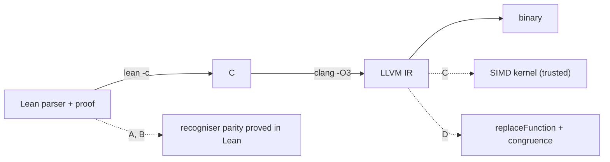

# SIMD recognisers in a verified parser: options

Status: **design note**. None of the options below is implemented in this
repository. Facts marked *verified* were checked against the toolchain in this
checkout on 2026-10-28; the rest is design analysis. The note is
self-contained: it states the repository facts, the proof obligation and the
acceptance check for each option, so it can be acted on without other context.

The question this note answers: if the parser is written in Lean and proved
correct, then lowered, can a faster SIMD recogniser replace part of the lowered
code while the correctness result survives?

Short answer: yes, but the swap must be justified at one of two levels, and the
lowering step is a separate trust assumption either way. The expensive part is
not the SIMD proof; it is the context theorem that says replacing a callee
preserves the caller's behaviour.

## 1. The proposed pipeline



A recogniser is a function over a byte buffer:

```lean
abbrev Mask := UInt64                  -- bit i set when byte i has property P
def spec : ByteArray → Nat → Mask      -- the reference recogniser
```

Parity is the whole local obligation:

```lean
def Parity (fast : ByteArray → Nat → Mask) : Prop :=
  ∀ buf off, fast buf off = spec buf off
```

If both sides can be undefined on some inputs, the obligation is
`Refines fast spec` instead; here the recogniser is total, so equality is the
right target.

The parser is then either

- parameterised over a recogniser (`parse (r : Recogniser)`), so a fast
  implementation plugs in at the source level, or
- compiled once and patched at the IR level, which needs a call-aware
  refinement theorem.

## 2. Verified facts about this toolchain

| Fact | Evidence |
|---|---|
| Lean `v4.35.0-rc3` has **no LLVM backend** | `lean --features` prints `[]`; `lean -b out.bc file.lean` aborts with `Please build a version of Lean4 with -DLLVM=ON` |
| Lean lowers to **C**, not LLVM IR | `lean -c /tmp/out.c File.lean` emits C containing `#include <lean/lean.h>` |
| `@[implemented_by]` is accepted and substitutes at compile time | a probe with `@[implemented_by fast] def classify := slow` compiles; substitution is a compiler feature and equality is not checked |
| `@[noinline]` is accepted | probe compiles |
| `ByteArray` exposes byte access only (`get`, `get!`, `uget`, `size`, `data`, `toList`, `foldl`); there is no `ByteArray.toUInt64LE?` | `#check` probes |
| `UInt64.toBitVec` / `UInt64.ofBitVec` exist | `#check` |
| This repository's LLVM semantics is single-function: no `call`, no module/global state | `LeanLLVM/Semantics.lean` (`Beh`, `Refines`); `Instr` has no `call` constructor |
| The `.ll` parser refuses vector types, `getelementptr`, `phi`, calls and aggregates | `LeanLLVM/Parser.lean` (`parseTy`, `parseSimple`, `parseValueInstr`) |

Consequence: "lower to LLVM" here means Lean → C → clang → LLVM IR. The clang
IR for a recogniser can contain `getelementptr`, `phi`, calls, globals and
vector types, none of which the current parser or semantics models.

## 3. Option A — source-level parametric recogniser, pure Lean SWAR

**Mechanism.** The parser takes the recogniser as a parameter; the fast
recogniser is ordinary Lean over `ByteArray`, reading 8 bytes at a time and
classifying them with bit tricks (`(x - 0x0101…) & ~x & 0x8080…` style
predicates, or direct `BitVec` arithmetic).

```lean
structure Recogniser where
  classify : ByteArray → Nat → Mask
  correct  : ∀ buf off, classify buf off = spec buf off

def parse (r : Recogniser) : ByteArray → Option Module := ...
theorem parse_correct (r : Recogniser) : ∀ buf, parse r buf = parseSpec buf := ...
```

**Proof obligation.** `Recogniser.correct` for the SWAR classifier. This
decomposes into `BitVec 64` lemmas about lane tests and a tail argument. The
parser theorem is then instantiated at the fast recogniser; no whole-program
reasoning is needed.

**Trust boundary.** Lean's kernel and the C compiler/clang. Nothing else.

**Implementation notes.**

- `ByteArray` has no word load. Assemble an 8-byte word from `get!` and shifts,
  or add a narrow `@[extern]` for `memcpy`-style loads. Measure both; the
  compiler may or may not fuse the byte assembly.
- Define the tail rule before proving anything: a SIMD/SWAR load can read past
  `off + 8` near the end of the buffer. Either the caller pads the buffer and
  the contract says so, or the recogniser falls back to a scalar tail. The
  parity statement must quantify over the same contract, or it is false at the
  end of every buffer.
- State the mask bit order and endianness next to `spec`, not only in the fast
  code.
- The current parser works on `String`/`List Char` (`tokenize` in
  `LeanLLVM/Parser.lean`). A byte recogniser needs a `ByteArray` boundary
  (`String.toUTF8`), and the parser must be refactored to consume
  recogniser results rather than characters. That refactor is part of the
  option's cost.

**Effort.** Medium. The SWAR lemmas are small; the parser plumbing is the work.

**When to choose.** First, unless measurement shows it is insufficient.

## 4. Option B — `@[implemented_by]`

**Mechanism.** Keep the slow, easy-to-reason-about definition as the logical
one, and give the compiler a fast replacement:

```lean
def classifySpec (buf : ByteArray) (off : Nat) : Mask := ...
def classifyFast (buf : ByteArray) (off : Nat) : Mask := ...  -- SWAR or extern

@[implemented_by classifyFast]
def classify := classifySpec
```

**Proof obligation.** Still `classifyFast = classifySpec`; the attribute does
not prove anything, it only changes what runs. The equality theorem is what
justifies the substitution.

**Trust boundary.** The attribute's implementation. This is a compiler feature,
not a kernel check: if the fast implementation is wrong, the theorem is still
true about `classifySpec` and the binary is still wrong. Record that explicitly.

**When to choose.** When the fast implementation cannot be used in the logical
definition — `unsafe`, mutable state, `@[extern]` — but the slow one can.

## 5. Option C — native SIMD through FFI

**Mechanism.** A C or Rust kernel using AVX2/NEON intrinsics, called from Lean:

```lean
@[extern "leanllvm_recognise16"]
opaque recognise16 (buf : ByteArray) (off : Nat) : Mask
```

**Proof obligation.** Two layers:

1. Model the kernel's instruction subset in Lean (byte compare, movemask,
   shuffle) and prove the model equals `spec` — a `BitVec`/`Vector` proof.
2. Show the C kernel implements the model. Exhaustive testing is impossible for
   a 64-bit input; the realistic choices are differential and boundary testing
   against the model, or external C verification (support for intrinsics is
   limited). Either way the kernel is a **named trusted component**.

**Contract.** The kernel must state, in Lean and in its docstring: buffer
padding, alignment, endianness, and the tail rule. A mismatch between the
contract and the caller is a silent out-of-bounds read, not a proof failure.

**Trust boundary.** Lean kernel + Lean→C compiler + C compiler + the SIMD
kernel + the calling convention.

**Effort.** Medium for the model, high for any serious validation of the C.

**When to choose.** Only after A is measured and found insufficient, and only
with the trust boundary written down where the guarantee is claimed.

## 6. Option D — replace the recogniser in the lowered IR

**Mechanism.** Compile the parser, keep the recogniser function boundary
(`@[noinline]`, or operate before aggressive inlining), prove at the IR level

```lean
Refines fastIR specIR
```

and add a `replaceFunction` pass whose soundness is that refinement. This is
the translation-validation route: the compiler's output is trusted, the
hand-written replacement is not.

**Framework requirements, in order:**

1. A `call` instruction and a module-level semantics with a function table;
   `Beh` at a chosen entry point.
2. A congruence theorem: if `f' ⊑ f`, every caller context of `f` refines when
   `f'` is substituted. Without this, `Refines fastIR specIR` cannot reach the
   parser.
3. A `replaceFunction` pass, sound by that congruence.
4. Enough IR to parse clang output: `getelementptr`, `phi`, globals,
   aggregates/arrays, `memcpy`-class intrinsics, and vector types.

**Trust boundary.** The compiler for everything except the replaced function;
the swap is proved.

**Effort.** Large. This is the call-aware core of an Alive2-style checker, not
a slice. Items 1–2 are the milestone; item 4 is a separate expansion.

**When to choose.** When hand-written SIMD must be swapped into code that is
otherwise compiler-generated, and the parser's source proof must not be
re-run for each variant.

## 7. Option E — let the compiler vectorise (baseline)

Write the recogniser as a simple loop over `Array UInt8` (or C), compile with
`clang -O3 -march=native`, and inspect whether it vectorises. No new proof: the
source-level parity theorem still holds and the compiler is already trusted.

This is the cheapest way to size the prize. Its limits: you do not control
whether vectorisation fires, the tail may fall back to scalar, and the result
is whatever clang's cost model decides.

## 8. Comparison

| | Proof covers executable? | Added trust | Repo change | Speed ceiling | Effort | Choose when |
|---|---|---|---|---|---|---|
| A. Lean SWAR | Yes, up to the C compiler | None | Parser parameterisation + recogniser module | Good for byte classification | Medium | Default first step |
| B. `implemented_by` | Yes, up to the attribute + C compiler | The attribute | Minimal | Same as the fast implementation | Low–medium | Fast code is `unsafe`/extern |
| C. FFI SIMD | Only up to the kernel | C compiler + kernel + ABI | `lake` link args, extern, kernel | Highest | Medium–high | A is measurably insufficient |
| D. IR replacement | Yes, for the swap | Compiler for the rest | Calls, congruence, `replaceFunction`, wider IR | Highest, and composable | Large | Many variants, compiler-generated code |
| E. Auto-vectorisation | Yes, up to clang | None new | Benchmark only | Unknown, compiler-dependent | Low | Measure before building |

## 9. Recommended sequence

1. **Profile.** Determine whether the parser's time is in byte classification,
   in `String`/`Char` handling, or in the AST-building layer. A recogniser
   cannot speed up a cost that is not there.
2. **Option E.** Write the classifier as a plain loop and see what `clang -O3`
   already does. This bounds the achievable win.
3. **Option A.** Parameterise the parser over `Recogniser`, implement SWAR over
   `ByteArray`, prove `Parity`, and benchmark against the scalar parser on the
   repository's `.ll` files plus a larger corpus.
4. **Option C** only if A leaves a measured gap. Model the kernel, state the
   padding/alignment/tail contract, validate differentially, and record the
   trusted components.
5. **Option D** as a separate milestone, beginning with calls and the
   congruence theorem. Do not start it until a post-lowering swap is an actual
   requirement.

The rule behind the order: buy speed where the proof is cheap. The recogniser
parity proof is a `BitVec` exercise; the replacement-in-context theorem is a
new semantics layer.

## 10. Acceptance criteria

**A**

- `recognise_fast_eq_spec : ∀ buf off, fast buf off = spec buf off`, no
  `sorry`/`native_decide`, standard axioms only.
- `parse_correct` instantiated at the fast recogniser.
- The fast and scalar parsers produce the same AST on the corpus
  (`#guard` or an executable differential run).
- A benchmark, with the corpus and flags recorded, showing the measured
  improvement over the scalar recogniser.

**B**

- The same parity theorem, plus a differential run of the compiled binary
  against the spec on the corpus.
- The attribute and its trust assumption recorded next to the definition.

**C**

- A Lean model of the kernel and `model = spec`.
- A differential harness over the corpus and boundary cases (start, end,
  tail, misaligned offsets).
- The padding/alignment/endianness/tail contract in the module docstring.

**D**

- `Refines fastIR specIR` and `replaceFunction_sound`.
- An end-to-end example: the same module with and without the replacement,
  same observable outputs, one caller and one callee.
- A call-aware version of the existing pass lift, so the congruence theorem is
  exercised, not merely stated.

## 11. Non-goals

- A verified Lean → LLVM compiler. Lean here has no LLVM backend; the C
  compiler and clang are trusted.
- Verifying clang, libc or the operating system.
- SIMD in the **IR semantics** as a prerequisite for parser speed. Vector IR is
  a separate feature for accepting and optimising vectorised LLVM input.
- Proving the hardware implements the SIMD instructions.

## 12. Open questions for the implementer

- Where exactly is the boundary in the generated C? Small Lean functions are
  inlined; `@[noinline]` is accepted, but the observable symbol is a compiler
  decision. Record what was inspected.
- Does the recogniser operate on `.ll` bytes, on `String`, or on both? The
  current parser is `String`-based; the recogniser is byte-based.
- What is the tail contract: caller padding, scalar tail, or a read-limited
  mask?
- Which property is classified, and over which alphabet? `.ll` is mostly ASCII,
  but names can be quoted.
- Is the win in the lexer at all? A recogniser that classifies bytes but is
  followed by `List Char` traversal may not pay off; the parser's data
  structures are part of the optimisation, not just the classifier.
